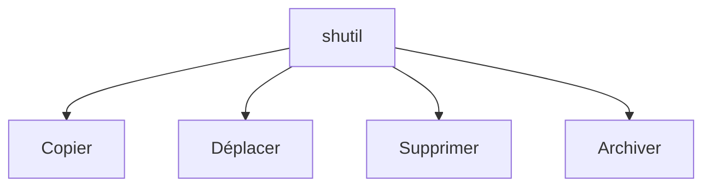

# Copier et déplacer des fichiers (shutil)

> [!info] En une phrase
> shutil fait en Python ce que tu fais dans l'explorateur : copier, déplacer, supprimer des dossiers entiers, créer une archive en une ligne.

```dataviewjs
await dv.view("10 — Templates/Scripts/learning", { view: "concept" })
```

## 1 · Comprendre
### Définition
`shutil` (*shell utilities*, bibliothèque standard) regroupe les opérations « haut niveau » sur les fichiers et les dossiers, celles qui en touchent plusieurs à la fois.

### Pourquoi ça existe
`pathlib` gère surtout **un** chemin ; `shutil` gère les opérations complètes (copier un dossier et tout son contenu, déplacer, supprimer un arbre).

### Le problème résolu
Recoder à la main la copie récursive d'un dossier, fichier par fichier, avec les erreurs que ça implique.

## 2 · Explorer
### Comment ça fonctionne

| Fonction | Fait |
| --- | --- |
| `shutil.copy2(src, dst)` | copie un fichier (avec sa date) |
| `shutil.copytree(src, dst)` | copie un dossier entier |
| `shutil.move(src, dst)` | déplace ou renomme |
| `shutil.rmtree(dossier)` | **supprime** un dossier et tout son contenu |
| `shutil.make_archive(nom, "zip", dossier)` | crée `nom.zip` à partir d'un dossier |
| `shutil.disk_usage(".")` | espace disque libre |

### Exemple concret
```python
import shutil
from pathlib import Path

travail = Path("travail")
shutil.copytree("donnees", travail, dirs_exist_ok=True)   # copie de sécurité

for f in travail.glob("*.tmp"):
    f.unlink()                                             # supprimer un fichier : pathlib

shutil.make_archive("export", "zip", root_dir=travail)     # crée export.zip
shutil.rmtree(travail)                                     # nettoyage
```

### Cas d'utilisation
- Préparer un dossier temporaire avant de zipper
- Déplacer les fichiers traités dans un dossier `archives/`
- Archive simple d'un dossier entier (pour un contrôle fin, voir [[Archive zip (zipfile)]])

> [!warning] À ne pas confondre
> `rmtree` ne passe pas par la corbeille : c'est **définitif**. Teste toujours sur un dossier de test, et affiche le chemin avant de supprimer. Et `copy` (fichier) ≠ `copytree` (dossier).

## 3 · Pratiquer
- Crée un dossier de test avec quelques fichiers, copie-le avec `copytree`, puis déplace un fichier de la copie dans un sous-dossier `traites/`.
- Crée une archive du dossier avec `make_archive` et ouvre-la pour vérifier son contenu.

## 4 · Expliquer
> [!quote] Mon résumé, avec mes mots
> _À écrire sans regarder la fiche. Si je bloque, je ne l'ai pas encore compris._

## 5 · Relier
- **Prérequis** : [[Chemin de fichier en Python (pathlib)]]
- **Complémentaires** : [[Archive zip (zipfile)]]
- **Utilisé par** : [[Cours - Manipuler des fichiers et des archives]]

## 6 · Réviser
> [!question] Me faire interroger
> Je demande à Claude de m'interroger sur cette notion pour vérifier que je l'ai comprise.

### Validation de la maîtrise
La notion est maîtrisée quand j'ai réussi **tous les exercices** qui l'utilisent (statut `reussi` dans l'exercice).

```dataviewjs
await dv.view("10 — Templates/Scripts/learning", { view: "maitrise" })
```
