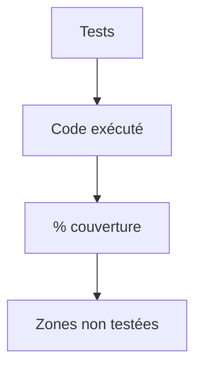

# Couverture de code

> [!info] En une phrase
> La couverture mesure quelle part du code (lignes, branches) a été exécutée par les tests ; elle montre ce qui n'est jamais testé, pas si les tests sont bons.

```dataviewjs
await dv.view("10 — Templates/Scripts/learning", { view: "concept" })
```

## 1 · Comprendre
### Définition
```bash
npx vitest run --coverage
pytest --cov=monpaquet --cov-report=term-missing
```
```
File        | % Stmts | % Branch | % Funcs | % Lines | Uncovered Lines
taille.js   |   85.7  |   75.0   |   100   |   85.7  | 9
```
- **Lignes** : chaque ligne exécutée au moins une fois.
- **Branches** : chaque côté de chaque `if` (souvent plus révélateur).
- Une CI peut exiger un **seuil** (ex. 80 %) et échouer en dessous.
- GitLab peut afficher la couverture dans la merge request.

### Pourquoi ça existe
Sans mesure, on ne sait pas quelles parties du code ne sont jamais vérifiées.

### Le problème résolu
Repérer les zones non testées, en particulier les cas d'erreur oubliés.

## 2 · Explorer
### Comment ça fonctionne


### Exemple concret
```js
// vitest.config.js
export default { test: { coverage: { provider: "v8", thresholds: { lines: 80, branches: 70 } } } };
```
Lis surtout la colonne *Uncovered Lines* : ce sont souvent les `catch` et les cas limites.

### Cas d'utilisation
- Seuil minimal dans la CI
- Choisir quoi tester ensuite

> [!warning] À ne pas confondre
> **100 % de couverture** ne veut pas dire **sans bug** : une ligne exécutée sans `expect` utile est « couverte » mais pas vérifiée. Vise les parties importantes plutôt qu'un chiffre.

## 3 · Pratiquer
- Mesure la couverture d'un petit projet, trouve une branche non couverte et ajoute le test qui la couvre

## 4 · Expliquer
> [!quote] Mon résumé, avec mes mots
> _À écrire sans regarder la fiche. Si je bloque, je ne l'ai pas encore compris._

## 5 · Relier
- **Prérequis** : [[Test unitaire]]
- **Complémentaires** : [[Pipeline GitLab CI]]

## 6 · Réviser
> [!question] Me faire interroger
> Je demande à Claude de m'interroger sur cette notion pour vérifier que je l'ai comprise.

### Validation de la maîtrise
La notion est maîtrisée quand j'ai réussi **tous les exercices** qui l'utilisent (statut `reussi` dans l'exercice).

```dataviewjs
await dv.view("10 — Templates/Scripts/learning", { view: "maitrise" })
```
