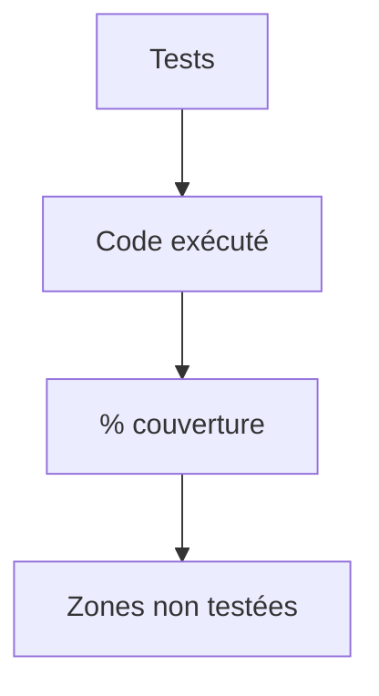

# Couverture de code

> [!info] En une phrase
> La couverture mesure quelle part du code (lignes, branches) a été exécutée par les tests ; elle montre ce qui n'est jamais testé, pas si les tests sont bons.

```dataviewjs
await dv.view("10 — Templates/Scripts/learning", { view: "concept" })
```

## 1 · Comprendre
### Définition
```bash
npx vitest run --coverage
pytest --cov=monpaquet --cov-report=term-missing
```
```
File        | % Stmts | % Branch | % Funcs | % Lines | Uncovered Lines
taille.js   |   85.7  |   75.0   |   100   |   85.7  | 9
```
- **Lignes** : chaque ligne exécutée au moins une fois.
- **Branches** : chaque côté de chaque `if` (souvent plus révélateur).
- Une CI peut exiger un **seuil** (ex. 80 %) et échouer en dessous.
- GitLab peut afficher la couverture dans la merge request.

### Pourquoi ça existe
Sans mesure, on ne sait pas quelles parties du code ne sont jamais vérifiées.

### Le problème résolu
Repérer les zones non testées, en particulier les cas d'erreur oubliés.

## 2 · Explorer
### Comment ça fonctionne


### Exemple concret
```js
// vitest.config.js
export default { test: { coverage: { provider: "v8", thresholds: { lines: 80, branches: 70 } } } };
```
Lis surtout la colonne *Uncovered Lines* : ce sont souvent les `catch` et les cas limites.

### Cas d'utilisation
- Seuil minimal dans la CI
- Choisir quoi tester ensuite

> [!warning] À ne pas confondre
> **100 % de couverture** ne veut pas dire **sans bug** : une ligne exécutée sans `expect` utile est « couverte » mais pas vérifiée. Vise les parties importantes plutôt qu'un chiffre.

## 3 · Pratiquer

### Exercice visuel

Sur Excalidraw, **sans regarder la fiche**. Puis je compare avec la fiche, je corrige en rouge ce qui était faux, et j'explique mon dessin à voix haute ou à Claude dans le chat.

> [!example] 🧠 Dessine de mémoire
> Dessine une fonction avec un `if` et un `else`, et un seul test. Colorie en vert ce qui a été exécuté, en rouge ce qui ne l'a pas été.

> [!example] 🔍 Trouve l'erreur
> Ce schéma est faux. Corrige-le en rouge et explique l'erreur.
>
> ```mermaid
> flowchart TD
>   C[Couverture 100] --> B[Aucun bug]
> ```

### Mon schéma

> [!tip] Mon dessin Excalidraw
> _Je crée le dessin « Schéma - Couverture de code » et je l'intègre ici avec `![[Schéma - Couverture de code.excalidraw]]`, puis je coche `schema`._

### Appliquer dans le fil rouge
- Pas encore d'étape du fil rouge pour cette notion : elle sera pratiquée dans le fil rouge de son niveau (voir [[Niveaux]]).

## 4 · Relier
- **Prérequis** : [[Test unitaire]]
- **Complémentaires** : [[Pipeline GitLab CI]]

## 5 · Réviser
> [!question] Me faire interroger
> Je demande à Claude de m'interroger sur cette notion pour vérifier que je l'ai comprise.

### Validation de la maîtrise
Trois cases à cocher dans les propriétés de la fiche :
- `schema` : mon dessin du concept est dans « Mon schéma » ;
- `exercice_visuel` : j'ai fait et corrigé les exercices visuels de la section 3 ;
- `fil_rouge` : je l'ai appliqué dans le fil rouge (coché tout seul quand une étape qui l'utilise est réussie).

Les trois cochées : la notion compte comme **comprise**. **Maîtrisé** : c'est moi qui le mets dans `status`, quand je le sens.

```dataviewjs
await dv.view("10 — Templates/Scripts/learning", { view: "maitrise" })
```
