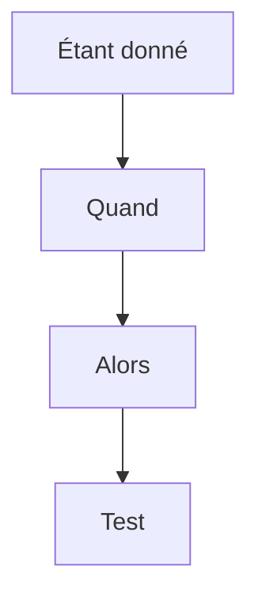

# Critères d'acceptation

> [!info] En une phrase
> Les critères d'acceptation sont les **conditions précises et vérifiables** qu'une fonctionnalité doit remplir pour être acceptée. Ils transforment une demande floue en une liste de cas qu'on peut tester un par un.

```dataviewjs
await dv.view("10 — Templates/Scripts/learning", { view: "concept" })
```

## 1 · Comprendre
### Définition
**Format courant (Gherkin)** : *Étant donné* &lt;situation de départ&gt;, *quand* &lt;action&gt;, *alors* &lt;résultat attendu&gt;. En anglais : *Given / When / Then*.

**Couvrir aussi les cas d'erreur**, pas seulement le cas idéal : tâche vide, utilisateur sans droit, fonction Nuclio indisponible.

**Ils sont écrits avant de coder**, avec le demandeur. Ils servent ensuite de base aux tests (manuels ou automatisés, par exemple de bout en bout).

**Spécifiques à une story**, à la différence de la [[Définition de terminé]] qui vaut pour toutes.

### Pourquoi ça existe
« Ça marche » veut dire des choses différentes pour le développeur et pour le demandeur.

### Le problème résolu
Savoir sans débat si une fonctionnalité est finie, et ne pas oublier les cas limites.

## 2 · Explorer
### Comment ça fonctionne


### Exemple concret
```gherkin
Fonctionnalité : Export PNG d'une tâche

  Scénario : export réussi
    Étant donné une tâche de 10 images avec des annotations
    Quand je clique sur « Export PNG »
    Alors un fichier PNG se télécharge en moins de 10 secondes
    Et chaque annotation y apparaît avec la couleur de son label

  Scénario : tâche sans annotation
    Étant donné une tâche sans annotation
    Quand je clique sur « Export PNG »
    Alors un message « Aucune annotation à exporter » s'affiche

  Scénario : service indisponible
    Étant donné que la fonction d'export ne répond pas
    Quand je clique sur « Export PNG »
    Alors un message d'erreur s'affiche et le bouton redevient cliquable
```

### Cas d'utilisation
- Compléter chaque ticket GitLab de critères vérifiables
- Écrire les tests de bout en bout à partir des scénarios
- Fixer les critères de succès d'un POC

> [!warning] À ne pas confondre
> Un critère d'acceptation décrit un **résultat observable**, pas une implémentation (« alors un PNG se télécharge », pas « alors la fonction appelle Pillow »).

## 3 · Pratiquer
- Écris trois scénarios Étant donné / Quand / Alors pour ton bouton d'export, dont deux cas d'erreur

## 4 · Expliquer
> [!quote] Mon résumé, avec mes mots
> _À écrire sans regarder la fiche. Si je bloque, je ne l'ai pas encore compris._

## 5 · Relier
- **Prérequis** : [[User story]]
- **Complémentaires** : [[Exigences fonctionnelles et non fonctionnelles]] · [[Définition de terminé]] · [[Test de bout en bout]] · [[Test automatisé]]

## 6 · Réviser
> [!question] Me faire interroger
> Je demande à Claude de m'interroger sur cette notion pour vérifier que je l'ai comprise.

### Validation de la maîtrise
La notion est maîtrisée quand j'ai réussi **tous les exercices** qui l'utilisent (statut `reussi` dans l'exercice).

```dataviewjs
await dv.view("10 — Templates/Scripts/learning", { view: "maitrise" })
```
