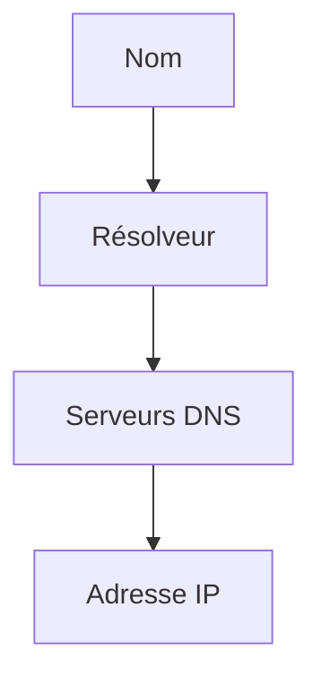

# DNS

> [!info] En une phrase
> L'annuaire d'Internet : il traduit un nom (gitlab.com) en adresse IP.

```dataviewjs
await dv.view("10 — Templates/Scripts/learning", { view: "concept" })
```

## 1 · Comprendre
### Définition
Le **DNS** (*Domain Name System*) répond à la question « quelle est l'IP de ce nom ? ». Ta machine demande à un **résolveur** (celui de la box ou de l'entreprise), qui interroge la hiérarchie DNS et met la réponse en cache pendant une durée (TTL).

| Enregistrement | Sens |
| --- | --- |
| `A` / `AAAA` | nom → IPv4 / IPv6 |
| `CNAME` | nom → autre nom (alias) |
| `MX` | serveur de mail |
| `TXT` | texte (vérifications) |

Le fichier **hosts** (`/etc/hosts`, `C:\Windows\System32\drivers\etc\hosts`) force une réponse localement, avant le DNS.

### Pourquoi ça existe
Les humains retiennent des noms, les machines utilisent des adresses, qui peuvent changer.

### Le problème résolu
Sans DNS, il faudrait connaître et mettre à jour l'IP de chaque site.

## 2 · Explorer
### Comment ça fonctionne


### Exemple concret
```bash
nslookup gitlab.com
dig +short gitlab.com          # Linux, si installé (paquet dnsutils)
cat /etc/resolv.conf           # quel résolveur utilise WSL
```
```powershell
Resolve-DnsName gitlab.com
```
Dans un réseau Docker (compose), un DNS interne résout les **noms de services** (`db`, `cvat_server`).

### Cas d'utilisation
- `Could not resolve host` : problème de DNS, pas de serveur
- Un nom interne d'entreprise (`nexus.entreprise.local`) résolu seulement sur le VPN
- `CVAT_HOST` doit être un nom que les clients savent résoudre

> [!warning] À ne pas confondre
> « le nom ne se résout pas » (DNS) et « le serveur ne répond pas » (réseau, pare-feu, service arrêté). Teste d'abord `nslookup`, puis la connexion.

## 3 · Pratiquer

### Exercice visuel

Sur Excalidraw, **sans regarder la fiche**. Puis je compare avec la fiche, je corrige en rouge ce qui était faux, et j'explique mon dessin avec mes mots (section 4).

> [!example] 🛣️ Suis le trajet
> Dessine la résolution de `vortex-gitlab` puis de `gitlab.com` depuis ton PC : le cache, le serveur DNS de l'entreprise, la réponse.

> [!example] 🔄 Change de contexte
> Redessine-le dans le réseau de compose : comment le front trouve le service `api` par son nom ?

### Mon schéma

> [!tip] Mon dessin Excalidraw
> _Je crée le dessin « Schéma - DNS » et je l'intègre ici avec `![[Schéma - DNS.excalidraw]]`._

### Appliquer dans le fil rouge
- [[MesDépenses 07 - Tout lancer avec compose]]

## 4 · Expliquer
> [!quote] Mon résumé, avec mes mots
> _J'explique mon schéma avec mes mots, sans regarder la fiche. Si je bloque, je ne l'ai pas encore compris._

## 5 · Relier
- **Prérequis** : [[Adresse IP]]
- **Complémentaires** : [[Reverse proxy]] · [[HTTPS et TLS]]
- **Commandes** : [[nslookup]]

## 6 · Réviser
> [!question] Me faire interroger
> Je demande à Claude de m'interroger sur cette notion pour vérifier que je l'ai comprise.

### Validation de la maîtrise
La notion est maîtrisée quand je sais :
1. **l'expliquer** de façon fluide, à partir de mon schéma (section 4) ;
2. **l'adapter** à un autre contexte (consigne « Change de contexte », ou Claude m'interroge sur un autre cas) ;
3. **l'appliquer** pour de vrai dans le fil rouge (section 3).

Réussir un exercice ne suffit pas. C'est moi qui passe le statut en `maitrise`.

```dataviewjs
await dv.view("10 — Templates/Scripts/learning", { view: "maitrise" })
```
