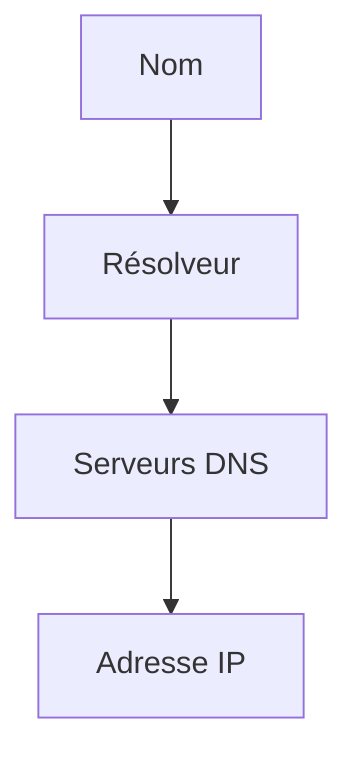

# DNS

> [!info] En une phrase
> L'annuaire d'Internet : il traduit un nom (gitlab.com) en adresse IP.

```dataviewjs
await dv.view("10 — Templates/Scripts/learning", { view: "concept" })
```

## 1 · Comprendre
### Définition
Le **DNS** (*Domain Name System*) répond à la question « quelle est l'IP de ce nom ? ». Ta machine demande à un **résolveur** (celui de la box ou de l'entreprise), qui interroge la hiérarchie DNS et met la réponse en cache pendant une durée (TTL).

| Enregistrement | Sens |
| --- | --- |
| `A` / `AAAA` | nom → IPv4 / IPv6 |
| `CNAME` | nom → autre nom (alias) |
| `MX` | serveur de mail |
| `TXT` | texte (vérifications) |

Le fichier **hosts** (`/etc/hosts`, `C:\Windows\System32\drivers\etc\hosts`) force une réponse localement, avant le DNS.

### Pourquoi ça existe
Les humains retiennent des noms, les machines utilisent des adresses, qui peuvent changer.

### Le problème résolu
Sans DNS, il faudrait connaître et mettre à jour l'IP de chaque site.

## 2 · Explorer
### Comment ça fonctionne


### Exemple concret
```bash
nslookup gitlab.com
dig +short gitlab.com          # Linux, si installé (paquet dnsutils)
cat /etc/resolv.conf           # quel résolveur utilise WSL
```
```powershell
Resolve-DnsName gitlab.com
```
Dans un réseau Docker (compose), un DNS interne résout les **noms de services** (`db`, `cvat_server`).

### Cas d'utilisation
- `Could not resolve host` : problème de DNS, pas de serveur
- Un nom interne d'entreprise (`nexus.entreprise.local`) résolu seulement sur le VPN
- `CVAT_HOST` doit être un nom que les clients savent résoudre

> [!warning] À ne pas confondre
> « le nom ne se résout pas » (DNS) et « le serveur ne répond pas » (réseau, pare-feu, service arrêté). Teste d'abord `nslookup`, puis la connexion.

## 3 · Pratiquer
- Résous trois noms avec `nslookup`, ajoute une entrée dans le fichier hosts de WSL et vérifie qu'elle est prise en compte.

## 4 · Expliquer
> [!quote] Mon résumé, avec mes mots
> _À écrire sans regarder la fiche. Si je bloque, je ne l'ai pas encore compris._

## 5 · Relier
- **Prérequis** : [[Adresse IP]]
- **Complémentaires** : [[Reverse proxy]] · [[HTTPS et TLS]]
- **Commandes** : [[nslookup]]

## 6 · Réviser
> [!question] Me faire interroger
> Je demande à Claude de m'interroger sur cette notion pour vérifier que je l'ai comprise.

### Validation de la maîtrise
- [ ] Je l'explique sans notes, en 3 phrases, à quelqu'un qui ne connaît pas
- [ ] J'ai réussi un exercice qui l'utilise
- [ ] Je l'ai utilisé dans un projet
- [ ] Je sais dire quand ne pas l'utiliser (ou ce qu'il ne faut pas confondre)
