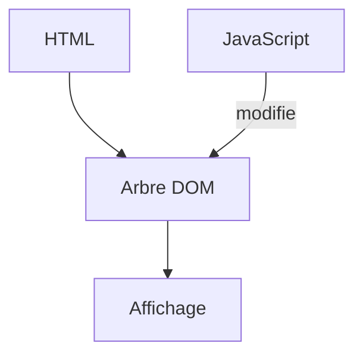

# DOM

> [!info] En une phrase
> Le DOM est l'arbre d'objets que le navigateur construit à partir du HTML, et que JavaScript lit et modifie pour changer la page.

```dataviewjs
await dv.view("10 — Templates/Scripts/learning", { view: "concept" })
```

## 1 · Comprendre
### Définition
**DOM** (*Document Object Model*) : chaque [[Élément et attribut HTML|élément]] devient un objet JS, avec ses enfants. L'objet `document` est la racine.
```js
const titre = document.querySelector("h1");          // le premier qui correspond (sélecteur CSS)
const items = document.querySelectorAll(".item");    // tous
titre.textContent = "Nouveau titre";                  // change le texte
titre.classList.add("actif");                         // ajoute une classe
const li = document.createElement("li");              // crée un élément
li.textContent = "c.csv";
document.querySelector("ul").append(li);              // l'ajoute à la page
```

### Pourquoi ça existe
Le HTML reçu est fixe : pour que la page change sans recharger, il faut un moyen de la modifier depuis le code.

### Le problème résolu
Mettre à jour une partie de la page (une liste, un message d'erreur) en réponse à l'utilisateur ou à des données.

## 2 · Explorer
### Comment ça fonctionne


### Exemple concret
```html
<ul id="liste"></ul>
<script>
  const fichiers = ["a.png", "b.png"];
  const ul = document.querySelector("#liste");
  for (const f of fichiers) {
    const li = document.createElement("li");
    li.textContent = f;
    ul.append(li);
  }
</script>
```
Utilise `textContent` pour du texte ; `innerHTML` interprète du HTML et ouvre la porte aux failles [[XSS]] si le contenu vient d'un utilisateur.

### Cas d'utilisation
- Les outils de développement (onglet Éléments) montrent le DOM en direct
- React, Vue et Angular modifient le DOM à ta place

> [!warning] À ne pas confondre
> Le **DOM** n'est pas le **fichier HTML** : c'est sa version vivante en mémoire. Après une modification en JS, « Afficher le code source » montre l'ancien HTML, l'onglet Éléments montre le DOM actuel.

## 3 · Pratiquer

### Exercice visuel

Sur Excalidraw, **sans regarder la fiche**. Puis je compare avec la fiche, je corrige en rouge ce qui était faux, et j'explique mon dessin à voix haute ou à Claude dans le chat.

> [!example] 🧠 Dessine de mémoire
> Dessine l'arbre DOM de la liste des dépenses (ul, li, bouton supprimer). Montre ce qui change dans l'arbre quand on supprime une ligne.

> [!example] ⚖️ Avant / après
> Avant / après : modifier le DOM à la main avec `document.querySelector`, puis laisser Vue le faire. Dessine qui touche à l'arbre dans chaque cas.

### Mon schéma

> [!tip] Mon dessin Excalidraw
> _Je crée le dessin « Schéma - DOM » et je l'intègre ici avec `![[Schéma - DOM.excalidraw]]`, puis je coche `schema`._

### Appliquer dans le fil rouge
- Pas encore d'étape du fil rouge pour cette notion : elle sera pratiquée dans le fil rouge de son niveau (voir [[Niveaux]]).

## 4 · Relier
- **Prérequis** : [[HTML]] · [[Sélecteur CSS]] · [[JavaScript]]
- **Complémentaires** : [[Événement JavaScript]]
- **Utilisé par** : [[React]]

## 5 · Réviser
> [!question] Me faire interroger
> Je demande à Claude de m'interroger sur cette notion pour vérifier que je l'ai comprise.

### Validation de la maîtrise
Trois cases à cocher dans les propriétés de la fiche :
- `schema` : mon dessin du concept est dans « Mon schéma » ;
- `exercice_visuel` : j'ai fait et corrigé les exercices visuels de la section 3 ;
- `fil_rouge` : je l'ai appliqué dans le fil rouge (coché tout seul quand une étape qui l'utilise est réussie).

Les trois cochées : la notion compte comme **comprise**. **Maîtrisé** : c'est moi qui le mets dans `status`, quand je le sens.

```dataviewjs
await dv.view("10 — Templates/Scripts/learning", { view: "maitrise" })
```
