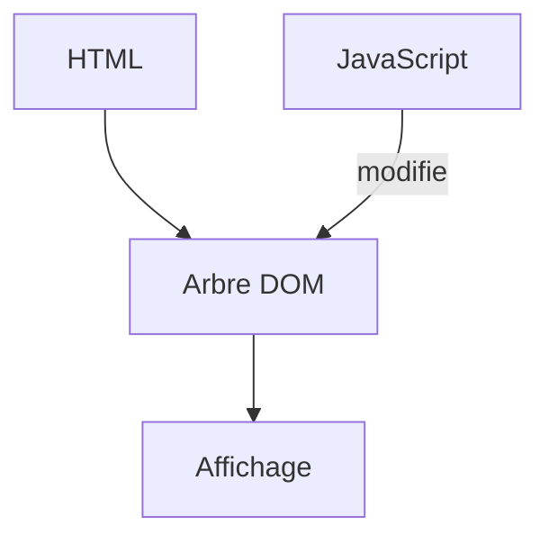

# DOM

> [!info] En une phrase
> Le DOM est l'arbre d'objets que le navigateur construit à partir du HTML, et que JavaScript lit et modifie pour changer la page.

```dataviewjs
await dv.view("10 — Templates/Scripts/learning", { view: "concept" })
```

## 1 · Comprendre
### Définition
**DOM** (*Document Object Model*) : chaque [[Élément et attribut HTML|élément]] devient un objet JS, avec ses enfants. L'objet `document` est la racine.
```js
const titre = document.querySelector("h1");          // le premier qui correspond (sélecteur CSS)
const items = document.querySelectorAll(".item");    // tous
titre.textContent = "Nouveau titre";                  // change le texte
titre.classList.add("actif");                         // ajoute une classe
const li = document.createElement("li");              // crée un élément
li.textContent = "c.csv";
document.querySelector("ul").append(li);              // l'ajoute à la page
```

### Pourquoi ça existe
Le HTML reçu est fixe : pour que la page change sans recharger, il faut un moyen de la modifier depuis le code.

### Le problème résolu
Mettre à jour une partie de la page (une liste, un message d'erreur) en réponse à l'utilisateur ou à des données.

## 2 · Explorer
### Comment ça fonctionne


### Exemple concret
```html
<ul id="liste"></ul>
<script>
  const fichiers = ["a.png", "b.png"];
  const ul = document.querySelector("#liste");
  for (const f of fichiers) {
    const li = document.createElement("li");
    li.textContent = f;
    ul.append(li);
  }
</script>
```
Utilise `textContent` pour du texte ; `innerHTML` interprète du HTML et ouvre la porte aux failles [[XSS]] si le contenu vient d'un utilisateur.

### Cas d'utilisation
- Les outils de développement (onglet Éléments) montrent le DOM en direct
- React, Vue et Angular modifient le DOM à ta place

> [!warning] À ne pas confondre
> Le **DOM** n'est pas le **fichier HTML** : c'est sa version vivante en mémoire. Après une modification en JS, « Afficher le code source » montre l'ancien HTML, l'onglet Éléments montre le DOM actuel.

## 3 · Pratiquer
- Dans la console d'une page, change le texte du titre et ajoute une classe
- Génère une liste `<li>` à partir d'un tableau

## 4 · Expliquer
> [!quote] Mon résumé, avec mes mots
> _À écrire sans regarder la fiche. Si je bloque, je ne l'ai pas encore compris._

## 5 · Relier
- **Prérequis** : [[HTML]] · [[Sélecteur CSS]] · [[JavaScript]]
- **Complémentaires** : [[Événement JavaScript]]
- **Utilisé par** : [[React]]

## 6 · Réviser
> [!question] Me faire interroger
> Je demande à Claude de m'interroger sur cette notion pour vérifier que je l'ai comprise.

### Validation de la maîtrise
La notion est maîtrisée quand j'ai réussi **tous les exercices** qui l'utilisent (statut `reussi` dans l'exercice).

```dataviewjs
await dv.view("10 — Templates/Scripts/learning", { view: "maitrise" })
```
