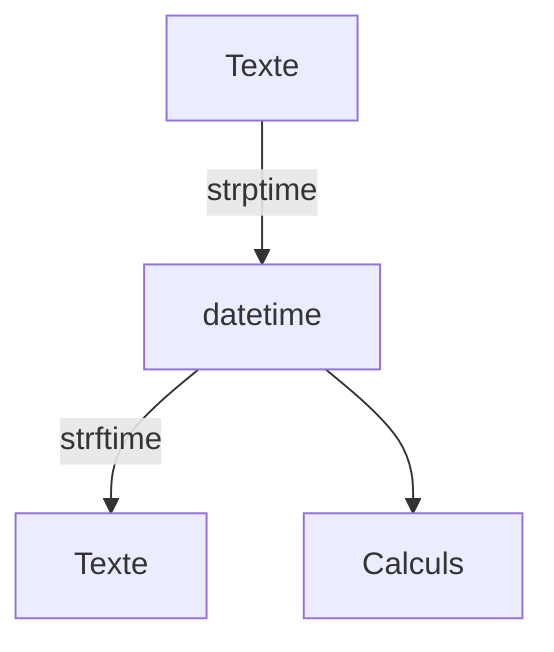

# Dates et heures (datetime)

> [!info] En une phrase
> Le module datetime représente des dates et des heures, calcule des écarts et les convertit en texte et inversement.

```dataviewjs
await dv.view("10 — Templates/Scripts/learning", { view: "concept" })
```

## 1 · Comprendre
### Définition
`datetime.now()` donne l'instant présent. `timedelta` représente une durée. `strftime` transforme une date en texte selon un format, `strptime` (ou `fromisoformat`) fait l'inverse.

### Pourquoi ça existe
Horodater des fichiers et des journaux, filtrer « les fichiers de plus de 7 jours », mesurer une durée.

### Le problème résolu
Calculer des dates à la main (fins de mois, années bissextiles, fuseaux) est une source d'erreurs infinie.

## 2 · Explorer
### Comment ça fonctionne


### Exemple concret
```python
from datetime import datetime, timedelta, timezone
from pathlib import Path

maintenant = datetime.now()
print(maintenant.strftime("%Y-%m-%d_%H%M"))     # 2026-11-06_2150 : idéal dans un nom de fichier
nom = f"export_{maintenant:%Y-%m-%d}.zip"

il_y_a_7_jours = maintenant - timedelta(days=7)
for f in Path("logs").iterdir():
    modif = datetime.fromtimestamp(f.stat().st_mtime)
    if modif < il_y_a_7_jours:
        print("ancien :", f.name)

d = datetime.fromisoformat("2026-11-06T21:50:00+00:00")   # format ISO des API
print(datetime.now(timezone.utc).isoformat())
```
| Code | Sens |
| --- | --- |
| `%Y-%m-%d` | 2026-11-06 |
| `%H:%M:%S` | 21:50:00 |
| `%d/%m/%Y` | 06/11/2026 |

### Cas d'utilisation
- Nommer une archive avec la date
- Supprimer ou archiver les fichiers trop anciens
- Lire les dates renvoyées par une API (format ISO 8601)

> [!warning] À ne pas confondre
> Une date **avec** fuseau horaire et une date **sans** : les comparer provoque une erreur. Dans les API et les serveurs, travaille en UTC. Et `%m` (mois) ≠ `%M` (minutes).

## 3 · Pratiquer
- Affiche la date du jour en trois formats, puis liste les fichiers d'un dossier modifiés depuis moins de 24 heures.

## 4 · Expliquer
> [!quote] Mon résumé, avec mes mots
> _À écrire sans regarder la fiche. Si je bloque, je ne l'ai pas encore compris._

## 5 · Relier
- **Prérequis** : [[Variables et types en Python]]
- **Complémentaires** : [[Journaliser avec logging]] · [[Chemin de fichier en Python (pathlib)]]

## 6 · Réviser
> [!question] Me faire interroger
> Je demande à Claude de m'interroger sur cette notion pour vérifier que je l'ai comprise.

### Validation de la maîtrise
- [ ] Je l'explique sans notes, en 3 phrases, à quelqu'un qui ne connaît pas
- [ ] J'ai réussi un exercice qui l'utilise
- [ ] Je l'ai utilisé dans un projet
- [ ] Je sais dire quand ne pas l'utiliser (ou ce qu'il ne faut pas confondre)
