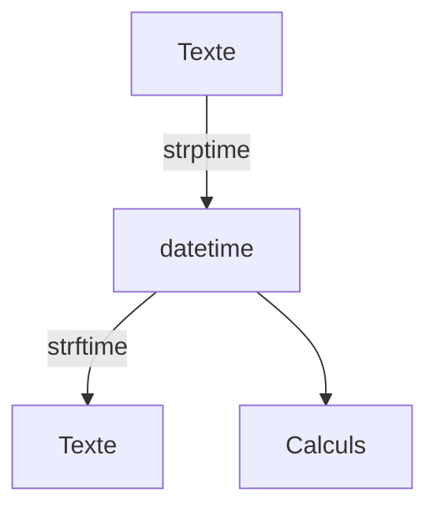

# Dates et heures (datetime)

> [!info] En une phrase
> Le module datetime représente des dates et des heures, calcule des écarts et les convertit en texte et inversement.

```dataviewjs
await dv.view("10 — Templates/Scripts/learning", { view: "concept" })
```

## 1 · Comprendre
### Définition
`datetime.now()` donne l'instant présent. `timedelta` représente une durée. `strftime` transforme une date en texte selon un format, `strptime` (ou `fromisoformat`) fait l'inverse.

### Pourquoi ça existe
Horodater des fichiers et des journaux, filtrer « les fichiers de plus de 7 jours », mesurer une durée.

### Le problème résolu
Calculer des dates à la main (fins de mois, années bissextiles, fuseaux) est une source d'erreurs infinie.

## 2 · Explorer
### Comment ça fonctionne


### Exemple concret
```python
from datetime import datetime, timedelta, timezone
from pathlib import Path

maintenant = datetime.now()
print(maintenant.strftime("%Y-%m-%d_%H%M"))     # 2026-11-06_2150 : idéal dans un nom de fichier
nom = f"export_{maintenant:%Y-%m-%d}.zip"

il_y_a_7_jours = maintenant - timedelta(days=7)
for f in Path("logs").iterdir():
    modif = datetime.fromtimestamp(f.stat().st_mtime)
    if modif < il_y_a_7_jours:
        print("ancien :", f.name)

d = datetime.fromisoformat("2026-11-06T21:50:00+00:00")   # format ISO des API
print(datetime.now(timezone.utc).isoformat())
```
| Code | Sens |
| --- | --- |
| `%Y-%m-%d` | 2026-11-06 |
| `%H:%M:%S` | 21:50:00 |
| `%d/%m/%Y` | 06/11/2026 |

### Cas d'utilisation
- Nommer une archive avec la date
- Supprimer ou archiver les fichiers trop anciens
- Lire les dates renvoyées par une API (format ISO 8601)

> [!warning] À ne pas confondre
> Une date **avec** fuseau horaire et une date **sans** : les comparer provoque une erreur. Dans les API et les serveurs, travaille en UTC. Et `%m` (mois) ≠ `%M` (minutes).

## 3 · Pratiquer

### Exercice visuel

Sur Excalidraw, **sans regarder la fiche**. Puis je compare avec la fiche, je corrige en rouge ce qui était faux, et j'explique mon dessin à voix haute ou à Claude dans le chat.

> [!example] 🧠 Dessine de mémoire
> Dessine une frise avec deux dates de dépenses et l'écart entre elles (`timedelta`). Écris les mêmes dates en texte avec `strftime`.

> [!example] 🔍 Trouve l'erreur
> Ce schéma est faux. Corrige-le en rouge et explique l'erreur.
>
> ```mermaid
> flowchart TD
>   T[Texte 2026-11-19] --> C[Comparaison directe]
>   C --> D[datetime OK]
> ```

### Mon schéma

> [!tip] Mon dessin Excalidraw
> _Je crée le dessin « Schéma - Dates et heures (datetime) » et je l'intègre ici avec `![[Schéma - Dates et heures (datetime).excalidraw]]`, puis je coche `schema`._

### Appliquer dans le fil rouge
- [[Dépenses 08 - Lire un vrai fichier]]

## 4 · Relier
- **Prérequis** : [[Variables et types]]
- **Complémentaires** : [[Journaliser avec logging]] · [[Chemin de fichier]]

## 5 · Réviser
> [!question] Me faire interroger
> Je demande à Claude de m'interroger sur cette notion pour vérifier que je l'ai comprise.

### Validation (compris, puis maîtrisé)
Trois cases à cocher dans les propriétés de la fiche :
- `schema` : mon dessin du concept est dans « Mon schéma » ;
- `exercice_visuel` : j'ai fait et corrigé les exercices visuels de la section 3 ;
- `fil_rouge` : je l'ai appliqué dans le fil rouge (coché tout seul quand une étape qui l'utilise est réussie).

Les trois cochées : la notion compte comme **comprise**. **Maîtrisé** : c'est moi qui le mets dans `status`, quand je le sens.

```dataviewjs
await dv.view("10 — Templates/Scripts/learning", { view: "maitrise" })
```
