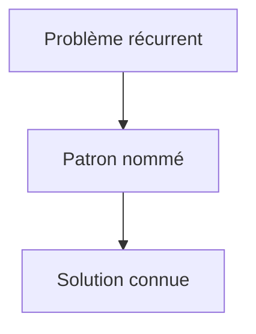

# Design pattern

> [!info] En une phrase
> Un design pattern (patron de conception) est une solution type, connue et nommée, à un problème de conception qui revient souvent : stratégie, fabrique, observateur, adaptateur, singleton…

```dataviewjs
await dv.view("10 — Templates/Scripts/learning", { view: "concept" })
```

## 1 · Comprendre
### Définition
Les plus utiles à connaître :
| Patron | Problème | Où tu le vois |
| --- | --- | --- |
| **Stratégie** | choisir un comportement parmi plusieurs à l'exécution | formats d'export, algorithmes |
| **Fabrique** (*factory*) | créer le bon objet sans exposer comment | `creerClient(config)` |
| **Observateur** | prévenir plusieurs abonnés d'un changement | `addEventListener`, Observable RxJS, webhooks |
| **Adaptateur** | faire parler deux interfaces incompatibles | envelopper le SDK de CVAT derrière ta propre interface |
| **Décorateur** | ajouter un comportement autour d'un existant | décorateurs Python `@`, middleware |
| **Singleton** | une seule instance partagée | connexion à la base, service `providedIn: "root"` |
| **Dépôt** (*repository*) | isoler l'accès aux données | couche d'accès en base |
| **Middleware / chaîne** | traiter une requête par étapes | Express, Django |

### Pourquoi ça existe
Les mêmes problèmes de conception reviennent ; réinventer la solution à chaque fois fait perdre du temps et crée du code inhabituel.

### Le problème résolu
Un vocabulaire commun (« on fait une stratégie ») et des solutions éprouvées.

## 2 · Explorer
### Comment ça fonctionne


### Exemple concret
```python
# Adaptateur : ton code ne dépend pas directement du SDK
class SourceAnnotations:
    def annotations(self, tache_id: int) -> list[dict]: ...

class SourceCvat(SourceAnnotations):
    def __init__(self, client): self.client = client
    def annotations(self, tache_id):
        return self.client.tasks.retrieve(tache_id).get_annotations()["shapes"]

class SourceFichier(SourceAnnotations):          # pour les tests
    def __init__(self, chemin): self.chemin = chemin
    def annotations(self, tache_id): return json.loads(Path(self.chemin).read_text())
```

### Cas d'utilisation
- Lire le code d'un framework
- Concevoir une extension (plugin, format)
- Parler conception en équipe

> [!warning] À ne pas confondre
> Chercher à placer des patterns partout : on part du **problème**, pas du patron. Et le **singleton** est souvent un état global déguisé, difficile à tester.

## 3 · Pratiquer

### Exercice visuel

Sur Excalidraw, **sans regarder la fiche**. Puis je compare avec la fiche, je corrige en rouge ce qui était faux, et j'explique mon dessin à voix haute ou à Claude dans le chat.

> [!example] 🧠 Dessine de mémoire
> Dessine une carte des patrons que tu as vus, rangés en trois familles (création, structure, comportement), avec un problème résolu sous chacun.

> [!example] 🔄 Change de contexte
> Trouve un patron déjà utilisé dans un framework que tu connais (FastAPI, Vue, Angular) et dessine où il se cache.

### Mon schéma

> [!tip] Mon dessin Excalidraw
> _Je crée le dessin « Schéma - Design pattern » et je l'intègre ici avec `![[Schéma - Design pattern.excalidraw]]`, puis je coche `schema`._

### Appliquer dans le fil rouge
- Pas encore d'étape du fil rouge pour cette notion : elle sera pratiquée dans le fil rouge de son niveau (voir [[Niveaux]]).

## 4 · Relier
- **Prérequis** : [[Principes SOLID]]
- **Complémentaires** : [[Middleware]] · [[Observable et RxJS]]
- **Créationnels** : [[Patron Fabrique (Factory)]] · [[Patron Monteur (Builder)]] · [[Patron Singleton]]
- **Structurels** : [[Patron Adaptateur (Adapter)]] · [[Patron Décorateur (Decorator)]] · [[Patron Façade (Facade)]] · [[Patron Proxy]] · [[Patron Dépôt (Repository)]]
- **Comportementaux** : [[Patron Stratégie (Strategy)]] · [[Patron Observateur (Observer)]] · [[Patron Commande (Command)]] · [[Patron État (State)]] · [[Patron Chaîne de responsabilité]] · [[Patron Méthode modèle (Template Method)]]

## 5 · Réviser
> [!question] Me faire interroger
> Je demande à Claude de m'interroger sur cette notion pour vérifier que je l'ai comprise.

### Validation de la maîtrise
Trois cases à cocher dans les propriétés de la fiche :
- `schema` : mon dessin du concept est dans « Mon schéma » ;
- `exercice_visuel` : j'ai fait et corrigé les exercices visuels de la section 3 ;
- `fil_rouge` : je l'ai appliqué dans le fil rouge (coché tout seul quand une étape qui l'utilise est réussie).

Les trois cochées : la notion compte comme **comprise**. **Maîtrisé** : c'est moi qui le mets dans `status`, quand je le sens.

```dataviewjs
await dv.view("10 — Templates/Scripts/learning", { view: "maitrise" })
```
