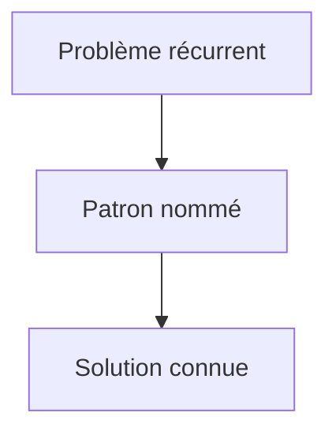

# Design pattern

> [!info] En une phrase
> Un design pattern (patron de conception) est une solution type, connue et nommée, à un problème de conception qui revient souvent : stratégie, fabrique, observateur, adaptateur, singleton…

```dataviewjs
await dv.view("10 — Templates/Scripts/learning", { view: "concept" })
```

## 1 · Comprendre
### Définition
Les plus utiles à connaître :
| Patron | Problème | Où tu le vois |
| --- | --- | --- |
| **Stratégie** | choisir un comportement parmi plusieurs à l'exécution | formats d'export, algorithmes |
| **Fabrique** (*factory*) | créer le bon objet sans exposer comment | `creerClient(config)` |
| **Observateur** | prévenir plusieurs abonnés d'un changement | `addEventListener`, Observable RxJS, webhooks |
| **Adaptateur** | faire parler deux interfaces incompatibles | envelopper le SDK de CVAT derrière ta propre interface |
| **Décorateur** | ajouter un comportement autour d'un existant | décorateurs Python `@`, middleware |
| **Singleton** | une seule instance partagée | connexion à la base, service `providedIn: "root"` |
| **Dépôt** (*repository*) | isoler l'accès aux données | couche d'accès en base |
| **Middleware / chaîne** | traiter une requête par étapes | Express, Django |

### Pourquoi ça existe
Les mêmes problèmes de conception reviennent ; réinventer la solution à chaque fois fait perdre du temps et crée du code inhabituel.

### Le problème résolu
Un vocabulaire commun (« on fait une stratégie ») et des solutions éprouvées.

## 2 · Explorer
### Comment ça fonctionne


### Exemple concret
```python
# Adaptateur : ton code ne dépend pas directement du SDK
class SourceAnnotations:
    def annotations(self, tache_id: int) -> list[dict]: ...

class SourceCvat(SourceAnnotations):
    def __init__(self, client): self.client = client
    def annotations(self, tache_id):
        return self.client.tasks.retrieve(tache_id).get_annotations()["shapes"]

class SourceFichier(SourceAnnotations):          # pour les tests
    def __init__(self, chemin): self.chemin = chemin
    def annotations(self, tache_id): return json.loads(Path(self.chemin).read_text())
```

### Cas d'utilisation
- Lire le code d'un framework
- Concevoir une extension (plugin, format)
- Parler conception en équipe

> [!warning] À ne pas confondre
> Chercher à placer des patterns partout : on part du **problème**, pas du patron. Et le **singleton** est souvent un état global déguisé, difficile à tester.

## 3 · Pratiquer
- Repère dans ton code ou celui d'Express trois patrons de la liste et explique leur rôle

## 4 · Expliquer
> [!quote] Mon résumé, avec mes mots
> _À écrire sans regarder la fiche. Si je bloque, je ne l'ai pas encore compris._

## 5 · Relier
- **Prérequis** : [[Principes SOLID]]
- **Complémentaires** : [[Middleware]] · [[Observable et RxJS]]

## 6 · Réviser
> [!question] Me faire interroger
> Je demande à Claude de m'interroger sur cette notion pour vérifier que je l'ai comprise.

### Validation de la maîtrise
La notion est maîtrisée quand j'ai réussi **tous les exercices** qui l'utilisent (statut `reussi` dans l'exercice).

```dataviewjs
await dv.view("10 — Templates/Scripts/learning", { view: "maitrise" })
```
