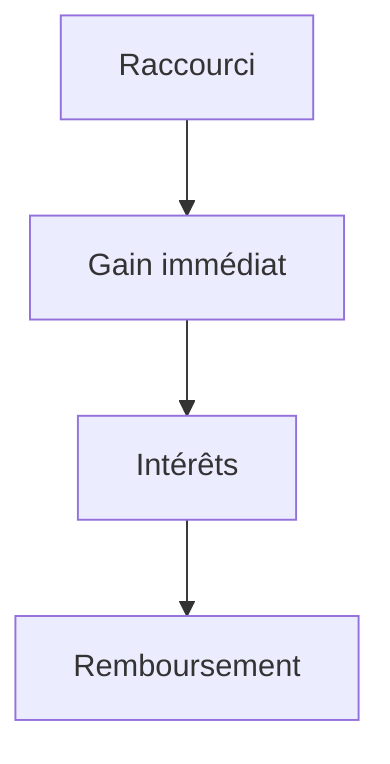

# Dette technique

> [!info] En une phrase
> La dette technique, ce sont les **raccourcis pris dans le code** (volontairement ou non) qui font gagner du temps maintenant mais **coûtent plus cher plus tard**, chaque fois qu'on doit modifier ce code. Comme une dette d'argent, elle a des intérêts.

```dataviewjs
await dv.view("10 — Templates/Scripts/learning", { view: "concept" })
```

## 1 · Comprendre
### Définition
**Volontaire** : dans un POC, on code vite exprès (pas de tests, valeurs en dur, erreurs ignorées). C'est normal, **si on le note** et qu'on ne garde pas ce code tel quel.

**Involontaire** : code copié-collé, noms flous, fonctions de 300 lignes, dépendances jamais mises à jour.

**Les intérêts** : chaque nouvelle fonctionnalité prend plus de temps, les bugs se multiplient, on a peur de toucher au code.

**Le remboursement** : [[Refactorisation]], ajout de tests, mise à jour des dépendances, réécriture du code de POC avant la production.

### Pourquoi ça existe
Il est parfois raisonnable de s'endetter pour aller vite (un POC, une démo urgente). Le problème, c'est la dette **cachée** et jamais remboursée.

### Le problème résolu
Rendre visible ce qui ralentira l'équipe, pour décider en connaissance de cause quand rembourser.

## 2 · Explorer
### Comment ça fonctionne


### Exemple concret
```python
# Dans le POC : raccourcis assumés et notés
CVAT_URL = "http://localhost:8080"   # DETTE : à passer en variable d'environnement
TOKEN = "abc123"                      # DETTE : secret en dur, interdit hors POC

def handler(context, event):
    # DETTE : aucune gestion d'erreur si la tâche n'existe pas
    xml = telecharger_annotations(CVAT_URL, TOKEN, event.body["tache_id"])
    return dessiner_png(xml)
```

### Cas d'utilisation
- Lister les raccourcis d'un POC dans son compte rendu
- Garder une colonne « dette » dans le backlog

> [!warning] À ne pas confondre
> La dette technique n'est pas « du mauvais code » en général : c'est un **choix** (ou un oubli) qui a un coût futur. Du code simple et un peu répétitif peut être tout à fait sain.

## 3 · Pratiquer

### Exercice visuel

Sur Excalidraw, **sans regarder la fiche**. Puis je compare avec la fiche, je corrige en rouge ce qui était faux, et j'explique mon dessin à voix haute ou à Claude dans le chat.

> [!example] ⚖️ Avant / après
> Avant / après : un raccourci pris dans ton script (adresse en dur, pas de gestion d'erreur), puis ce qu'il coûte trois mois plus tard. Dessine les intérêts de la dette.

> [!example] 🧠 Dessine de mémoire
> Dessine la dette comme un emprunt : ce qu'on gagne tout de suite, ce qu'on paie ensuite, comment on rembourse.

### Mon schéma

> [!tip] Mon dessin Excalidraw
> _Je crée le dessin « Schéma - Dette technique » et je l'intègre ici avec `![[Schéma - Dette technique.excalidraw]]`, puis je coche `schema`._

### Appliquer dans le fil rouge
- Pas encore d'étape du fil rouge pour cette notion : elle sera pratiquée dans le fil rouge de son niveau (voir [[Niveaux]]).

## 4 · Relier
- **Prérequis** : [[Preuve de concept (POC)]]
- **Complémentaires** : [[Refactorisation]] · [[MVP (produit minimum viable)]] · [[Principes DRY, KISS et YAGNI]] · [[Décision d'architecture (ADR)]]

## 5 · Réviser
> [!question] Me faire interroger
> Je demande à Claude de m'interroger sur cette notion pour vérifier que je l'ai comprise.

### Validation de la maîtrise
Trois cases à cocher dans les propriétés de la fiche :
- `schema` : mon dessin du concept est dans « Mon schéma » ;
- `exercice_visuel` : j'ai fait et corrigé les exercices visuels de la section 3 ;
- `fil_rouge` : je l'ai appliqué dans le fil rouge (coché tout seul quand une étape qui l'utilise est réussie).

Les trois cochées : la notion compte comme **comprise**. **Maîtrisé** : c'est moi qui le mets dans `status`, quand je le sens.

```dataviewjs
await dv.view("10 — Templates/Scripts/learning", { view: "maitrise" })
```
