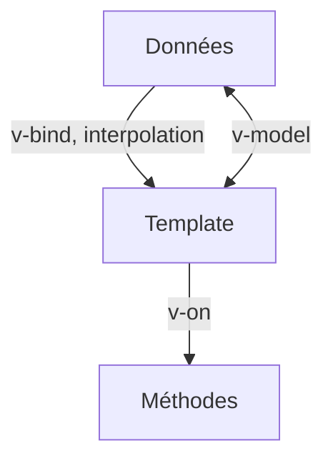

# Directives Vue

> [!info] En une phrase
> Les directives sont des attributs spéciaux du template Vue (v-if, v-for, v-model, v-bind, v-on) qui affichent conditionnellement, répètent, lient des valeurs ou écoutent des événements.

```dataviewjs
await dv.view("10 — Templates/Scripts/learning", { view: "concept" })
```

## 1 · Comprendre
### Définition
| Directive | Raccourci | Rôle |
| --- | --- | --- |
| `v-if` / `v-else-if` / `v-else` | | afficher ou non (l'élément est créé ou retiré) |
| `v-show` | | cacher en CSS (l'élément reste) |
| `v-for="t in taches" :key="t.id"` | | répéter |
| `v-bind:href="url"` | `:href` | lier un attribut à une valeur |
| `v-on:click="f"` | `@click` | écouter un événement (`@submit.prevent` fait `preventDefault`) |
| `v-model="texte"` | | liaison dans les deux sens avec un champ de formulaire |
| `v-html` | | insérer du HTML (danger [[XSS]]) |
`{{ expression }}` affiche une valeur en l'**échappant** (sans risque).

### Pourquoi ça existe
Un template doit pouvoir exprimer des conditions, des boucles et des liaisons sans devenir du JavaScript.

### Le problème résolu
Écrire des interfaces dynamiques en restant proche du HTML.

## 2 · Explorer
### Comment ça fonctionne


### Exemple concret
```vue
<template>
  <form @submit.prevent="ajouter">
    <input v-model.trim="texte" placeholder="Nouvelle tâche" />
    <button :disabled="!texte">Ajouter</button>
  </form>
  <p v-if="taches.length === 0">Aucune tâche</p>
  <ul v-else>
    <li v-for="t in taches" :key="t.id" :class="{ fini: t.fini }" @click="t.fini = !t.fini">
      {{ t.nom }}
    </li>
  </ul>
</template>
```

### Cas d'utilisation
- Formulaires
- Listes
- Affichage conditionnel

> [!warning] À ne pas confondre
> `v-if` (retire l'élément du DOM) et `v-show` (le garde, masqué) : `v-show` pour un affichage qui bascule souvent. Et ne mets pas `v-if` et `v-for` sur le même élément : filtre avec un `computed`.

## 3 · Pratiquer
- Écris la liste de tâches complète (ajout, bascule, suppression, compteur) avec seulement des directives

## 4 · Expliquer
> [!quote] Mon résumé, avec mes mots
> _À écrire sans regarder la fiche. Si je bloque, je ne l'ai pas encore compris._

## 5 · Relier
- **Prérequis** : [[Composant monofichier Vue (SFC)]] · [[Formulaire HTML]]
- **Complémentaires** : [[Réactivité Vue (ref et computed)]]

## 6 · Réviser
> [!question] Me faire interroger
> Je demande à Claude de m'interroger sur cette notion pour vérifier que je l'ai comprise.

### Validation de la maîtrise
La notion est maîtrisée quand j'ai réussi **tous les exercices** qui l'utilisent (statut `reussi` dans l'exercice).

```dataviewjs
await dv.view("10 — Templates/Scripts/learning", { view: "maitrise" })
```
