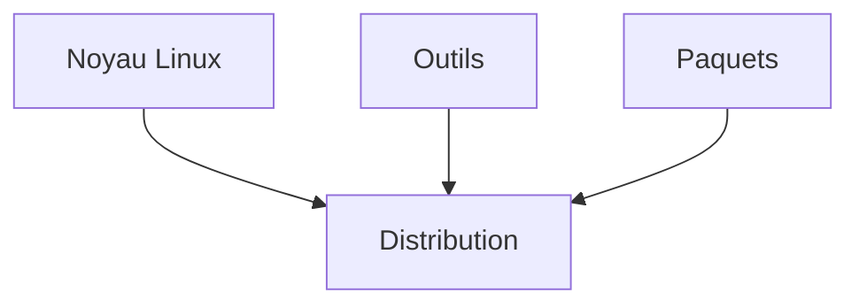

# Distribution Linux

> [!info] En une phrase
> Une distribution Linux (Ubuntu, Debian, Alpine…) est un système complet construit autour du noyau Linux : le noyau, plus les outils de base, plus un gestionnaire de paquets pour installer des logiciels.

```dataviewjs
await dv.view("10 — Templates/Scripts/learning", { view: "concept" })
```

## 1 · Comprendre
### Définition
**Linux, au sens strict, c'est seulement le noyau.** Seul, il ne sert à rien : pas de shell, pas de `ls`, aucun moyen d'installer un programme.

Une **distribution** assemble tout ce qu'il faut autour :
- le **noyau** Linux (le moteur) ;
- les **outils** : Bash, `ls`, `cp`, `grep`… (la carrosserie et le tableau de bord) ;
- un **gestionnaire de paquets** pour installer des logiciels : `apt` (Ubuntu, Debian), `apk` (Alpine), `dnf` (Fedora) ;
- des choix par défaut : configuration, version des outils, rythme des mises à jour.

| Distribution | Où tu la croises |
| --- | --- |
| **Ubuntu** | ta WSL, beaucoup de serveurs et de runners CI |
| **Debian** | la base des images Docker officielles (`python:3.12-slim`) |
| **Alpine** | des images Docker toutes petites (`alpine`, `nginx:alpine`) |

Toutes partagent le même moteur : un programme Linux tourne sur toutes, à condition que ses bibliothèques soient installées.

### Pourquoi ça existe
Personne ne veut assembler un système à la main à partir du noyau seul.

### Le problème résolu
Avoir un système Linux prêt à l'emploi, adapté à un usage : poste de travail, serveur, ou image Docker légère.

## 2 · Explorer
### Comment ça fonctionne


### Exemple concret
**Le noyau ou la distribution ?**
```bash
uname -r              # le moteur : 5.15.167.4-microsoft-standard-WSL2
cat /etc/os-release   # la voiture : NAME="Ubuntu" VERSION="24.04 LTS"
```

**Pourquoi WSL ?** Un programme Linux parle au noyau Linux avec ses appels système, que le noyau Windows ne comprend pas. WSL 2 ajoute un vrai noyau Linux dans ton PC ; Ubuntu tourne dessus.

**Et les conteneurs ?** Une image Docker contient les outils d'une distribution (Debian, Alpine) et ton programme, **mais pas de noyau**. Le conteneur emprunte celui de la machine : sur ton PC, le noyau de WSL. C'est comme un appartement qui partage les fondations de l'immeuble ; une machine virtuelle, elle, est une maison entière avec ses propres fondations (son propre noyau), donc plus lourde et plus lente à démarrer.
```bash
docker run --rm alpine uname -r            # même noyau que ta WSL
docker run --rm alpine cat /etc/os-release # mais distribution Alpine
```

### Cas d'utilisation
- Choisir l'image de base d'un Dockerfile (`-slim` pour Debian, `-alpine`)
- Savoir quelle commande d'installation utiliser : `apt` ou `apk`
- Lire une documentation qui dit « sous Debian/Ubuntu… »

> [!warning] À ne pas confondre
> **Linux** (le noyau) et **Ubuntu** (une distribution). Et sur Alpine, `apt` et `bash` n'existent pas par défaut : c'est `apk` et `sh`.

## 3 · Pratiquer
- Fais l'[[Exercice - Distribution, noyau et conteneur]]

## 4 · Expliquer
> [!quote] Mon résumé, avec mes mots
> _À écrire sans regarder la fiche. Si je bloque, je ne l'ai pas encore compris._

## 5 · Relier
- **Prérequis** : [[Système d'exploitation et noyau]]
- **Complémentaires** : [[Noyau (kernel)]] · [[WSL]] · [[Gestionnaire de paquets]] · [[Image Docker]] · [[Conteneur]]

## 6 · Réviser
> [!question] Me faire interroger
> Je demande à Claude de m'interroger sur cette notion pour vérifier que je l'ai comprise.

### Validation de la maîtrise
La notion est maîtrisée quand j'ai réussi **tous les exercices** qui l'utilisent (statut `reussi` dans l'exercice).

```dataviewjs
await dv.view("10 — Templates/Scripts/learning", { view: "maitrise" })
```
