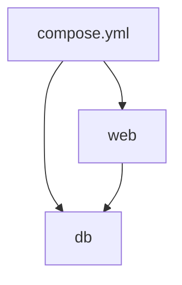

# Docker Compose

> [!info] En une phrase
> Décrire dans un fichier YAML plusieurs conteneurs qui vont ensemble (services, ports, volumes, réseau) et les lancer d'une seule commande.

```dataviewjs
await dv.view("10 — Templates/Scripts/learning", { view: "concept" })
```

## 1 · Comprendre
### Définition
`docker compose` lit un fichier `docker-compose.yml` (ou `compose.yaml`) qui décrit des **services**. Chaque service = un conteneur, avec son image (ou son `build`), ses ports, volumes, variables. Compose crée aussi un **réseau** où les services se joignent **par leur nom**.

### Pourquoi ça existe
Une vraie application = plusieurs conteneurs (CVAT : serveur, interface, base, Redis, Traefik…). Les lancer un par un avec de longues commandes `docker run` est ingérable.

### Le problème résolu
Remplacer dix commandes `docker run` à retenir par un fichier versionné, lisible et partagé.

## 2 · Explorer
### Comment ça fonctionne


### Exemple concret
```yaml
services:
  db:
    image: postgres:16
    environment:
      POSTGRES_PASSWORD: dev
    volumes:
      - db-data:/var/lib/postgresql/data
  api:
    build: .                  # construit l'image depuis le Dockerfile local
    ports:
      - "8080:8000"
    environment:
      DB_HOST: db             # le nom du service sert d'adresse
    depends_on:
      - db
volumes:
  db-data:
```
```bash
docker compose up -d          # crée et démarre tout
docker compose ps             # état des services
docker compose logs -f api    # suivre les logs d'un service
docker compose down           # arrête et supprime (ajouter -v supprime aussi les volumes)
```
Plusieurs fichiers peuvent se superposer : `docker compose -f docker-compose.yml -f docker-compose.dev.yml up` (CVAT en a plusieurs).

### Cas d'utilisation
- Lancer CVAT en local (son `docker-compose.yml` liste les images, les ports, Traefik)
- Comprendre quelles images un projet **construit** (`build:`) ou **télécharge** (`image:`)

> [!warning] À ne pas confondre
> `docker compose` (v2, une sous-commande, à utiliser) et `docker-compose` (l'ancien outil séparé). Et `depends_on` attend que le conteneur **démarre**, pas que le service soit **prêt**.

## 3 · Pratiquer
- Lis le `docker-compose.yml` de CVAT : liste les services, leurs images et les ports publiés.
- Écris un compose avec `postgres` et un conteneur `python:3.12-slim` qui fait `sleep infinity`, puis vérifie depuis le second que `db` répond à son nom (`getent hosts db`).

## 4 · Expliquer
> [!quote] Mon résumé, avec mes mots
> _À écrire sans regarder la fiche. Si je bloque, je ne l'ai pas encore compris._

## 5 · Relier
- **Prérequis** : [[Conteneur]] · [[YAML]] · [[Volume Docker]] · [[Port]]
- **Complémentaires** : [[Reverse proxy]]
- **Commandes** : [[docker compose up]]

## 6 · Réviser
> [!question] Me faire interroger
> Je demande à Claude de m'interroger sur cette notion pour vérifier que je l'ai comprise.

### Validation de la maîtrise
La notion est maîtrisée quand j'ai réussi **tous les exercices** qui l'utilisent (statut `reussi` dans l'exercice).

```dataviewjs
await dv.view("10 — Templates/Scripts/learning", { view: "maitrise" })
```
