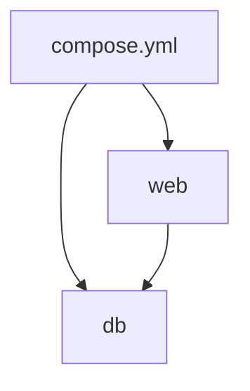

# Docker Compose

> [!info] En une phrase
> Décrire dans un fichier YAML plusieurs conteneurs qui vont ensemble (services, ports, volumes, réseau) et les lancer d'une seule commande.

```dataviewjs
await dv.view("10 — Templates/Scripts/learning", { view: "concept" })
```

## 1 · Comprendre
### Définition
`docker compose` lit un fichier `docker-compose.yml` (ou `compose.yaml`) qui décrit des **services**. Chaque service = un conteneur, avec son image (ou son `build`), ses ports, volumes, variables. Compose crée aussi un **réseau** où les services se joignent **par leur nom**.

### Pourquoi ça existe
Une vraie application = plusieurs conteneurs (par exemple : serveur, interface, base, Redis, reverse proxy). Les lancer un par un avec de longues commandes `docker run` est ingérable.

### Le problème résolu
Remplacer dix commandes `docker run` à retenir par un fichier versionné, lisible et partagé.

## 2 · Explorer
### Comment ça fonctionne


### Exemple concret
```yaml
services:
  db:
    image: postgres:16
    environment:
      POSTGRES_PASSWORD: dev
    volumes:
      - db-data:/var/lib/postgresql/data
  api:
    build: .                  # construit l'image depuis le Dockerfile local
    ports:
      - "8080:8000"
    environment:
      DB_HOST: db             # le nom du service sert d'adresse
    depends_on:
      - db
volumes:
  db-data:
```
```bash
docker compose up -d          # crée et démarre tout
docker compose ps             # état des services
docker compose logs -f api    # suivre les logs d'un service
docker compose down           # arrête et supprime (ajouter -v supprime aussi les volumes)
```
Plusieurs fichiers peuvent se superposer : `docker compose -f docker-compose.yml -f docker-compose.dev.yml up` (les gros projets en ont souvent plusieurs).

### Cas d'utilisation
- Comprendre quelles images un projet **construit** (`build:`) ou **télécharge** (`image:`)

> [!warning] À ne pas confondre
> `docker compose` (v2, une sous-commande, à utiliser) et `docker-compose` (l'ancien outil séparé). Et `depends_on` attend que le conteneur **démarre**, pas que le service soit **prêt**.

## 3 · Pratiquer

### Exercice visuel

Sur Excalidraw, **sans regarder la fiche**. Puis je compare avec la fiche, je corrige en rouge ce qui était faux, et j'explique mon dessin à voix haute ou à Claude dans le chat.

> [!example] 🧠 Dessine de mémoire
> Dessine le `docker-compose.yml` de ton application en image : les services api, front-vue, front-angular, leurs ports, le volume, le réseau commun.

> [!example] 🔍 Trouve l'erreur
> Ce schéma est faux. Corrige-le en rouge et explique l'erreur.
>
> ```mermaid
> flowchart TD
>   V[front-vue] --> L[localhost:8000]
>   L --> A[api]
> ```

### Mon schéma

> [!tip] Mon dessin Excalidraw
> _Je crée le dessin « Schéma - Docker Compose » et je l'intègre ici avec `![[Schéma - Docker Compose.excalidraw]]`, puis je coche `schema`._

### Appliquer dans le fil rouge
- [[MesDépenses Front 05 - Tout lancer avec compose]]
- [[MesDépenses Front 10 - Angular dans compose]]
- [[MesDépenses 05 - L'API et PostgreSQL avec compose]]
- [[MesDépenses 06 - Dépanner un conteneur]]
- [[Fil rouge 03 - Une page web pour le rapport]]

## 4 · Relier
- **Au travail** : [Docker Compose au travail](obsidian://open?vault=Travail&file=Docker%20Compose%20au%20travail)
- **Prérequis** : [[Conteneur]] · [[YAML]] · [[Volume Docker]] · [[Port]]
- **Complémentaires** : [[Reverse proxy]]
- **Commandes** : [[docker compose up]]

## 5 · Réviser
> [!question] Me faire interroger
> Je demande à Claude de m'interroger sur cette notion pour vérifier que je l'ai comprise.

### Validation (compris, puis maîtrisé)
Trois cases à cocher dans les propriétés de la fiche :
- `schema` : mon dessin du concept est dans « Mon schéma » ;
- `exercice_visuel` : j'ai fait et corrigé les exercices visuels de la section 3 ;
- `fil_rouge` : je l'ai appliqué dans le fil rouge (coché tout seul quand une étape qui l'utilise est réussie).

Les trois cochées : la notion compte comme **comprise**. **Maîtrisé** : c'est moi qui le mets dans `status`, quand je le sens.

```dataviewjs
await dv.view("10 — Templates/Scripts/learning", { view: "maitrise" })
```
