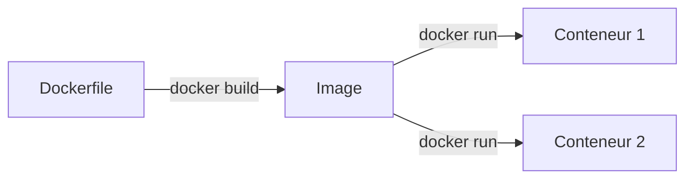

# Docker

> [!info] En une phrase
> Un outil qui emballe une application avec tout ce dont elle a besoin pour qu'elle tourne pareil partout.

```dataviewjs
await dv.view("10 — Templates/Scripts/learning", { view: "concept" })
```

## 1 · Comprendre
### Définition
**Docker** construit des [[Image Docker|images]] (le modèle : système minimal + dépendances + ton code) et lance des [[Conteneur|conteneurs]] (des instances isolées de ces images).

### Pourquoi ça existe
Supprimer le « ça marche sur ma machine » : la même image tourne à l'identique sur ton PC, chez un collègue et sur le serveur.

### Le problème résolu
Installer à la main la bonne version de Node, de PostgreSQL et des bibliothèques sur chaque machine est long et source d'écarts.

## 2 · Explorer
### Comment ça fonctionne

- Un conteneur **partage le noyau** de la machine : il démarre en secondes, contrairement à une machine virtuelle.
- Un conteneur est **jetable** : les données à garder vont dans un **volume**.

### Exemple concret
```dockerfile
# Dockerfile d'une API Node
FROM node:22-alpine
WORKDIR /app
COPY package*.json ./
RUN npm ci --omit=dev
COPY . .
EXPOSE 3000
CMD ["node", "server.js"]
```
```bash
docker build -t api-notes .
docker run -p 3000:3000 api-notes
```

### Cas d'utilisation
- Lancer une base de données sans l'installer ([[Fiche - Lancer PostgreSQL avec Docker]])
- Livrer une application identique en dev et en production
- Base du déploiement et de la CI/CD

> [!warning] À ne pas confondre
> **Image** (le modèle, en lecture seule) et **conteneur** (une instance qui tourne). Et **Docker** ≠ **machine virtuelle** : pas de système d'exploitation complet par conteneur.

## 3 · Pratiquer
- [[Fiche - Lancer PostgreSQL avec Docker]]
- [[Projet - API Notes]] (étape bonus : conteneuriser l'API)

## 4 · Expliquer
> [!quote] Mon résumé, avec mes mots
> _À écrire sans regarder la fiche. Si je bloque, je ne l'ai pas encore compris._

## 5 · Relier
- **Prérequis** : [[Terminal]], [[Node.js]] (pour conteneuriser une app que tu sais déjà lancer)
- **Notions clés** : [[Image Docker]], [[Conteneur]]
- **Commandes** : [[docker build]] · [[docker run]] · [[docker ps]]

## 6 · Réviser
> [!question] Me faire interroger
> Je demande à Claude de m'interroger sur cette notion pour vérifier que je l'ai comprise.

### Validation de la maîtrise
La notion est maîtrisée quand j'ai réussi **tous les exercices** qui l'utilisent (statut `reussi` dans l'exercice).

```dataviewjs
await dv.view("10 — Templates/Scripts/learning", { view: "maitrise" })
```
