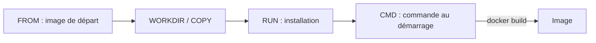

# Dockerfile

> [!info] En une phrase
> La recette écrite d'une image : une liste d'instructions que Docker exécute dans l'ordre pour la construire.

```dataviewjs
await dv.view("10 — Templates/Scripts/learning", { view: "concept" })
```

## 1 · Comprendre
### Définition
Un **Dockerfile** est un fichier texte, à la racine du projet en général, qui décrit comment construire une [[Image Docker]]. Chaque instruction ajoute une **couche**, mise en cache.

### Pourquoi ça existe
Fabriquer l'image de façon automatique et identique à chaque fois, sur n'importe quelle machine (poste, CI, serveur).

### Le problème résolu
Préparer un serveur à la main en suivant un document : une étape oubliée et l'environnement diffère.

## 2 · Explorer
### Comment ça fonctionne


### Exemple concret
```dockerfile
FROM python:3.11-slim                 # image de départ (sans registre : Docker Hub)
WORKDIR /app                          # dossier de travail dans l'image
COPY requirements.txt .               # d'abord les dépendances, pour le cache
RUN pip install -r requirements.txt   # exécuté pendant la construction
COPY . .                              # puis le code
CMD ["python", "main.py"]             # exécuté au démarrage du conteneur
```

| Instruction | Rôle |
| --- | --- |
| `FROM` | l'image de départ |
| `WORKDIR` | le dossier de travail |
| `COPY` | copie des fichiers du projet dans l'image |
| `RUN` | commande exécutée **pendant le build** |
| `ARG` | variable de build, voir [[Variable de build Docker (ARG)]] |
| `CMD` | commande lancée **au démarrage** du conteneur |

Un Dockerfile peut contenir **plusieurs `FROM`** (*multi-stage build*) : une étape compile, la suivante ne garde que le résultat. Un projet peut aussi avoir **plusieurs Dockerfile** (`Dockerfile`, `Dockerfile.ui`…), construits avec `docker build -f`.

### Cas d'utilisation
- Conteneuriser une application (API, front)
- Projet CVAT : partie 1 (reprendre CVAT sur GitLab, construire ses images en CI via le Nexus)

> [!warning] À ne pas confondre
> `RUN` (pendant le build) et `CMD` (au démarrage du conteneur). Et le **Dockerfile** (la recette) avec l'**image** (le résultat).

## 3 · Pratiquer
- Dans le dépôt CVAT, ouvre chaque Dockerfile et note ses lignes `FROM` : quelles images de départ sont utilisées ?

## 4 · Expliquer
> [!quote] Mon résumé, avec mes mots
> _À écrire sans regarder la fiche. Si je bloque, je ne l'ai pas encore compris._

## 5 · Relier
- **Prérequis** : [[Docker]]
- **Notion parente** : [[Image Docker]]
- **Complémentaires** : [[Variable de build Docker (ARG)]] · [[Registre Docker]]
- **Utilisé par** : [[Construire une image dans la CI]]
- **Commandes** : [[docker build]]

## 6 · Réviser
> [!question]- Quelle est la différence entre `RUN` et `CMD` ?
> `RUN` s'exécute pendant la construction de l'image ; `CMD` est la commande lancée quand le conteneur démarre.

> [!question]- D'où vient l'image d'un `FROM python:3.11-slim` ?
> De Docker Hub, car aucun registre n'est précisé : c'est `docker.io/library/python:3.11-slim`.

> [!question]- Pourquoi copier le fichier des dépendances avant le reste du code ?
> Pour profiter du cache : l'installation n'est relancée que si les dépendances changent.

### Validation de la maîtrise
- [ ] Je l'explique sans notes, en 3 phrases, à quelqu'un qui ne connaît pas
- [ ] J'ai réussi un exercice qui l'utilise
- [ ] Je l'ai utilisé dans un projet
- [ ] Je sais dire quand ne pas l'utiliser (ou ce qu'il ne faut pas confondre)
