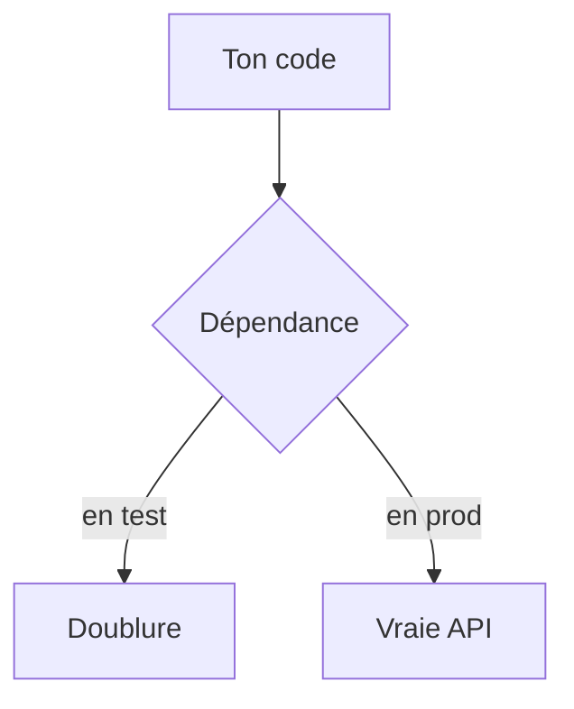

# Doublure de test (mock)

> [!info] En une phrase
> Une doublure remplace pendant un test une dépendance lente ou imprévisible (API, base, horloge, disque) par une fausse version contrôlée, pour tester son code seul.

```dataviewjs
await dv.view("10 — Templates/Scripts/learning", { view: "concept" })
```

## 1 · Comprendre
### Définition
Types de doublures :
- **stub** : renvoie une réponse prévue (« l'API répond ces 3 tâches ») ;
- **mock** / **spy** : enregistre comment il a été appelé, pour le vérifier (« `envoyerMail` a été appelé une fois avec cette adresse ») ;
- **fake** : une vraie implémentation simplifiée (une base en mémoire).
```js
import { vi } from "vitest";
const fetchMock = vi.fn().mockResolvedValue({ ok: true, json: async () => [{ id: 1 }] });
vi.stubGlobal("fetch", fetchMock);
vi.useFakeTimers(); vi.setSystemTime(new Date("2026-11-06"));   // contrôler la date
```
```python
from unittest.mock import patch
with patch("monmodule.requests.get") as get:
    get.return_value.json.return_value = {"count": 3}
```
Le plus simple reste souvent d'**injecter** la dépendance en paramètre ([[Service et injection de dépendances|injection de dépendances]]) : le test passe alors une fausse version.

### Pourquoi ça existe
Un test qui appelle la vraie API de CVAT est lent, dépend du réseau et peut modifier des données.

### Le problème résolu
Tester rapidement et de façon reproductible, y compris les cas d'erreur difficiles à provoquer (500, délai dépassé).

## 2 · Explorer
### Comment ça fonctionne


### Exemple concret
```js
// exporter.js
export async function compterTaches(client) {
  const rep = await client.get("/api/tasks");
  return rep.count;
}
// exporter.test.js
it("compte les tâches", async () => {
  const client = { get: vi.fn().mockResolvedValue({ count: 3 }) };
  expect(await compterTaches(client)).toBe(3);
  expect(client.get).toHaveBeenCalledWith("/api/tasks");
});
```

### Cas d'utilisation
- Fonction qui appelle une API externe
- Code qui dépend de la date ou du hasard
- Simuler une erreur réseau

> [!warning] À ne pas confondre
> Tout simuler : un test où tout est faux ne vérifie plus rien de réel. Simule les **frontières** (réseau, horloge), garde la logique réelle, et complète avec des [[Test d'intégration|tests d'intégration]].

## 3 · Pratiquer

### Exercice visuel

Sur Excalidraw, **sans regarder la fiche**. Puis je compare avec la fiche, je corrige en rouge ce qui était faux, et j'explique mon dessin avec mes mots (section 4).

> [!example] ⚖️ Avant / après
> Avant / après : un test de ta fonction Nuclio qui appelle le vrai serveur CVAT, puis le même avec une doublure. Dessine ce qui est remplacé.

> [!example] 🛣️ Suis le trajet
> Dessine le trajet d'un appel `requests.get` dans un test : ton code, le mock, la fausse réponse, l'assert.

### Mon schéma

> [!tip] Mon dessin Excalidraw
> _Je crée le dessin « Schéma - Doublure de test (mock) » et je l'intègre ici avec `![[Schéma - Doublure de test (mock).excalidraw]]`._

### Appliquer dans le fil rouge
- Pas encore d'étape du fil rouge pour cette notion : je l'applique dans mon travail (CVAT, Nuclio) ou je demande une étape à Claude.

## 4 · Expliquer
> [!quote] Mon résumé, avec mes mots
> _J'explique mon schéma avec mes mots, sans regarder la fiche. Si je bloque, je ne l'ai pas encore compris._

## 5 · Relier
- **Prérequis** : [[Test unitaire]]
- **Complémentaires** : [[Service et injection de dépendances]]

## 6 · Réviser
> [!question] Me faire interroger
> Je demande à Claude de m'interroger sur cette notion pour vérifier que je l'ai comprise.

### Validation de la maîtrise
La notion est maîtrisée quand je sais :
1. **l'expliquer** de façon fluide, à partir de mon schéma (section 4) ;
2. **l'adapter** à un autre contexte (consigne « Change de contexte », ou Claude m'interroge sur un autre cas) ;
3. **l'appliquer** pour de vrai dans le fil rouge (section 3).

Réussir un exercice ne suffit pas. C'est moi qui passe le statut en `maitrise`.

```dataviewjs
await dv.view("10 — Templates/Scripts/learning", { view: "maitrise" })
```
