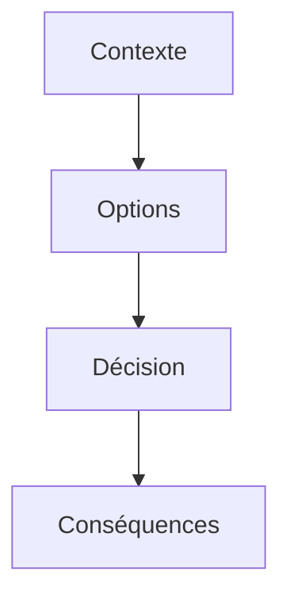

# Décision d'architecture (ADR)

> [!info] En une phrase
> Un ADR (*Architecture Decision Record*, compte rendu de décision d'architecture) est une **courte note qui garde la trace d'une décision technique importante** : le contexte, la décision prise, les options écartées et les conséquences.

```dataviewjs
await dv.view("10 — Templates/Scripts/learning", { view: "concept" })
```

## 1 · Comprendre
### Définition
**Une décision par fichier**, numérotée : `0001-utiliser-nuclio-pour-l-export.md`.

**Structure simple** :
- *Contexte* : le problème et les contraintes ;
- *Décision* : ce qu'on a choisi ;
- *Alternatives* : ce qu'on n'a pas choisi, et pourquoi ;
- *Conséquences* : ce que ça implique (positif et négatif) ;
- *Statut* : proposée, acceptée, remplacée par l'ADR n°…

**On ne modifie pas un ADR accepté** : si on change d'avis, on en écrit un nouveau qui remplace l'ancien. L'historique des raisonnements reste lisible.

**On les range dans le dépôt** (`docs/adr/`), à côté du code, donc versionnés avec Git.

**La conclusion d'un POC** donne souvent un ADR : « on a testé, on choisit cette approche, voici pourquoi ».

### Pourquoi ça existe
Six mois plus tard, personne ne se souvient pourquoi on a choisi telle technologie, et on refait le débat (ou on casse une contrainte qu'on avait oubliée).

### Le problème résolu
Garder la mémoire des choix et de leurs raisons, en quelques lignes, sans gros document.

## 2 · Explorer
### Comment ça fonctionne


### Exemple concret
```markdown
# 0001 - Faire l'export PNG dans une fonction Nuclio
Statut : acceptée (2026-11-20)
## Contexte
CVAT doit produire une image de ses annotations. Le POC a montré que
Nuclio peut appeler l'API CVAT et renvoyer un PNG en 4 s pour 50 images.
## Décision
L'export est une fonction Nuclio appelée par un bouton du front React.
## Alternatives écartées
- Modifier le backend Django de CVAT : plus difficile à maintenir lors des mises à jour.
- Export dans le navigateur : trop lent sur les grosses tâches.
## Conséquences
+ CVAT reste presque inchangé, la fonction se déploie à part.
- Il faut gérer un jeton de service et la limite de temps de Nuclio.
```

### Cas d'utilisation
- Conclure un POC
- Choisir entre deux bibliothèques ou deux architectures
- Expliquer à un nouveau collègue pourquoi le projet est fait ainsi

> [!warning] À ne pas confondre
> Un ADR n'est pas une spec technique complète : il ne raconte **qu'une seule décision**. Et il ne sert à rien pour les petits choix faciles à changer.

## 3 · Pratiquer
- Écris l'ADR n°1 de ton projet : pourquoi l'export passe par Nuclio (ou pas)

## 4 · Expliquer
> [!quote] Mon résumé, avec mes mots
> _À écrire sans regarder la fiche. Si je bloque, je ne l'ai pas encore compris._

## 5 · Relier
- **Prérequis** : [[Spécification technique]]
- **Complémentaires** : [[Preuve de concept (POC)]] · [[Dette technique]] · [[Monolithe et microservices]] · [[Changelog]]

## 6 · Réviser
> [!question] Me faire interroger
> Je demande à Claude de m'interroger sur cette notion pour vérifier que je l'ai comprise.

### Validation de la maîtrise
La notion est maîtrisée quand j'ai réussi **tous les exercices** qui l'utilisent (statut `reussi` dans l'exercice).

```dataviewjs
await dv.view("10 — Templates/Scripts/learning", { view: "maitrise" })
```
