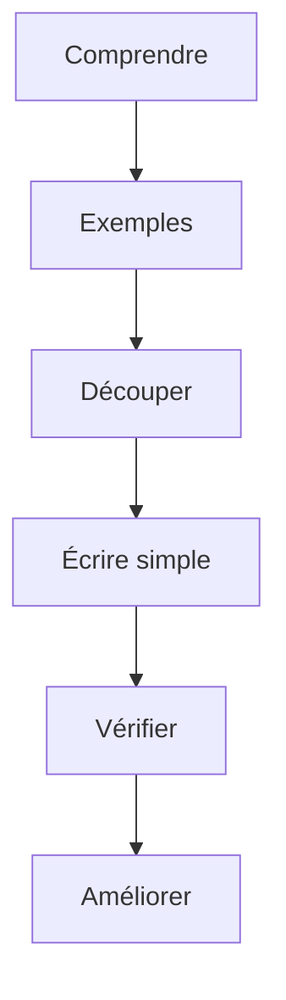

# Décomposer un problème

> [!info] En une phrase
> Résoudre un problème, c'est d'abord le comprendre, puis le découper en sous-problèmes assez petits pour qu'on sache résoudre chacun, puis assembler et vérifier.

```dataviewjs
await dv.view("10 — Templates/Scripts/learning", { view: "concept" })
```

## 1 · Comprendre
### Définition
Une méthode en cinq étapes, valable pour un exercice, un bug ou une fonctionnalité :
1. **Comprendre** : reformuler avec ses mots. Quelles sont les **entrées** ? Quelle **sortie** exacte ? Quelles **contraintes** ?
2. **Exemples à la main** : faire deux ou trois exemples sur papier, dont un **cas limite** (liste vide, un seul élément, valeurs égales, nombres négatifs). Si on ne sait pas le faire à la main, on ne saura pas le programmer.
3. **Découper** : écrire les grandes étapes, puis découper chaque étape jusqu'à ce que chacune soit évidente (une fonction chacune).
4. **Écrire** : d'abord la solution la plus simple qui marche, même lente.
5. **Vérifier puis améliorer** : tester avec les exemples et les cas limites ; ensuite seulement, simplifier ou accélérer.
Questions à se poser quand on bloque : « Ai-je déjà résolu un problème qui ressemble ? », « Et si le problème était plus petit ? », « Que faudrait-il savoir pour que ce soit facile ? ».

### Pourquoi ça existe
Face à un problème entier, on ne voit pas par où commencer et on écrit du code au hasard.

### Le problème résolu
Avancer par petites étapes sûres, au lieu de tout essayer en même temps et de se perdre.

## 2 · Explorer
### Comment ça fonctionne


### Exemple concret
Problème : « Zipper chaque sous-dossier d'un dossier, en ignorant les fichiers cachés, et faire un rapport. »
```
1. lister les sous-dossiers                    → fonction lister_sous_dossiers(dossier)
2. pour chaque sous-dossier :
   2a. lister ses fichiers non cachés          → fonction fichiers_visibles(d)
   2b. créer l'archive                         → fonction zipper(d, fichiers)
   2c. retenir nom, nombre, taille             → une ligne de rapport
3. écrire le rapport                            → fonction ecrire_rapport(lignes)
Cas limites : dossier vide, sous-dossier sans fichier visible, nom avec espaces
```
Chaque ligne devient une fonction courte, testable seule.

### Cas d'utilisation
- Commencer un exercice ou une fonctionnalité
- Déboguer : réduire le problème jusqu'au plus petit cas qui échoue
- Estimer une tâche

> [!warning] À ne pas confondre
> Se jeter sur le clavier avant d'avoir compris le problème : c'est la cause n° 1 des heures perdues. Et chercher directement la solution « optimale » : d'abord une solution simple et juste.

## 3 · Pratiquer
- Applique les cinq étapes, par écrit, à : « trouver dans un dossier les fichiers en double (même contenu) »

## 4 · Expliquer
> [!quote] Mon résumé, avec mes mots
> _À écrire sans regarder la fiche. Si je bloque, je ne l'ai pas encore compris._

## 5 · Relier
- **Prérequis** : [[Algorithme]] · [[Fonction]]
- **Complémentaires** : [[Pseudo-code et trace d'exécution]] · [[Séparation des responsabilités]]

## 6 · Réviser
> [!question] Me faire interroger
> Je demande à Claude de m'interroger sur cette notion pour vérifier que je l'ai comprise.

### Validation de la maîtrise
La notion est maîtrisée quand j'ai réussi **tous les exercices** qui l'utilisent (statut `reussi` dans l'exercice).

```dataviewjs
await dv.view("10 — Templates/Scripts/learning", { view: "maitrise" })
```
