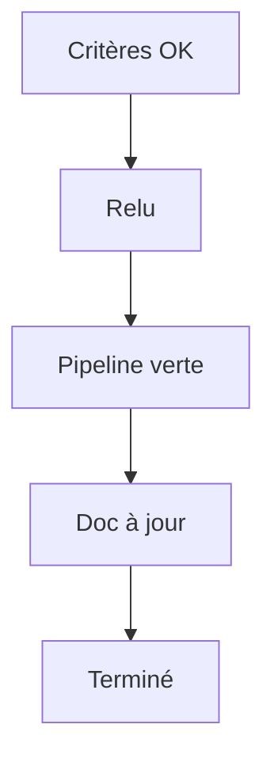

# Définition de terminé

> [!info] En une phrase
> La définition de terminé (*Definition of Done*, DoD) est la **liste commune de conditions qu'un travail doit remplir pour être déclaré fini**, quelle que soit la fonctionnalité : code relu, tests passés, documentation à jour, déployé…

```dataviewjs
await dv.view("10 — Templates/Scripts/learning", { view: "concept" })
```

## 1 · Comprendre
### Définition
**Elle vaut pour tous les tickets**, à la différence des [[Critères d'acceptation|critères d'acceptation]] qui sont propres à chacun.

**Elle est décidée par l'équipe** et affichée (wiki, modèle de ticket ou de merge request).

**Exemple de contenu** :
- les critères d'acceptation de la story sont vérifiés ;
- le code est relu dans une merge request ;
- la pipeline GitLab est verte (lint, tests, construction de l'image) ;
- les tests nécessaires sont écrits ;
- la documentation (README, changelog) est à jour ;
- c'est déployé en environnement de recette.

**« Fini » sans définition**, c'est souvent « ça marche sur ma machine ».

### Pourquoi ça existe
Chaque développeur a sa propre idée de « fini ». Résultat : du travail déclaré terminé qui revient avec des bugs, ou qu'il faut reprendre pour le déployer.

### Le problème résolu
Une qualité minimale garantie, et des estimations honnêtes (fini veut dire vraiment fini).

## 2 · Explorer
### Comment ça fonctionne


### Exemple concret
```markdown
## Définition de terminé - appli de dépenses
- [ ] Les critères d'acceptation du ticket sont vérifiés
- [ ] Merge request relue et approuvée
- [ ] Pipeline GitLab verte (lint, tests, image construite)
- [ ] Pas de secret dans le code
- [ ] README mis à jour si l'installation change
- [ ] Déployé et testé sur l'environnement de recette
```

### Cas d'utilisation
- Mettre la liste dans le modèle de merge request GitLab
- Savoir si on peut fermer un ticket

> [!warning] À ne pas confondre
> Un POC n'a pas la même définition de terminé qu'un MVP : pour un POC, « terminé » veut dire « on a la réponse à la question », pas « c'est prêt pour la production ».

## 3 · Pratiquer

### Exercice visuel

Sur Excalidraw, **sans regarder la fiche**. Puis je compare avec la fiche, je corrige en rouge ce qui était faux, et j'explique mon dessin à voix haute ou à Claude dans le chat.

> [!example] 🧠 Dessine de mémoire
> Dessine une liste de conditions « terminé » pour une étape de ton application (code, tests, CI verte, README, relu).

> [!example] 🔍 Trouve l'erreur
> Ce schéma est faux. Corrige-le en rouge et explique l'erreur.
>
> ```mermaid
> flowchart TD
>   C[Code écrit] --> L[Marche chez moi]
>   L --> T[Terminé]
> ```

### Mon schéma

> [!tip] Mon dessin Excalidraw
> _Je crée le dessin « Schéma - Définition de terminé » et je l'intègre ici avec `![[Schéma - Définition de terminé.excalidraw]]`, puis je coche `schema`._

### Appliquer dans le fil rouge
- Pas encore d'étape du fil rouge pour cette notion : elle sera pratiquée dans le fil rouge de son niveau (voir [[Niveaux]]).

## 4 · Relier
- **Prérequis** : [[User story]]
- **Complémentaires** : [[Critères d'acceptation]] · [[Merge request]] · [[Test automatisé]] · [[Pipeline GitLab CI]]

## 5 · Réviser
> [!question] Me faire interroger
> Je demande à Claude de m'interroger sur cette notion pour vérifier que je l'ai comprise.

### Validation (compris, puis maîtrisé)
Trois cases à cocher dans les propriétés de la fiche :
- `schema` : mon dessin du concept est dans « Mon schéma » ;
- `exercice_visuel` : j'ai fait et corrigé les exercices visuels de la section 3 ;
- `fil_rouge` : je l'ai appliqué dans le fil rouge (coché tout seul quand une étape qui l'utilise est réussie).

Les trois cochées : la notion compte comme **comprise**. **Maîtrisé** : c'est moi qui le mets dans `status`, quand je le sens.

```dataviewjs
await dv.view("10 — Templates/Scripts/learning", { view: "maitrise" })
```
