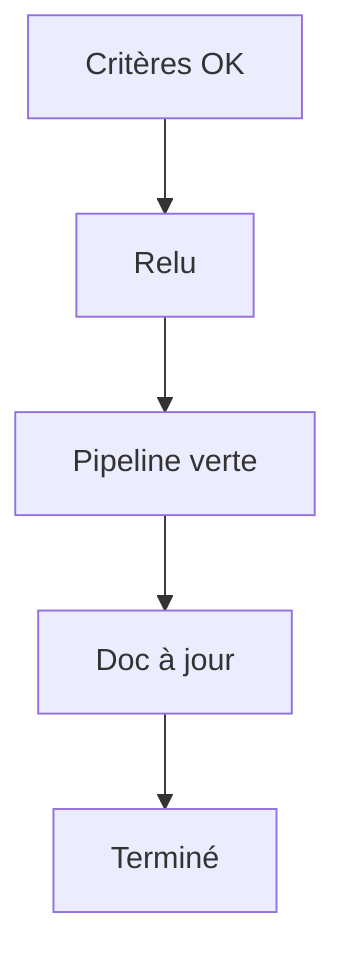

# Définition de terminé

> [!info] En une phrase
> La définition de terminé (*Definition of Done*, DoD) est la **liste commune de conditions qu'un travail doit remplir pour être déclaré fini**, quelle que soit la fonctionnalité : code relu, tests passés, documentation à jour, déployé…

```dataviewjs
await dv.view("10 — Templates/Scripts/learning", { view: "concept" })
```

## 1 · Comprendre
### Définition
**Elle vaut pour tous les tickets**, à la différence des [[Critères d'acceptation|critères d'acceptation]] qui sont propres à chacun.

**Elle est décidée par l'équipe** et affichée (wiki, modèle de ticket ou de merge request).

**Exemple de contenu** :
- les critères d'acceptation de la story sont vérifiés ;
- le code est relu dans une merge request ;
- la pipeline GitLab est verte (lint, tests, construction de l'image) ;
- les tests nécessaires sont écrits ;
- la documentation (README, changelog) est à jour ;
- c'est déployé en environnement de recette.

**« Fini » sans définition**, c'est souvent « ça marche sur ma machine ».

### Pourquoi ça existe
Chaque développeur a sa propre idée de « fini ». Résultat : du travail déclaré terminé qui revient avec des bugs, ou qu'il faut reprendre pour le déployer.

### Le problème résolu
Une qualité minimale garantie, et des estimations honnêtes (fini veut dire vraiment fini).

## 2 · Explorer
### Comment ça fonctionne


### Exemple concret
```markdown
## Définition de terminé - projet export CVAT
- [ ] Les critères d'acceptation du ticket sont vérifiés
- [ ] Merge request relue et approuvée
- [ ] Pipeline GitLab verte (lint, tests, image construite depuis le Nexus)
- [ ] Pas de secret dans le code
- [ ] README mis à jour si l'installation change
- [ ] Déployé et testé sur l'environnement de recette
```

### Cas d'utilisation
- Mettre la liste dans le modèle de merge request GitLab
- Savoir si on peut fermer un ticket

> [!warning] À ne pas confondre
> Un POC n'a pas la même définition de terminé qu'un MVP : pour un POC, « terminé » veut dire « on a la réponse à la question », pas « c'est prêt pour la production ».

## 3 · Pratiquer
- Écris la définition de terminé de ton projet CVAT, puis celle (plus courte) de ton POC

## 4 · Expliquer
> [!quote] Mon résumé, avec mes mots
> _À écrire sans regarder la fiche. Si je bloque, je ne l'ai pas encore compris._

## 5 · Relier
- **Prérequis** : [[User story]]
- **Complémentaires** : [[Critères d'acceptation]] · [[Merge request]] · [[Test automatisé]] · [[Pipeline GitLab CI]]

## 6 · Réviser
> [!question] Me faire interroger
> Je demande à Claude de m'interroger sur cette notion pour vérifier que je l'ai comprise.

### Validation de la maîtrise
La notion est maîtrisée quand j'ai réussi **tous les exercices** qui l'utilisent (statut `reussi` dans l'exercice).

```dataviewjs
await dv.view("10 — Templates/Scripts/learning", { view: "maitrise" })
```
