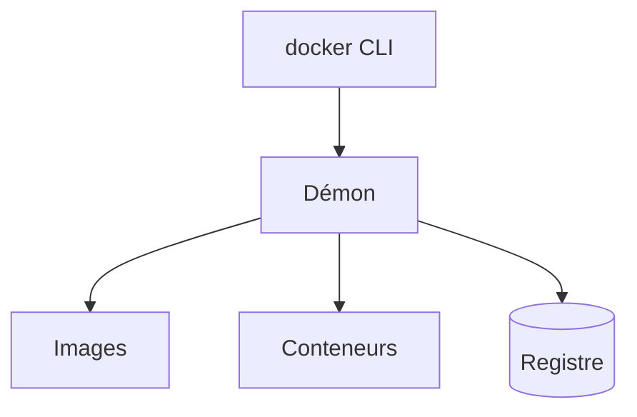

# Démon Docker

> [!info] En une phrase
> Le programme de fond qui fait vraiment le travail de Docker ; la commande docker n'est qu'un client qui lui envoie des ordres.

```dataviewjs
await dv.view("10 — Templates/Scripts/learning", { view: "concept" })
```

## 1 · Comprendre
### Définition
Docker a deux parties :
- le **client** : la commande `docker` que tu tapes ;
- le **démon** (`dockerd`) : un service qui tourne en permanence, construit les images, lance les conteneurs, télécharge depuis les registres.

Le client parle au démon par une connexion (un fichier socket sur la machine, ou le réseau avec `DOCKER_HOST`).

### Pourquoi ça existe
Les conteneurs doivent continuer à tourner quand tu fermes ton terminal : il faut un programme qui reste en fond et les surveille.

### Le problème résolu
Séparer « qui donne l'ordre » de « qui l'exécute » permet de piloter un démon à distance, par exemple depuis un job de CI.

## 2 · Explorer
### Comment ça fonctionne


### Exemple concret
```bash
docker version     # deux blocs : Client et Server (le démon)
docker info        # état du démon : nombre de conteneurs, miroirs configurés…
```
Message typique quand le démon ne tourne pas :
```text
Cannot connect to the Docker daemon at unix:///var/run/docker.sock. Is the docker daemon running?
```
→ sur ton poste : lancer Docker Desktop ; en CI : le service `docker:dind` manque ou `DOCKER_HOST` est faux.

### Cas d'utilisation
- Comprendre Docker-in-Docker : [[Construire une image dans la CI]]
- Comprendre pourquoi un **proxy** ou un **miroir** se configure côté démon (c'est lui qui télécharge)

> [!warning] À ne pas confondre
> Le **client** peut marcher alors que le **démon** est absent : `docker version` affiche la partie Client puis une erreur pour Server. Et c'est le démon qui télécharge les images : un proxy défini seulement dans ton terminal ne lui sert pas.

## 3 · Pratiquer

### Exercice visuel

Sur Excalidraw, **sans regarder la fiche**. Puis je compare avec la fiche, je corrige en rouge ce qui était faux, et j'explique mon dessin à voix haute ou à Claude dans le chat.

> [!example] 🛣️ Suis le trajet
> Dessine ce qui se passe quand tu tapes `docker ps` : le client, la socket, le démon, la réponse.

> [!example] 🔄 Change de contexte
> Redessine-le pour un job de CI qui construit une image : où est le démon cette fois ? Pourquoi est-ce un problème ?

### Mon schéma

> [!tip] Mon dessin Excalidraw
> _Je crée le dessin « Schéma - Démon Docker » et je l'intègre ici avec `![[Schéma - Démon Docker.excalidraw]]`, puis je coche `schema`._

### Appliquer dans le fil rouge
- [[Fil rouge 01 - Lancer l'application dans un conteneur]]

## 4 · Relier
- **Prérequis** : [[Docker]]
- **Complémentaires** : [[Proxy]] · [[Registre Docker]]
- **Utilisé par** : [[Construire une image dans la CI]] · [[Kaniko]]

## 5 · Réviser
> [!question] Me faire interroger
> Je demande à Claude de m'interroger sur cette notion pour vérifier que je l'ai comprise.

### Validation de la maîtrise
Trois cases à cocher dans les propriétés de la fiche :
- `schema` : mon dessin du concept est dans « Mon schéma » ;
- `exercice_visuel` : j'ai fait et corrigé les exercices visuels de la section 3 ;
- `fil_rouge` : je l'ai appliqué dans le fil rouge (coché tout seul quand une étape qui l'utilise est réussie).

Les trois cochées : la notion compte comme **comprise**. **Maîtrisé** : c'est moi qui le mets dans `status`, quand je le sens.

```dataviewjs
await dv.view("10 — Templates/Scripts/learning", { view: "maitrise" })
```
