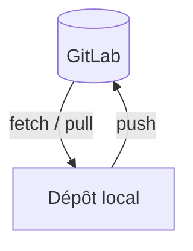

# Dépôt distant (remote)

> [!info] En une phrase
> Une copie du dépôt sur un serveur (GitLab, GitHub) avec laquelle on synchronise son dépôt local : fetch et pull pour recevoir, push pour envoyer.

```dataviewjs
await dv.view("10 — Templates/Scripts/learning", { view: "concept" })
```

## 1 · Comprendre
### Définition
Ton dépôt local connaît un ou plusieurs **remotes** (souvent `origin`). Git garde une image des branches du serveur : `origin/main`. Trois verbes :
- `git fetch` : télécharge les nouveautés **sans toucher** à tes fichiers ;
- `git pull` : `fetch` + intègre dans ta branche (merge ou rebase) ;
- `git push` : envoie tes commits.

### Pourquoi ça existe
Travailler à plusieurs, sauvegarder son travail, déclencher la CI.

### Le problème résolu
S'envoyer des fichiers par mail ou clé USB et écraser le travail des autres.

## 2 · Explorer
### Comment ça fonctionne


### Exemple concret
```bash
git clone git@gitlab.com:equipe/projet.git     # copie complète + remote origin
git remote -v                                  # les remotes
git fetch                                      # récupérer sans fusionner
git log --oneline main..origin/main            # ce que les autres ont poussé
git pull                                       # intégrer
git push -u origin ma-branche                  # première fois : lie la branche au serveur
git push                                       # les fois suivantes
```
`rejected (fetch first)` : le serveur a des commits que tu n'as pas ; fais `git pull` puis repousse.

### Cas d'utilisation
- Pousser sa branche pour ouvrir une [[Merge request]]
- Suivre le projet d'origine avec un second remote ([[Dépôt upstream]])

> [!warning] À ne pas confondre
> `fetch` (sans risque, ne modifie rien) et `pull` (modifie ta branche). Et `git push --force` réécrit l'historique du serveur : à éviter sur une branche partagée (`--force-with-lease` si vraiment nécessaire).

## 3 · Pratiquer

### Exercice visuel

Sur Excalidraw, **sans regarder la fiche**. Puis je compare avec la fiche, je corrige en rouge ce qui était faux, et j'explique mon dessin à voix haute ou à Claude dans le chat.

> [!example] 🛣️ Suis le trajet
> Dessine ton dépôt local et le dépôt sur GitLab. Suis `git push`, `git fetch` et `git pull` avec des flèches de couleurs différentes.

> [!example] 🔍 Trouve l'erreur
> Ce schéma est faux. Corrige-le en rouge et explique l'erreur.
>
> ```mermaid
> flowchart TD
>   G[GitLab] --> F[git fetch]
>   F --> W[Fichiers modifiés]
> ```

### Mon schéma

> [!tip] Mon dessin Excalidraw
> _Je crée le dessin « Schéma - Dépôt distant (remote) » et je l'intègre ici avec `![[Schéma - Dépôt distant (remote).excalidraw]]`, puis je coche `schema`._

### Appliquer dans le fil rouge
- [[Dépenses 07 - Le projet dans Git]]

## 4 · Relier
- **Prérequis** : [[Dépôt Git]] · [[Branche Git]]
- **Complémentaires** : [[Merge request]] · [[Dépôt upstream]] · [[Clé SSH]]
- **Commandes** : [[git clone]] · [[git fetch]] · [[git pull]] · [[git push]] · [[git remote]]

## 5 · Réviser
> [!question] Me faire interroger
> Je demande à Claude de m'interroger sur cette notion pour vérifier que je l'ai comprise.

### Validation de la maîtrise
Trois cases à cocher dans les propriétés de la fiche :
- `schema` : mon dessin du concept est dans « Mon schéma » ;
- `exercice_visuel` : j'ai fait et corrigé les exercices visuels de la section 3 ;
- `fil_rouge` : je l'ai appliqué dans le fil rouge (coché tout seul quand une étape qui l'utilise est réussie).

Les trois cochées : la notion compte comme **comprise**. **Maîtrisé** : c'est moi qui le mets dans `status`, quand je le sens.

```dataviewjs
await dv.view("10 — Templates/Scripts/learning", { view: "maitrise" })
```
