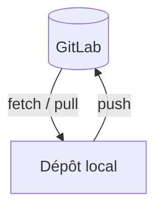

# Dépôt distant (remote)

> [!info] En une phrase
> Une copie du dépôt sur un serveur (GitLab, GitHub) avec laquelle on synchronise son dépôt local : fetch et pull pour recevoir, push pour envoyer.

```dataviewjs
await dv.view("10 — Templates/Scripts/learning", { view: "concept" })
```

## 1 · Comprendre
### Définition
Ton dépôt local connaît un ou plusieurs **remotes** (souvent `origin`). Git garde une image des branches du serveur : `origin/main`. Trois verbes :
- `git fetch` : télécharge les nouveautés **sans toucher** à tes fichiers ;
- `git pull` : `fetch` + intègre dans ta branche (merge ou rebase) ;
- `git push` : envoie tes commits.

### Pourquoi ça existe
Travailler à plusieurs, sauvegarder son travail, déclencher la CI.

### Le problème résolu
S'envoyer des fichiers par mail ou clé USB et écraser le travail des autres.

## 2 · Explorer
### Comment ça fonctionne


### Exemple concret
```bash
git clone git@gitlab.com:equipe/projet.git     # copie complète + remote origin
git remote -v                                  # les remotes
git fetch                                      # récupérer sans fusionner
git log --oneline main..origin/main            # ce que les autres ont poussé
git pull                                       # intégrer
git push -u origin ma-branche                  # première fois : lie la branche au serveur
git push                                       # les fois suivantes
```
`rejected (fetch first)` : le serveur a des commits que tu n'as pas ; fais `git pull` puis repousse.

### Cas d'utilisation
- Pousser sa branche pour ouvrir une [[Merge request]]
- Suivre le projet d'origine avec un second remote ([[Dépôt upstream]])

> [!warning] À ne pas confondre
> `fetch` (sans risque, ne modifie rien) et `pull` (modifie ta branche). Et `git push --force` réécrit l'historique du serveur : à éviter sur une branche partagée (`--force-with-lease` si vraiment nécessaire).

## 3 · Pratiquer
- Clone un dépôt, crée une branche, pousse-la, puis simule un collègue (second clone) qui pousse avant toi et résous le rejet.

## 4 · Expliquer
> [!quote] Mon résumé, avec mes mots
> _À écrire sans regarder la fiche. Si je bloque, je ne l'ai pas encore compris._

## 5 · Relier
- **Prérequis** : [[Dépôt Git]] · [[Branche Git]]
- **Complémentaires** : [[Merge request]] · [[Dépôt upstream]] · [[Clé SSH]]
- **Commandes** : [[git clone]] · [[git fetch]] · [[git pull]] · [[git push]] · [[git remote]]

## 6 · Réviser
> [!question] Me faire interroger
> Je demande à Claude de m'interroger sur cette notion pour vérifier que je l'ai comprise.

### Validation de la maîtrise
La notion est maîtrisée quand j'ai réussi **tous les exercices** qui l'utilisent (statut `reussi` dans l'exercice).

```dataviewjs
await dv.view("10 — Templates/Scripts/learning", { view: "maitrise" })
```
