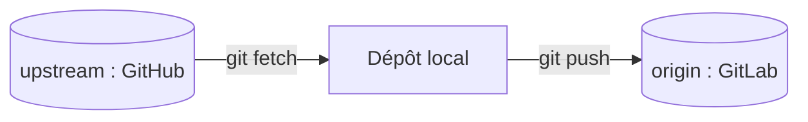

# Dépôt upstream

> [!info] En une phrase
> Le dépôt d'origine d'un projet que l'on a repris : on garde sa copie (origin) et on récupère les nouvelles versions de l'original (upstream).

```dataviewjs
await dv.view("10 — Templates/Scripts/learning", { view: "concept" })
```

## 1 · Comprendre
### Définition
Un dépôt local peut avoir **plusieurs remotes**. Par convention, `origin` est ta copie (là où tu pousses) et `upstream` est le projet d'origine (que tu lis seulement).

### Pourquoi ça existe
Adapter un logiciel open source sur le GitLab de l'entreprise sans perdre ses mises à jour.

### Le problème résolu
Télécharger une archive du code et la modifier : impossible ensuite de savoir ce qu'on a changé, ni d'intégrer la version suivante.

## 2 · Explorer
### Comment ça fonctionne


### Exemple concret
```bash
git clone <url-gitlab-du-projet>
cd projet
git remote add upstream https://github.com/<organisation>/<projet>.git
git remote -v

# plus tard, nouvelle version du projet d'origine
git fetch upstream --tags
git merge v2.x.y
git push origin
```
GitLab propose aussi le **mirroring** (*Settings > Repository > Mirroring repositories*) ; le *pull mirroring* dépend de l'édition de GitLab, et un miroir pur ne reçoit pas tes propres modifications.

### Cas d'utilisation
- Reprendre un projet open source et le personnaliser

> [!warning] À ne pas confondre
> `origin` (ta copie, tu y pousses) et `upstream` (l'original, tu ne fais qu'y lire).

## 3 · Pratiquer

### Exercice visuel

Sur Excalidraw, **sans regarder la fiche**. Puis je compare avec la fiche, je corrige en rouge ce qui était faux, et j'explique mon dessin à voix haute ou à Claude dans le chat.

> [!example] 🧠 Dessine de mémoire
> Dessine trois dépôts : le projet open source d'origine (upstream), ta copie sur GitLab (origin), ton dépôt local. Relie-les avec les bonnes commandes.

> [!example] 🛣️ Suis le trajet
> Suis l'arrivée d'une nouvelle version du projet d'origine jusqu'à ton dépôt local, en gardant tes propres modifications.

### Mon schéma

> [!tip] Mon dessin Excalidraw
> _Je crée le dessin « Schéma - Dépôt upstream » et je l'intègre ici avec `![[Schéma - Dépôt upstream.excalidraw]]`, puis je coche `schema`._

### Appliquer dans le fil rouge
- [[MesDépenses 07 - Travailler en branche]]

## 4 · Relier
- **Au travail** : [Dépôt upstream au travail](obsidian://open?vault=Travail&file=D%C3%A9p%C3%B4t%20upstream%20au%20travail)
- **Prérequis** : [[Dépôt Git]]
- **Notion parente** : [[Dépôt Git]]
- **Complémentaires** : [[Merge]] · [[Conflit de merge]]
- **Commandes** : [[git merge]]

## 5 · Réviser
> [!question] Me faire interroger
> Je demande à Claude de m'interroger sur cette notion pour vérifier que je l'ai comprise.

### Validation (compris, puis maîtrisé)
Trois cases à cocher dans les propriétés de la fiche :
- `schema` : mon dessin du concept est dans « Mon schéma » ;
- `exercice_visuel` : j'ai fait et corrigé les exercices visuels de la section 3 ;
- `fil_rouge` : je l'ai appliqué dans le fil rouge (coché tout seul quand une étape qui l'utilise est réussie).

Les trois cochées : la notion compte comme **comprise**. **Maîtrisé** : c'est moi qui le mets dans `status`, quand je le sens.

```dataviewjs
await dv.view("10 — Templates/Scripts/learning", { view: "maitrise" })
```
