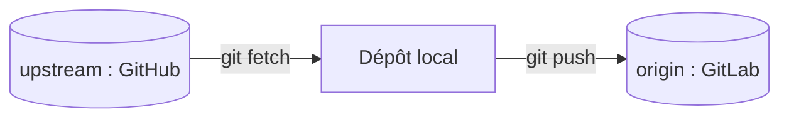

# Dépôt upstream

> [!info] En une phrase
> Le dépôt d'origine d'un projet que l'on a repris : on garde sa copie (origin) et on récupère les nouvelles versions de l'original (upstream).

```dataviewjs
await dv.view("10 — Templates/Scripts/learning", { view: "concept" })
```

## 1 · Comprendre
### Définition
Un dépôt local peut avoir **plusieurs remotes**. Par convention, `origin` est ta copie (là où tu pousses) et `upstream` est le projet d'origine (que tu lis seulement).

### Pourquoi ça existe
Adapter un logiciel open source sur le GitLab de l'entreprise sans perdre ses mises à jour.

### Le problème résolu
Télécharger une archive du code et la modifier : impossible ensuite de savoir ce qu'on a changé, ni d'intégrer la version suivante.

## 2 · Explorer
### Comment ça fonctionne


### Exemple concret
```bash
git clone <url-gitlab-du-projet>
cd projet
git remote add upstream https://github.com/<organisation>/<projet>.git
git remote -v

# plus tard, nouvelle version du projet d'origine
git fetch upstream --tags
git merge v2.x.y
git push origin
```
GitLab propose aussi le **mirroring** (*Settings > Repository > Mirroring repositories*) ; le *pull mirroring* dépend de l'édition de GitLab, et un miroir pur ne reçoit pas tes propres modifications.

### Cas d'utilisation
- Reprendre un projet open source et le personnaliser
- Projet CVAT : partie 1 (reprendre CVAT sur GitLab, construire ses images en CI via le Nexus)

> [!warning] À ne pas confondre
> `origin` (ta copie, tu y pousses) et `upstream` (l'original, tu ne fais qu'y lire).

## 3 · Pratiquer
- Ajoute `upstream` à ton dépôt CVAT et liste les tags de version disponibles avec `git tag`.

## 4 · Expliquer
> [!quote] Mon résumé, avec mes mots
> _À écrire sans regarder la fiche. Si je bloque, je ne l'ai pas encore compris._

## 5 · Relier
- **Prérequis** : [[Dépôt Git]]
- **Notion parente** : [[Dépôt Git]]
- **Complémentaires** : [[Merge]] · [[Conflit de merge]]
- **Commandes** : [[git merge]]

## 6 · Réviser
> [!question] Me faire interroger
> Je demande à Claude de m'interroger sur cette notion pour vérifier que je l'ai comprise.

### Validation de la maîtrise
La notion est maîtrisée quand j'ai réussi **tous les exercices** qui l'utilisent (statut `reussi` dans l'exercice).

```dataviewjs
await dv.view("10 — Templates/Scripts/learning", { view: "maitrise" })
```
