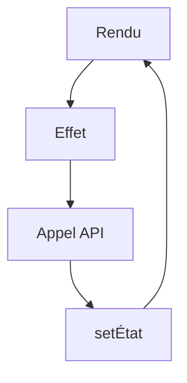

# Effet React (useEffect)

> [!info] En une phrase
> useEffect lance du code après l'affichage pour synchroniser le composant avec l'extérieur (charger des données, s'abonner, minuterie), et peut le nettoyer ensuite.

```dataviewjs
await dv.view("10 — Templates/Scripts/learning", { view: "concept" })
```

## 1 · Comprendre
### Définition
```tsx
useEffect(() => {
  // code lancé après le rendu
  return () => { /* nettoyage : avant le prochain effet et à la disparition */ };
}, [dependances]);
```
| Dépendances | Quand l'effet s'exécute |
| --- | --- |
| `[]` | une fois, à l'apparition du composant |
| `[id]` | à l'apparition, puis chaque fois que `id` change |
| absent | après **chaque** rendu (rarement voulu) |
En développement, le mode strict de React lance les effets **deux fois** pour vérifier que le nettoyage est correct.

### Pourquoi ça existe
Le rendu doit rester un simple calcul ; les actions vers l'extérieur (réseau, minuteries, abonnements) ont besoin d'un endroit à part.

### Le problème résolu
Charger des données quand un composant apparaît ou quand un paramètre change, sans fuite (abonnement jamais arrêté, réponse arrivée trop tard).

## 2 · Explorer
### Comment ça fonctionne


### Exemple concret
```tsx
function Tache({ id }: { id: number }) {
  const [tache, setTache] = useState<Tache | null>(null);
  const [erreur, setErreur] = useState("");
  useEffect(() => {
    const ctrl = new AbortController();
    fetch(`/api/taches/${id}`, { signal: ctrl.signal })
      .then((r) => { if (!r.ok) throw new Error(`Erreur ${r.status}`); return r.json(); })
      .then(setTache)
      .catch((e) => { if (e.name !== "AbortError") setErreur(e.message); });
    return () => ctrl.abort();        // annule si id change ou si le composant disparaît
  }, [id]);
  if (erreur) return <p>{erreur}</p>;
  if (!tache) return <p>Chargement…</p>;
  return <h2>{tache.nom}</h2>;
}
```
Dans les vrais projets, on utilise souvent une bibliothèque de données (**TanStack Query**) qui gère cache, chargement et erreurs.

### Cas d'utilisation
- Charger des données
- Minuteries et intervalles
- Écouter un événement de la fenêtre

> [!warning] À ne pas confondre
> Mettre dans un effet ce qui n'est **pas** une synchronisation avec l'extérieur (calculer une valeur dérivée, réagir à un clic) : calcule au rendu, réagis dans le gestionnaire d'événement. Et oublier une dépendance donne des valeurs périmées.

## 3 · Pratiquer

### Exercice visuel

Sur Excalidraw, **sans regarder la fiche**. Puis je compare avec la fiche, je corrige en rouge ce qui était faux, et j'explique mon dessin à voix haute ou à Claude dans le chat.

> [!example] 🛣️ Suis le trajet
> Dessine la vie d'un composant : premier affichage, l'effet qui charge les dépenses, la mise à jour, le nettoyage.

> [!example] 🔍 Trouve l'erreur
> Ce schéma est faux. Corrige-le en rouge et explique l'erreur.
>
> ```mermaid
> flowchart TD
>   E[Effet sans tableau] --> S[setState]
>   S --> A[Affichage]
>   A --> F[Fin]
> ```

### Mon schéma

> [!tip] Mon dessin Excalidraw
> _Je crée le dessin « Schéma - Effet React (useEffect) » et je l'intègre ici avec `![[Schéma - Effet React (useEffect).excalidraw]]`, puis je coche `schema`._

### Appliquer dans le fil rouge
- Pas encore d'étape du fil rouge pour cette notion : elle sera pratiquée dans le fil rouge de son niveau (voir [[Niveaux]]).

## 4 · Relier
- **Prérequis** : [[État et réactivité]] · [[async et await]] · [[Appeler une API HTTP]]
- **Complémentaires** : [[Hook React]]

## 5 · Réviser
> [!question] Me faire interroger
> Je demande à Claude de m'interroger sur cette notion pour vérifier que je l'ai comprise.

### Validation (compris, puis maîtrisé)
Trois cases à cocher dans les propriétés de la fiche :
- `schema` : mon dessin du concept est dans « Mon schéma » ;
- `exercice_visuel` : j'ai fait et corrigé les exercices visuels de la section 3 ;
- `fil_rouge` : je l'ai appliqué dans le fil rouge (coché tout seul quand une étape qui l'utilise est réussie).

Les trois cochées : la notion compte comme **comprise**. **Maîtrisé** : c'est moi qui le mets dans `status`, quand je le sens.

```dataviewjs
await dv.view("10 — Templates/Scripts/learning", { view: "maitrise" })
```
