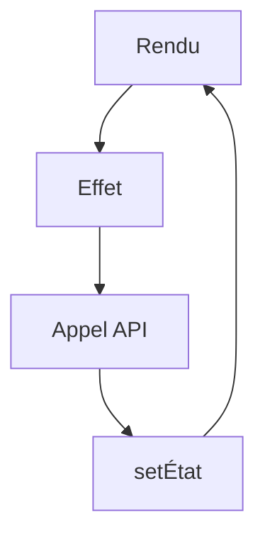

# Effet React (useEffect)

> [!info] En une phrase
> useEffect lance du code après l'affichage pour synchroniser le composant avec l'extérieur (charger des données, s'abonner, minuterie), et peut le nettoyer ensuite.

```dataviewjs
await dv.view("10 — Templates/Scripts/learning", { view: "concept" })
```

## 1 · Comprendre
### Définition
```tsx
useEffect(() => {
  // code lancé après le rendu
  return () => { /* nettoyage : avant le prochain effet et à la disparition */ };
}, [dependances]);
```
| Dépendances | Quand l'effet s'exécute |
| --- | --- |
| `[]` | une fois, à l'apparition du composant |
| `[id]` | à l'apparition, puis chaque fois que `id` change |
| absent | après **chaque** rendu (rarement voulu) |
En développement, le mode strict de React lance les effets **deux fois** pour vérifier que le nettoyage est correct.

### Pourquoi ça existe
Le rendu doit rester un simple calcul ; les actions vers l'extérieur (réseau, minuteries, abonnements) ont besoin d'un endroit à part.

### Le problème résolu
Charger des données quand un composant apparaît ou quand un paramètre change, sans fuite (abonnement jamais arrêté, réponse arrivée trop tard).

## 2 · Explorer
### Comment ça fonctionne


### Exemple concret
```tsx
function Tache({ id }: { id: number }) {
  const [tache, setTache] = useState<Tache | null>(null);
  const [erreur, setErreur] = useState("");
  useEffect(() => {
    const ctrl = new AbortController();
    fetch(`/api/taches/${id}`, { signal: ctrl.signal })
      .then((r) => { if (!r.ok) throw new Error(`Erreur ${r.status}`); return r.json(); })
      .then(setTache)
      .catch((e) => { if (e.name !== "AbortError") setErreur(e.message); });
    return () => ctrl.abort();        // annule si id change ou si le composant disparaît
  }, [id]);
  if (erreur) return <p>{erreur}</p>;
  if (!tache) return <p>Chargement…</p>;
  return <h2>{tache.nom}</h2>;
}
```
Dans les vrais projets, on utilise souvent une bibliothèque de données (**TanStack Query**) qui gère cache, chargement et erreurs.

### Cas d'utilisation
- Charger des données
- Minuteries et intervalles
- Écouter un événement de la fenêtre

> [!warning] À ne pas confondre
> Mettre dans un effet ce qui n'est **pas** une synchronisation avec l'extérieur (calculer une valeur dérivée, réagir à un clic) : calcule au rendu, réagis dans le gestionnaire d'événement. Et oublier une dépendance donne des valeurs périmées.

## 3 · Pratiquer
- Charge une liste depuis jsonplaceholder dans un effet, avec chargement, erreur et annulation quand un filtre change

## 4 · Expliquer
> [!quote] Mon résumé, avec mes mots
> _À écrire sans regarder la fiche. Si je bloque, je ne l'ai pas encore compris._

## 5 · Relier
- **Prérequis** : [[État React (useState)]] · [[async et await]] · [[Appeler une API avec fetch]]
- **Complémentaires** : [[Hook React]]

## 6 · Réviser
> [!question] Me faire interroger
> Je demande à Claude de m'interroger sur cette notion pour vérifier que je l'ai comprise.

### Validation de la maîtrise
La notion est maîtrisée quand j'ai réussi **tous les exercices** qui l'utilisent (statut `reussi` dans l'exercice).

```dataviewjs
await dv.view("10 — Templates/Scripts/learning", { view: "maitrise" })
```
