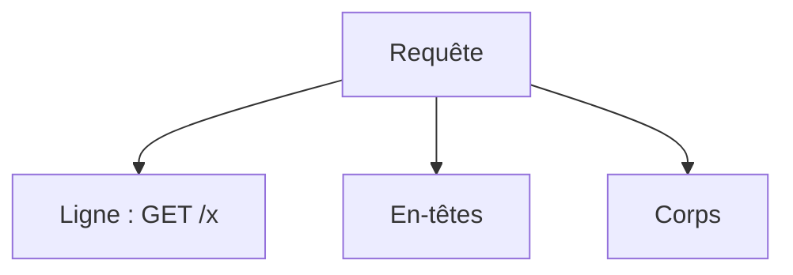

# En-tête HTTP

> [!info] En une phrase
> Les en-têtes sont des lignes « Nom: valeur » qui accompagnent une requête ou une réponse : type du contenu, authentification, cache, cookies, origine.

```dataviewjs
await dv.view("10 — Templates/Scripts/learning", { view: "concept" })
```

## 1 · Comprendre
### Définition
| En-tête | Sens | Sens de circulation |
| --- | --- | --- |
| `Content-Type: application/json` | format du corps | les deux |
| `Accept: application/json` | format souhaité en réponse | requête |
| `Authorization: Bearer eyJ…` | preuve d'identité | requête |
| `Cookie` / `Set-Cookie` | cookies envoyés / à enregistrer | requête / réponse |
| `User-Agent` | qui fait la requête | requête |
| `Origin` | site d'où vient la requête | requête (navigateur) |
| `Access-Control-Allow-Origin` | origines autorisées ([[CORS]]) | réponse |
| `Cache-Control` | règles de cache | réponse |
| `Location` | où aller (redirection, ressource créée) | réponse |
| `X-Forwarded-For` / `X-Forwarded-Proto` | client d'origine, ajouté par un proxy | requête |
Les noms ne tiennent pas compte de la casse.

### Pourquoi ça existe
Le corps transporte les données ; il faut un endroit pour les informations *sur* l'échange.

### Le problème résolu
Négocier le format, s'authentifier, gérer le cache et la sécurité sans toucher aux données.

## 2 · Explorer
### Comment ça fonctionne


### Exemple concret
```bash
curl -v https://example.com 2>&1 | grep -E "^[<>]"
# > GET / HTTP/2
# > user-agent: curl/8.5.0
# < content-type: text/html; charset=UTF-8
# < cache-control: max-age=604800
curl -H "Authorization: Token abc" -H "Accept: application/json" https://cvat.exemple.com/api/users/self
```

### Cas d'utilisation
- Envoyer un jeton à une API
- Comprendre une erreur CORS
- Configurer un reverse proxy (`X-Forwarded-*`)

> [!warning] À ne pas confondre
> Oublier `Content-Type: application/json` en envoyant du JSON : le serveur ne lit pas le corps (`req.body` vide dans Express).

## 3 · Pratiquer
- Avec `curl -v`, lis tous les en-têtes d'une requête vers GitHub et explique-en cinq

## 4 · Expliquer
> [!quote] Mon résumé, avec mes mots
> _À écrire sans regarder la fiche. Si je bloque, je ne l'ai pas encore compris._

## 5 · Relier
- **Prérequis** : [[HTTP]]
- **Complémentaires** : [[CORS]] · [[Authentification]]

## 6 · Réviser
> [!question] Me faire interroger
> Je demande à Claude de m'interroger sur cette notion pour vérifier que je l'ai comprise.

### Validation de la maîtrise
La notion est maîtrisée quand j'ai réussi **tous les exercices** qui l'utilisent (statut `reussi` dans l'exercice).

```dataviewjs
await dv.view("10 — Templates/Scripts/learning", { view: "maitrise" })
```
