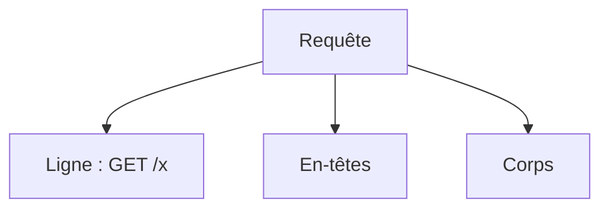

# En-tête HTTP

> [!info] En une phrase
> Les en-têtes sont des lignes « Nom: valeur » qui accompagnent une requête ou une réponse : type du contenu, authentification, cache, cookies, origine.

```dataviewjs
await dv.view("10 — Templates/Scripts/learning", { view: "concept" })
```

## 1 · Comprendre
### Définition
| En-tête | Sens | Sens de circulation |
| --- | --- | --- |
| `Content-Type: application/json` | format du corps | les deux |
| `Accept: application/json` | format souhaité en réponse | requête |
| `Authorization: Bearer eyJ…` | preuve d'identité | requête |
| `Cookie` / `Set-Cookie` | cookies envoyés / à enregistrer | requête / réponse |
| `User-Agent` | qui fait la requête | requête |
| `Origin` | site d'où vient la requête | requête (navigateur) |
| `Access-Control-Allow-Origin` | origines autorisées ([[CORS]]) | réponse |
| `Cache-Control` | règles de cache | réponse |
| `Location` | où aller (redirection, ressource créée) | réponse |
| `X-Forwarded-For` / `X-Forwarded-Proto` | client d'origine, ajouté par un proxy | requête |
Les noms ne tiennent pas compte de la casse.

### Pourquoi ça existe
Le corps transporte les données ; il faut un endroit pour les informations *sur* l'échange.

### Le problème résolu
Négocier le format, s'authentifier, gérer le cache et la sécurité sans toucher aux données.

## 2 · Explorer
### Comment ça fonctionne


### Exemple concret
```bash
curl -v https://example.com 2>&1 | grep -E "^[<>]"
# > GET / HTTP/2
# > user-agent: curl/8.5.0
# < content-type: text/html; charset=UTF-8
# < cache-control: max-age=604800
curl -H "Authorization: Token abc" -H "Accept: application/json" https://cvat.exemple.com/api/users/self
```

### Cas d'utilisation
- Envoyer un jeton à une API
- Comprendre une erreur CORS
- Configurer un reverse proxy (`X-Forwarded-*`)

> [!warning] À ne pas confondre
> Oublier `Content-Type: application/json` en envoyant du JSON : le serveur ne lit pas le corps (`req.body` vide dans Express).

## 3 · Pratiquer

### Exercice visuel

Sur Excalidraw, **sans regarder la fiche**. Puis je compare avec la fiche, je corrige en rouge ce qui était faux, et j'explique mon dessin à voix haute ou à Claude dans le chat.

> [!example] 🧠 Dessine de mémoire
> Dessine une requête POST et sa réponse avec leurs en-têtes (Content-Type, Origin, Authorization, Access-Control-Allow-Origin). Colorie ceux qui viennent du navigateur tout seul.

> [!example] 🛣️ Suis le trajet
> Suis l'en-tête `Content-Type: application/json` du front Vue jusqu'à FastAPI : qui l'écrit, qui le lit, à quoi il sert.

### Mon schéma

> [!tip] Mon dessin Excalidraw
> _Je crée le dessin « Schéma - En-tête HTTP » et je l'intègre ici avec `![[Schéma - En-tête HTTP.excalidraw]]`, puis je coche `schema`._

### Appliquer dans le fil rouge
- [[MesDépenses 04 - Régler CORS]]

## 4 · Relier
- **Prérequis** : [[HTTP]]
- **Complémentaires** : [[CORS]] · [[Authentification]]

## 5 · Réviser
> [!question] Me faire interroger
> Je demande à Claude de m'interroger sur cette notion pour vérifier que je l'ai comprise.

### Validation (compris, puis maîtrisé)
Trois cases à cocher dans les propriétés de la fiche :
- `schema` : mon dessin du concept est dans « Mon schéma » ;
- `exercice_visuel` : j'ai fait et corrigé les exercices visuels de la section 3 ;
- `fil_rouge` : je l'ai appliqué dans le fil rouge (coché tout seul quand une étape qui l'utilise est réussie).

Les trois cochées : la notion compte comme **comprise**. **Maîtrisé** : c'est moi qui le mets dans `status`, quand je le sens.

```dataviewjs
await dv.view("10 — Templates/Scripts/learning", { view: "maitrise" })
```
