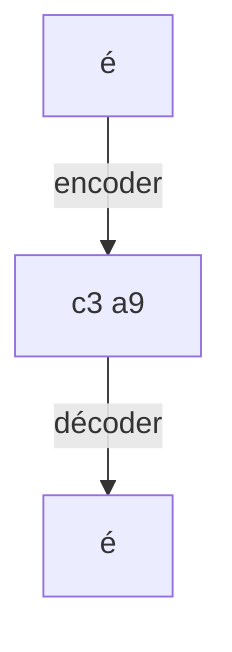

# Encodage des caractères

> [!info] En une phrase
> La table qui transforme des caractères en octets ; UTF-8 est la norme et sait écrire toutes les langues.

```dataviewjs
await dv.view("10 — Templates/Scripts/learning", { view: "concept" })
```

## 1 · Comprendre
### Définition
Un fichier texte n'est qu'une suite d'octets ; l'**encodage** dit quel caractère correspond à quels octets. **ASCII** ne couvre que l'anglais (128 caractères). **UTF-8** couvre tout (accents, arabe, emoji) : 1 octet pour les lettres simples, 2 à 4 pour les autres. Ailleurs on croise encore **Latin-1** / **Windows-1252**.

### Pourquoi ça existe
Les machines ne stockent que des nombres : il faut une convention commune pour le texte.

### Le problème résolu
Les textes illisibles quand l'écrivain et le lecteur n'utilisent pas la même table.

## 2 · Explorer
### Comment ça fonctionne

Lire de l'UTF-8 en croyant que c'est du Latin-1 donne le fameux `é` au lieu de `é`.

### Exemple concret
```python
"é".encode("utf-8")              # b'\xc3\xa9'
b"\xc3\xa9".decode("latin-1")    # 'é'  ← mauvais décodage
open("f.txt", encoding="utf-8")  # toujours préciser l'encodage
```
```bash
file -i notes.txt                # charset=utf-8 ?
iconv -f latin1 -t utf-8 ancien.txt > nouveau.txt
```

### Cas d'utilisation
- Accents cassés dans un CSV ouvert dans Excel, dans un log, dans une base
- `UnicodeDecodeError` en Python

> [!warning] À ne pas confondre
> **Encodage** (UTF-8, Latin-1 : comment stocker les caractères) et **fins de ligne** (CRLF / LF : comment terminer une ligne, voir [[Fichiers entre Windows et Linux]]). Et un fichier binaire (image) n'a pas d'encodage de texte.

## 3 · Pratiquer
- Enregistre un texte accentué en UTF-8, relis-le en Latin-1 en Python, puis répare-le.

## 4 · Expliquer
> [!quote] Mon résumé, avec mes mots
> _À écrire sans regarder la fiche. Si je bloque, je ne l'ai pas encore compris._

## 5 · Relier
- **Prérequis** : [[Binaire et octet]]
- **Complémentaires** : [[Lire et écrire un fichier]] · [[Fichiers entre Windows et Linux]]

## 6 · Réviser
> [!question] Me faire interroger
> Je demande à Claude de m'interroger sur cette notion pour vérifier que je l'ai comprise.

### Validation de la maîtrise
- [ ] Je l'explique sans notes, en 3 phrases, à quelqu'un qui ne connaît pas
- [ ] J'ai réussi un exercice qui l'utilise
- [ ] Je l'ai utilisé dans un projet
- [ ] Je sais dire quand ne pas l'utiliser (ou ce qu'il ne faut pas confondre)
