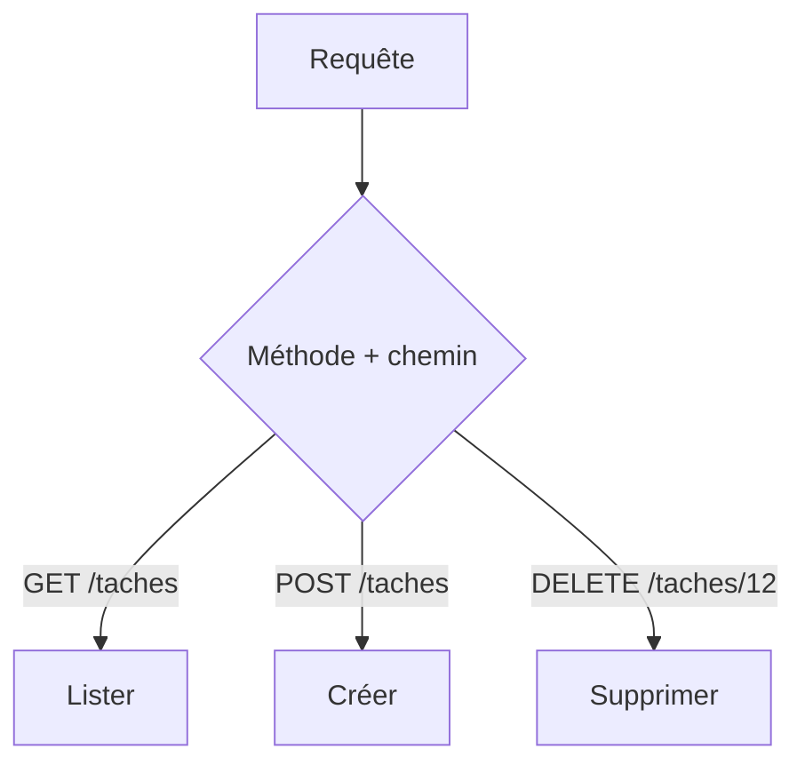

# Endpoint

> [!info] En une phrase
> Un endpoint est une adresse précise d'une API combinée à une méthode HTTP (GET /api/tasks/12) : c'est une opération du contrat.

## 1 · Comprendre
### Définition
**Endpoint** = **méthode** + **chemin**. `GET /notes` (lister) et `POST /notes` (créer) sont deux endpoints différents sur la même route.
Ce qu'un endpoint peut recevoir :

| Où | Exemple | En Express | En Python (requests) |
| --- | --- | --- | --- |
| Paramètre de chemin | `/taches/12` | `req.params.id` | dans l'URL |
| Paramètre de requête | `/taches?page=2&statut=fini` | `req.query.page` | `params={...}` |
| En-têtes | `Authorization: Bearer …` | `req.headers` | `headers={...}` |
| Corps (JSON) | `{ "nom": "x" }` | `req.body` | `json={...}` |
Chaque endpoint documente aussi ses **réponses** possibles (codes de statut et forme du JSON).

### Pourquoi ça existe
Une API offre beaucoup d'opérations : il faut un nom précis pour chacune.

### Le problème résolu
Savoir exactement quoi appeler, avec quoi, et à quoi s'attendre.

## 2 · Explorer
### Comment ça fonctionne


### Exemple concret
```bash
curl "https://jsonplaceholder.typicode.com/todos?userId=1&_limit=2"
curl -X POST https://jsonplaceholder.typicode.com/todos \
     -H "Content-Type: application/json" \
     -d '{"title":"exporter","completed":false}'
```
Dans une API de projets : `GET /api/tasks/{id}/comments` renvoie les commentaires d'une tâche.

> [!abstract]- Comment ça s'écrit (référence à chercher, pas à apprendre par cœur)
> L'idée est la même partout ; seule l'écriture change. Les exemples plus haut sont en Python ou en JavaScript.
>
> **C# (.NET)**
> ```csharp
> app.MapGet("/depenses", () => depenses);
> app.MapGet("/depenses/{id:int}", (int id) =>
> {
>     var d = depenses.FirstOrDefault(x => x.Id == id);
>     return d is null ? Results.NotFound() : Results.Ok(d);
> });
> app.MapPost("/depenses", (Depense d) => Results.Created($"/depenses/{d.Id}", d));
> ```
> ASP.NET Core, style « API minimale ». `{id:int}` lit un paramètre dans l'adresse ; un objet en paramètre est lu dans le corps JSON. `Results` choisit le code de statut. L'autre style, avec des classes `Controller`, fait la même chose.

### Cas d'utilisation
- Lire la documentation d'une API
- Écrire une route Express

> [!warning] À ne pas confondre
> Le **chemin** (`/taches/12`) et le **paramètre de requête** (`?page=2`) : le chemin identifie une ressource, la requête filtre ou pagine.

## 3 · Relier
- **Au travail** : [Endpoint au travail](obsidian://open?vault=Travail&file=Endpoint%20au%20travail)
- **Prérequis** : [[API]] · [[Méthode HTTP]]
- **Complémentaires** : [[API REST]] · [[Express]]
