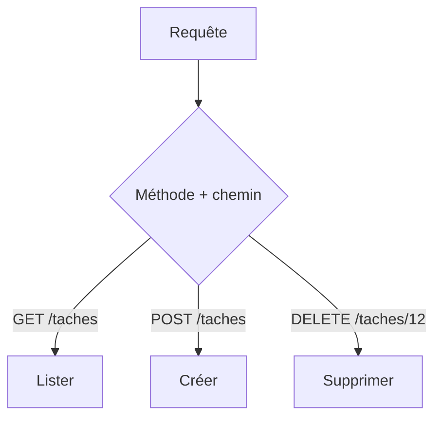

# Endpoint

> [!info] En une phrase
> Un endpoint est une adresse précise d'une API combinée à une méthode HTTP (GET /api/tasks/12) : c'est une opération du contrat.

```dataviewjs
await dv.view("10 — Templates/Scripts/learning", { view: "concept" })
```

## 1 · Comprendre
### Définition
**Endpoint** = **méthode** + **chemin**. `GET /notes` (lister) et `POST /notes` (créer) sont deux endpoints différents sur la même route.
Ce qu'un endpoint peut recevoir :
| Où | Exemple | En Express | En Python (requests) |
| --- | --- | --- | --- |
| Paramètre de chemin | `/taches/12` | `req.params.id` | dans l'URL |
| Paramètre de requête | `/taches?page=2&statut=fini` | `req.query.page` | `params={...}` |
| En-têtes | `Authorization: Bearer …` | `req.headers` | `headers={...}` |
| Corps (JSON) | `{ "nom": "x" }` | `req.body` | `json={...}` |
Chaque endpoint documente aussi ses **réponses** possibles (codes de statut et forme du JSON).

### Pourquoi ça existe
Une API offre beaucoup d'opérations : il faut un nom précis pour chacune.

### Le problème résolu
Savoir exactement quoi appeler, avec quoi, et à quoi s'attendre.

## 2 · Explorer
### Comment ça fonctionne


### Exemple concret
```bash
curl "https://jsonplaceholder.typicode.com/todos?userId=1&_limit=2"
curl -X POST https://jsonplaceholder.typicode.com/todos \
     -H "Content-Type: application/json" \
     -d '{"title":"exporter","completed":false}'
```
Dans CVAT : `GET /api/tasks/{id}/annotations` renvoie les annotations d'une tâche.

### Cas d'utilisation
- Lire la documentation d'une API
- Écrire une route Express
- Configurer le bouton qui appelle ta fonction Nuclio

> [!warning] À ne pas confondre
> Le **chemin** (`/taches/12`) et le **paramètre de requête** (`?page=2`) : le chemin identifie une ressource, la requête filtre ou pagine.

## 3 · Pratiquer

### Exercice visuel

Sur Excalidraw, **sans regarder la fiche**. Puis je compare avec la fiche, je corrige en rouge ce qui était faux, et j'explique mon dessin avec mes mots (section 4).

> [!example] 🧠 Dessine de mémoire
> Dessine le contrat de l'API MesDépenses comme une liste d'endpoints (méthode + adresse) et entoure ceux qui ont un paramètre de chemin.

> [!example] 🔄 Change de contexte
> Redessine trois endpoints de l'API CVAT que tu utilises (labels, annotations d'un job). Quel paramètre précise la ressource ?

### Mon schéma

> [!tip] Mon dessin Excalidraw
> _Je crée le dessin « Schéma - Endpoint » et je l'intègre ici avec `![[Schéma - Endpoint.excalidraw]]`._

### Appliquer dans le fil rouge
- Pas encore d'étape du fil rouge pour cette notion : je l'applique dans mon travail (CVAT, Nuclio) ou je demande une étape à Claude.

## 4 · Expliquer
> [!quote] Mon résumé, avec mes mots
> _J'explique mon schéma avec mes mots, sans regarder la fiche. Si je bloque, je ne l'ai pas encore compris._

## 5 · Relier
- **Prérequis** : [[API]] · [[Méthode HTTP]]
- **Complémentaires** : [[API REST]] · [[Express]]

## 6 · Réviser
> [!question] Me faire interroger
> Je demande à Claude de m'interroger sur cette notion pour vérifier que je l'ai comprise.

### Validation de la maîtrise
La notion est maîtrisée quand je sais :
1. **l'expliquer** de façon fluide, à partir de mon schéma (section 4) ;
2. **l'adapter** à un autre contexte (consigne « Change de contexte », ou Claude m'interroge sur un autre cas) ;
3. **l'appliquer** pour de vrai dans le fil rouge (section 3).

Réussir un exercice ne suffit pas. C'est moi qui passe le statut en `maitrise`.

```dataviewjs
await dv.view("10 — Templates/Scripts/learning", { view: "maitrise" })
```
