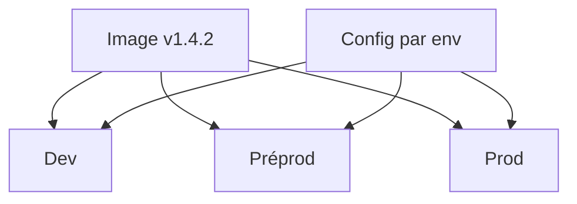

# Environnement de déploiement

> [!info] En une phrase
> Un environnement est une copie de l'application qui tourne pour un usage précis : développement, test, préproduction (staging), production ; même image, configuration différente.

```dataviewjs
await dv.view("10 — Templates/Scripts/learning", { view: "concept" })
```

## 1 · Comprendre
### Définition
| Environnement | Pour | Données |
| --- | --- | --- |
| **local** (dev) | développer | fausses |
| **test / CI** | tests automatiques | jetables |
| **préproduction** (*staging*) | valider avant la mise en ligne, démontrer | proches de la réalité |
| **production** | les vrais utilisateurs | réelles |
Principes :
- **La même image** passe d'un environnement à l'autre ; seule la **configuration** change ([[Variable d'environnement|variables d'environnement]], [[Secret et fichier .env|secrets]]).
- On garde les environnements aussi **semblables** que possible.
- On sait **revenir en arrière** (*rollback*) : redéployer l'image précédente (d'où des tags d'image par version ou par commit, jamais seulement `latest`).
Stratégies : redémarrage simple, **rolling** (instance par instance), **blue-green** (deux versions, on bascule), **canary** (un petit pourcentage d'abord).

### Pourquoi ça existe
Tester directement en production met les utilisateurs en danger ; une configuration différente partout crée des bugs « qui n'arrivent que chez eux ».

### Le problème résolu
Valider dans des conditions réalistes et pouvoir annuler une mauvaise version en minutes.

## 2 · Explorer
### Comment ça fonctionne


### Exemple concret
```bash
# même image, configuration différente
docker run -e DATABASE_URL=$URL_PREPROD -e LOG_LEVEL=debug registre/app:1.4.2
docker run -e DATABASE_URL=$URL_PROD    -e LOG_LEVEL=info  registre/app:1.4.2
# retour arrière
docker compose pull && TAG=1.4.1 docker compose up -d
```
Dans GitLab, le mot-clé `environment:` affiche les déploiements de chaque environnement et permet de redéployer une ancienne version.

### Cas d'utilisation
- Préproduction de CVAT avant une mise à jour
- Tester ta fonction Nuclio sans toucher aux vraies annotations
- Annuler un déploiement raté

> [!warning] À ne pas confondre
> Reconstruire l'image pour chaque environnement : ce qui part en production n'est alors plus ce qui a été testé. On construit **une fois**, on déploie partout.

## 3 · Pratiquer
- Pour ton projet, liste les environnements nécessaires et, pour chacun, les variables qui changent

## 4 · Expliquer
> [!quote] Mon résumé, avec mes mots
> _À écrire sans regarder la fiche. Si je bloque, je ne l'ai pas encore compris._

## 5 · Relier
- **Prérequis** : [[Image Docker]] · [[Variable d'environnement]]
- **Complémentaires** : [[Tag Git]] · [[Variables CI-CD GitLab]]

## 6 · Réviser
> [!question] Me faire interroger
> Je demande à Claude de m'interroger sur cette notion pour vérifier que je l'ai comprise.

### Validation de la maîtrise
La notion est maîtrisée quand j'ai réussi **tous les exercices** qui l'utilisent (statut `reussi` dans l'exercice).

```dataviewjs
await dv.view("10 — Templates/Scripts/learning", { view: "maitrise" })
```
