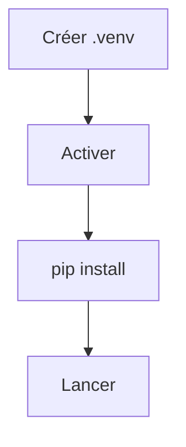

# Environnement virtuel Python

> [!info] En une phrase
> Un dossier (souvent .venv) qui contient un Python et ses paquets à part, propres à un projet, pour ne pas mélanger les dépendances des projets.

## 1 · Comprendre
### Définition
Un **environnement virtuel** (*venv*) est une copie légère de Python avec son propre dossier de paquets. Quand il est **activé**, `python` et `pip` du terminal sont ceux du venv.

### Pourquoi ça existe
Deux projets peuvent demander deux versions différentes du même paquet. Chaque projet a son venv, donc ses versions.

### Le problème résolu
Installer tous les paquets « dans le Python de la machine » finit par casser des projets (et parfois des outils du système) quand une version change.

## 2 · Explorer
### Comment ça fonctionne


### Exemple concret
```bash
python -m venv .venv                 # créer (une fois par projet)

# activer (à chaque nouveau terminal)
source .venv/bin/activate            # Linux, macOS, Git Bash
.venv\Scripts\Activate.ps1           # PowerShell

pip install -r requirements.txt      # installe dans le venv
python zipper.py photos
deactivate                           # désactiver
```
Le nom `(.venv)` apparaît au début de l'invite quand il est actif.

### Cas d'utilisation
- Chaque projet Python sur ton poste
- Dans Docker on s'en passe souvent : le conteneur **est** déjà un environnement isolé

> [!warning] À ne pas confondre
> Le dossier `.venv` **ne se commite pas** (ajoute-le au `.gitignore`) : on commite `requirements.txt`, et chacun recrée son venv. Si PowerShell refuse d'activer, c'est sa politique d'exécution : `Set-ExecutionPolicy -Scope CurrentUser RemoteSigned`.

## 3 · Relier
- **Prérequis** : [[Python]] · [[Terminal]]
- **Complémentaires** : [[Gestionnaire de paquets]]
- **Utilisé par** : [[Test automatisé]] · [[Python dans Docker]]
