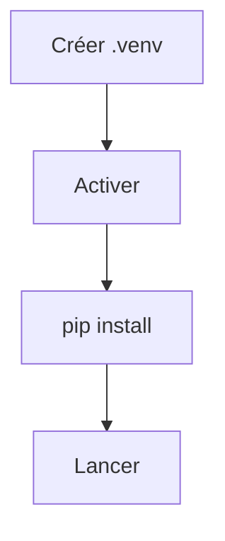

# Environnement virtuel Python

> [!info] En une phrase
> Un dossier (souvent .venv) qui contient un Python et ses paquets à part, propres à un projet, pour ne pas mélanger les dépendances des projets.

```dataviewjs
await dv.view("10 — Templates/Scripts/learning", { view: "concept" })
```

## 1 · Comprendre
### Définition
Un **environnement virtuel** (*venv*) est une copie légère de Python avec son propre dossier de paquets. Quand il est **activé**, `python` et `pip` du terminal sont ceux du venv.

### Pourquoi ça existe
Deux projets peuvent demander deux versions différentes du même paquet. Chaque projet a son venv, donc ses versions.

### Le problème résolu
Installer tous les paquets « dans le Python de la machine » finit par casser des projets (et parfois des outils du système) quand une version change.

## 2 · Explorer
### Comment ça fonctionne


### Exemple concret
```bash
python -m venv .venv                 # créer (une fois par projet)

# activer (à chaque nouveau terminal)
source .venv/bin/activate            # Linux, macOS, Git Bash
.venv\Scripts\Activate.ps1           # PowerShell

pip install -r requirements.txt      # installe dans le venv
python zipper.py photos
deactivate                           # désactiver
```
Le nom `(.venv)` apparaît au début de l'invite quand il est actif.

### Cas d'utilisation
- Chaque projet Python sur ton poste
- Dans Docker on s'en passe souvent : le conteneur **est** déjà un environnement isolé

> [!warning] À ne pas confondre
> Le dossier `.venv` **ne se commite pas** (ajoute-le au `.gitignore`) : on commite `requirements.txt`, et chacun recrée son venv. Si PowerShell refuse d'activer, c'est sa politique d'exécution : `Set-ExecutionPolicy -Scope CurrentUser RemoteSigned`.

## 3 · Pratiquer

### Exercice visuel

Sur Excalidraw, **sans regarder la fiche**. Puis je compare avec la fiche, je corrige en rouge ce qui était faux, et j'explique mon dessin à voix haute ou à Claude dans le chat.

> [!example] ⚖️ Avant / après
> Avant / après : deux projets qui partagent le Python du système, puis chacun avec son `.venv`. Dessine où va chaque paquet installé.

> [!example] 🛣️ Suis le trajet
> Dessine ce qui se passe quand tu fais `source .venv/bin/activate` puis `python` : quel dossier le PATH regarde en premier ?

### Mon schéma

> [!tip] Mon dessin Excalidraw
> _Je crée le dessin « Schéma - Environnement virtuel Python » et je l'intègre ici avec `![[Schéma - Environnement virtuel Python.excalidraw]]`, puis je coche `schema`._

### Appliquer dans le fil rouge
- [[Dépenses 10 - Un environnement propre]]
- [[MesDépenses 01 - Prendre l'API en main]]

## 4 · Relier
- **Prérequis** : [[Python]] · [[Terminal]]
- **Complémentaires** : [[pip]]
- **Utilisé par** : [[pytest]] · [[Python dans Docker]]

## 5 · Réviser
> [!question] Me faire interroger
> Je demande à Claude de m'interroger sur cette notion pour vérifier que je l'ai comprise.

### Validation de la maîtrise
Trois cases à cocher dans les propriétés de la fiche :
- `schema` : mon dessin du concept est dans « Mon schéma » ;
- `exercice_visuel` : j'ai fait et corrigé les exercices visuels de la section 3 ;
- `fil_rouge` : je l'ai appliqué dans le fil rouge (coché tout seul quand une étape qui l'utilise est réussie).

Les trois cochées : la notion compte comme **comprise**. **Maîtrisé** : c'est moi qui le mets dans `status`, quand je le sens.

```dataviewjs
await dv.view("10 — Templates/Scripts/learning", { view: "maitrise" })
```
