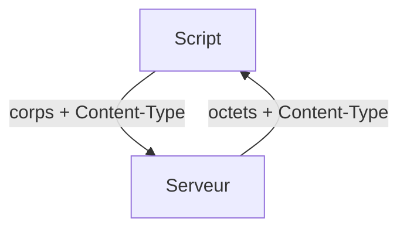

# Envoyer et recevoir un fichier en HTTP

> [!info] En une phrase
> Un fichier voyage dans le **corps** d'une requête ou d'une réponse HTTP, soit seul (corps brut), soit rangé dans un formulaire `multipart/form-data`, et l'en-tête `Content-Type` dit ce que c'est.

```dataviewjs
await dv.view("10 — Templates/Scripts/learning", { view: "concept" })
```

## 1 · Comprendre
### Définition
Il y a trois façons d'envoyer un fichier, et c'est **le serveur qui décide** laquelle il attend (lis sa documentation) :

| Façon | Le corps contient | `Content-Type` | Avec requests |
| --- | --- | --- | --- |
| **Formulaire multipart** | plusieurs « parties » : le fichier, son nom, d'autres champs | `multipart/form-data; boundary=...` | `files={"fichier": (nom, octets, type)}` |
| **Corps brut** | seulement les octets du fichier | le type du fichier : `application/zip`, `image/png` | `data=octets` + `headers={"Content-Type": ...}` |
| **Dans du JSON** | le fichier transformé en texte | `application/json` | `json={"image": texte_base64}` (voir [[Base64]]) |

Pour **recevoir** un fichier, c'est le même corps dans l'autre sens : la réponse contient les octets, et son `Content-Type` dit si c'est une image, un zip, du JSON…

### Le type MIME
`application/zip`, `image/png`, `image/jpeg`, `application/json`, `application/octet-stream` (« des octets, je ne sais pas quoi ») : ce sont des **types MIME**. Ils remplacent l'extension du fichier, qui n'existe pas dans une requête.

### Pourquoi ça existe
HTTP transporte des octets. Le multipart vient des formulaires HTML (`<input type="file">`) : il permet d'envoyer en une seule requête un fichier **et** d'autres champs (un numéro de job, un nom).

### Le problème résolu
Faire passer un zip, une image ou un PDF entre un script, une API (CVAT) et une fonction (Nuclio), sans dossier partagé.

## 2 · Explorer
### Comment ça fonctionne


### Exemple concret
```python
import requests

with open("rapport.zip", "rb") as f:          # rb : des octets
    octets = f.read()

# 1. Formulaire multipart : (nom du fichier, octets, type MIME)
r = requests.post("http://localhost:8000/envoyer",
                  files={"fichier": ("rapport.zip", octets, "application/zip")},
                  data={"job_id": "12"},       # champs texte à côté
                  timeout=30)

# 2. Corps brut
r = requests.post("http://localhost:8000/brut", data=octets,
                  headers={"Content-Type": "application/zip"}, timeout=30)

# Recevoir une image
r = requests.get("http://localhost:8000/image.png", timeout=30)
r.raise_for_status()
print(r.headers["Content-Type"])               # image/png
with open("recu.png", "wb") as f:              # wb : on écrit des octets
    f.write(r.content)                         # .content = bytes, .text = texte
```
Pour un très gros fichier : `requests.get(url, stream=True)` puis `for morceau in r.iter_content(65536): f.write(morceau)`, pour ne pas tout charger en mémoire.

### Cas d'utilisation
- Télécharger l'export zip d'une tâche CVAT
- Renvoyer le PNG généré par ta fonction Nuclio, avec `Content-Type: image/png`
- Envoyer une image à un service d'analyse

> [!warning] À ne pas confondre
> - `files=` fabrique le multipart **et** le `Content-Type` avec son `boundary`. Ne mets jamais `Content-Type: multipart/form-data` à la main : il manquerait le `boundary`, et le serveur ne saurait plus découper les parties.
> - `data=octets` n'est **pas** un formulaire multipart : c'est un corps brut. Le serveur qui attend un champ `fichier` répond 400.
> - Le **nom du champ** (`"fichier"`, `"file"`, `"image"`…) est imposé par le serveur ; le **nom du fichier** (`"rapport.zip"`) est libre.
> - `r.text` sur une image donne des caractères illisibles : pour un fichier, c'est toujours `r.content`.
> - Ouvre le fichier en `"rb"` : en `"r"`, Python essaie de le lire comme du texte.

## 3 · Pratiquer
- [[Envoi 02 - Envoyer le zip avec requests]]
- [[Envoi 04 - Recevoir une image et un zip]]

## 4 · Expliquer
> [!quote] Mon résumé, avec mes mots
> _À écrire sans regarder la fiche. Si je bloque, je ne l'ai pas encore compris._

## 5 · Relier
- **Prérequis** : [[Appeler une API HTTP (requests)]] · [[En-tête HTTP]] · [[Fichier en mémoire (io.BytesIO)]]
- **Complémentaires** : [[Appeler une API sans pip (urllib.request)]] · [[Base64]] · [[Formulaire HTML]] · [[Méthode HTTP]] · [[Code de statut HTTP]]
- **Utilisé par** : [[Cours - Envoyer et recevoir des fichiers par HTTP]] · [[Serverless et FaaS]]

## 6 · Réviser
> [!question] Me faire interroger
> Je demande à Claude de m'interroger sur cette notion pour vérifier que je l'ai comprise.

### Validation de la maîtrise
La notion est maîtrisée quand j'ai réussi **tous les exercices** qui l'utilisent (statut `reussi` dans l'exercice).

```dataviewjs
await dv.view("10 — Templates/Scripts/learning", { view: "maitrise" })
```
