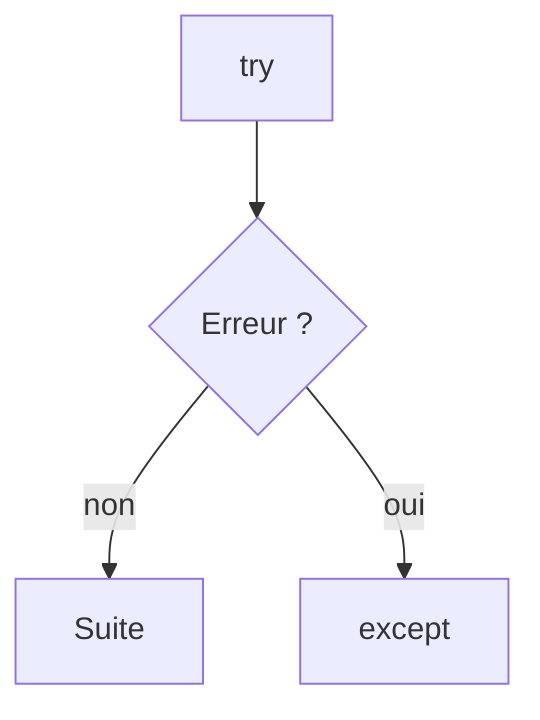

# Exception

> [!info] En une phrase
> Une erreur survenue pendant l'exécution, que Python signale en s'arrêtant, sauf si le code l'attrape avec try/except.

```dataviewjs
await dv.view("10 — Templates/Scripts/learning", { view: "concept" })
```

## 1 · Comprendre
### Définition
Quand une opération est impossible (fichier absent, division par zéro, clé manquante), Python **lève une exception**. Si rien ne l'attrape, le script s'arrête et affiche un **traceback** (la pile d'appels) avec un code de sortie 1.

`try:` / `except TypeErreur:` permet d'attraper une exception prévue et de réagir. `finally:` s'exécute dans tous les cas. `raise` lève soi-même une exception.

### Pourquoi ça existe
Séparer le chemin normal du code de la gestion des problèmes, et ne jamais continuer en silence après une erreur.

### Le problème résolu
Sans exceptions, chaque fonction devrait renvoyer un code d'erreur que tout le monde oublie de vérifier.

## 2 · Explorer
### Comment ça fonctionne


### Exemple concret
```python
from pathlib import Path
import sys

chemin = Path("donnees/config.json")
try:
    texte = chemin.read_text(encoding="utf-8")
except FileNotFoundError:
    print(f"Fichier manquant : {chemin}", file=sys.stderr)
    sys.exit(1)
```
**Lire un traceback** : on lit **la dernière ligne** d'abord (le type et le message), puis la ligne de **ton** fichier la plus basse dans la pile.
```text
Traceback (most recent call last):
  File "main.py", line 8, in <module>
    texte = chemin.read_text()
FileNotFoundError: [Errno 2] No such file or directory: 'donnees/config.json'
```

| Exception fréquente | Cause |
| --- | --- |
| `FileNotFoundError` | chemin faux ou fichier absent |
| `PermissionError` | pas le droit de lire ou écrire |
| `KeyError` | clé absente d'un dictionnaire |
| `TypeError` | mauvais type (`"2" + 2`) |
| `ModuleNotFoundError` | paquet non installé |

### Cas d'utilisation
- Gérer un fichier absent ou un dossier non accessible
- Sortir proprement en erreur pour que la CI ou Docker voient l'échec ([[Code de sortie]])

> [!warning] À ne pas confondre
> Attraper une erreur précise (`except FileNotFoundError`) et **tout** attraper (`except Exception: pass`) : ce dernier cache les bugs, le script « réussit » sans rien faire.

## 3 · Pratiquer
Dans le mini-projet [[Projet - Faire le ménage dans ses conteneurs Docker]] : [[Ménage 06 - Un script qui ne plante pas]].

## 4 · Expliquer
> [!quote] Mon résumé, avec mes mots
> _À écrire sans regarder la fiche. Si je bloque, je ne l'ai pas encore compris._

## 5 · Relier
- **Prérequis** : [[Fonction]] · [[Code de sortie]]
- **Complémentaires** : [[Lire et écrire un fichier]]
- **Utilisé par** : [[Archive zip (zipfile)]] · [[Copier et déplacer des fichiers (shutil)]]

## 6 · Réviser
> [!question] Me faire interroger
> Je demande à Claude de m'interroger sur cette notion pour vérifier que je l'ai comprise.

### Validation de la maîtrise
La notion est maîtrisée quand j'ai réussi **tous les exercices** qui l'utilisent (statut `reussi` dans l'exercice).

```dataviewjs
await dv.view("10 — Templates/Scripts/learning", { view: "maitrise" })
```
