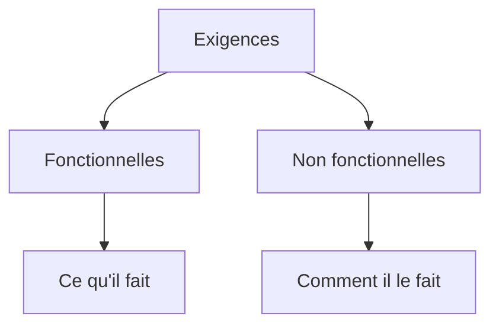

# Exigences fonctionnelles et non fonctionnelles

> [!info] En une phrase
> Une exigence est une chose que le logiciel **doit** respecter. Les exigences **fonctionnelles** disent **ce qu'il fait** ; les exigences **non fonctionnelles** disent **comment il doit le faire** : vitesse, sécurité, disponibilité, compatibilité…

```dataviewjs
await dv.view("10 — Templates/Scripts/learning", { view: "concept" })
```

## 1 · Comprendre
### Définition
**Fonctionnelle** : un comportement visible. « L'utilisateur peut exporter une tâche en PNG. » « Le PNG contient les rectangles et les polygones. »

**Non fonctionnelle** (on dit aussi *qualités* ou *contraintes*) :
- **performance** : temps de réponse, volume supporté ;
- **sécurité** : qui a le droit, données protégées ;
- **disponibilité** : le service tourne 99 % du temps ;
- **compatibilité** : navigateurs, versions des outils dont on dépend ;
- **exploitation** : journaux, supervision, déploiement via la CI GitLab.

**Une bonne exigence est vérifiable** : on peut écrire un test qui dit oui ou non. « Rapide » n'est pas vérifiable, « moins de 10 s pour 50 images » l'est.

**Priorité** : on les numérote (F1, F2, NF1…) et on indique si elles sont obligatoires ou souhaitables.

### Pourquoi ça existe
Les demandes fonctionnelles sont faciles à exprimer ; les non fonctionnelles sont souvent oubliées alors qu'elles font échouer les projets (trop lent, pas sécurisé, impossible à déployer).

### Le problème résolu
Lister tout ce que le logiciel doit respecter, de façon assez précise pour le vérifier.

## 2 · Explorer
### Comment ça fonctionne


### Exemple concret
```text
F1  Un bouton « Export PNG » apparaît sur la page d'une tâche          obligatoire
F2  Le PNG montre chaque annotation avec la couleur de son label        obligatoire
F3  L'utilisateur peut choisir l'épaisseur du trait                    souhaitable
NF1 Export en moins de 10 s pour une tâche de 50 images                obligatoire
NF2 Seuls les utilisateurs ayant accès à la tâche peuvent l'exporter   obligatoire
NF3 Le service est construit et déployé par la CI GitLab             obligatoire
NF4 Chaque export est journalisé (utilisateur, tâche, durée)           souhaitable
```

### Cas d'utilisation
- Rédiger la partie « exigences » d'une spec

> [!warning] À ne pas confondre
> Non fonctionnel ne veut pas dire « pas important » : c'est souvent ce qui décide si le produit est utilisable. Et une exigence décrit un besoin, pas une solution (« exporter en moins de 10 s », pas « utiliser un cache Redis »).

## 3 · Pratiquer

### Exercice visuel

Sur Excalidraw, **sans regarder la fiche**. Puis je compare avec la fiche, je corrige en rouge ce qui était faux, et j'explique mon dessin à voix haute ou à Claude dans le chat.

> [!example] 🧠 Dessine de mémoire
> Dessine deux colonnes pour ton application : ce que l'appli fait (fonctionnel) et comment elle doit le faire (non fonctionnel). Trois exemples par colonne.

> [!example] 🔄 Change de contexte
> Redessine-les pour une fonction qui tourne sur un serveur partagé. Quelle exigence non fonctionnelle compte le plus (temps, mémoire, réseau) ?

### Mon schéma

> [!tip] Mon dessin Excalidraw
> _Je crée le dessin « Schéma - Exigences fonctionnelles et non fonctionnelles » et je l'intègre ici avec `![[Schéma - Exigences fonctionnelles et non fonctionnelles.excalidraw]]`, puis je coche `schema`._

### Appliquer dans le fil rouge
- Pas encore d'étape du fil rouge pour cette notion : elle sera pratiquée dans le fil rouge de son niveau (voir [[Niveaux]]).

## 4 · Relier
- **Au travail** : [Exigences fonctionnelles et non fonctionnelles au travail](obsidian://open?vault=Travail&file=Exigences%20fonctionnelles%20et%20non%20fonctionnelles%20au%20travail)
- **Prérequis** : [[Spécification (specs)]]
- **Complémentaires** : [[Critères d'acceptation]] · [[User story]] · [[Cahier des charges]] · [[Supervision et observabilité]]

## 5 · Réviser
> [!question] Me faire interroger
> Je demande à Claude de m'interroger sur cette notion pour vérifier que je l'ai comprise.

### Validation (compris, puis maîtrisé)
Trois cases à cocher dans les propriétés de la fiche :
- `schema` : mon dessin du concept est dans « Mon schéma » ;
- `exercice_visuel` : j'ai fait et corrigé les exercices visuels de la section 3 ;
- `fil_rouge` : je l'ai appliqué dans le fil rouge (coché tout seul quand une étape qui l'utilise est réussie).

Les trois cochées : la notion compte comme **comprise**. **Maîtrisé** : c'est moi qui le mets dans `status`, quand je le sens.

```dataviewjs
await dv.view("10 — Templates/Scripts/learning", { view: "maitrise" })
```
