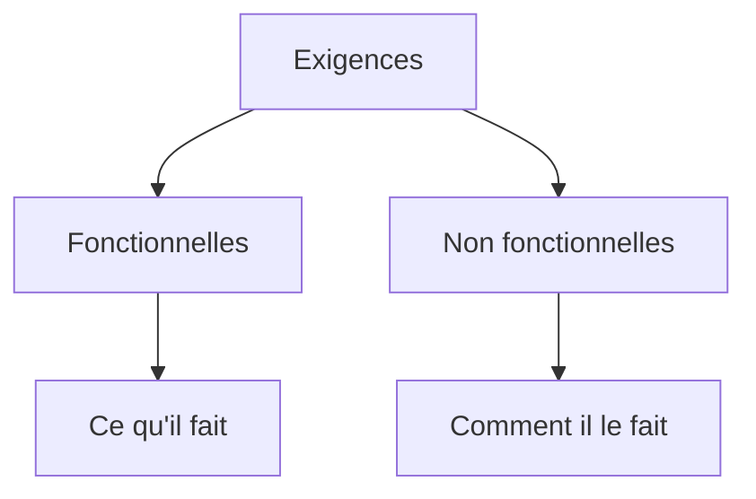

# Exigences fonctionnelles et non fonctionnelles

> [!info] En une phrase
> Une exigence est une chose que le logiciel **doit** respecter. Les exigences **fonctionnelles** disent **ce qu'il fait** ; les exigences **non fonctionnelles** disent **comment il doit le faire** : vitesse, sécurité, disponibilité, compatibilité…

```dataviewjs
await dv.view("10 — Templates/Scripts/learning", { view: "concept" })
```

## 1 · Comprendre
### Définition
**Fonctionnelle** : un comportement visible. « L'utilisateur peut exporter une tâche en PNG. » « Le PNG contient les rectangles et les polygones. »

**Non fonctionnelle** (on dit aussi *qualités* ou *contraintes*) :
- **performance** : temps de réponse, volume supporté ;
- **sécurité** : qui a le droit, données protégées ;
- **disponibilité** : le service tourne 99 % du temps ;
- **compatibilité** : navigateurs, versions de CVAT ;
- **exploitation** : journaux, supervision, déploiement via la CI GitLab, images depuis le Nexus.

**Une bonne exigence est vérifiable** : on peut écrire un test qui dit oui ou non. « Rapide » n'est pas vérifiable, « moins de 10 s pour 50 images » l'est.

**Priorité** : on les numérote (F1, F2, NF1…) et on indique si elles sont obligatoires ou souhaitables.

### Pourquoi ça existe
Les demandes fonctionnelles sont faciles à exprimer ; les non fonctionnelles sont souvent oubliées alors qu'elles font échouer les projets (trop lent, pas sécurisé, impossible à déployer).

### Le problème résolu
Lister tout ce que le logiciel doit respecter, de façon assez précise pour le vérifier.

## 2 · Explorer
### Comment ça fonctionne


### Exemple concret
```text
F1  Un bouton « Export PNG » apparaît sur la page d'une tâche          obligatoire
F2  Le PNG montre chaque annotation avec la couleur de son label        obligatoire
F3  L'utilisateur peut choisir l'épaisseur du trait                    souhaitable
NF1 Export en moins de 10 s pour une tâche de 50 images                obligatoire
NF2 Seuls les utilisateurs ayant accès à la tâche peuvent l'exporter   obligatoire
NF3 La fonction Nuclio est construite et déployée par la CI GitLab     obligatoire
NF4 Chaque export est journalisé (utilisateur, tâche, durée)           souhaitable
```

### Cas d'utilisation
- Rédiger la partie « exigences » d'une spec
- Vérifier qu'aucune contrainte d'entreprise (Nexus, réseau, sécurité) n'est oubliée

> [!warning] À ne pas confondre
> Non fonctionnel ne veut pas dire « pas important » : c'est souvent ce qui décide si le produit est utilisable. Et une exigence décrit un besoin, pas une solution (« exporter en moins de 10 s », pas « utiliser un cache Redis »).

## 3 · Pratiquer
- Classe en fonctionnelle ou non fonctionnelle cinq choses que ton export CVAT doit respecter, et rends-les vérifiables

## 4 · Expliquer
> [!quote] Mon résumé, avec mes mots
> _À écrire sans regarder la fiche. Si je bloque, je ne l'ai pas encore compris._

## 5 · Relier
- **Prérequis** : [[Spécification (specs)]]
- **Complémentaires** : [[Critères d'acceptation]] · [[User story]] · [[Cahier des charges]] · [[Supervision et observabilité]]

## 6 · Réviser
> [!question] Me faire interroger
> Je demande à Claude de m'interroger sur cette notion pour vérifier que je l'ai comprise.

### Validation de la maîtrise
La notion est maîtrisée quand j'ai réussi **tous les exercices** qui l'utilisent (statut `reussi` dans l'exercice).

```dataviewjs
await dv.view("10 — Templates/Scripts/learning", { view: "maitrise" })
```
