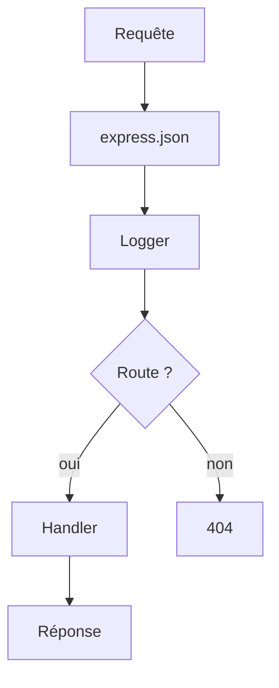

# Express

> [!info] En une phrase
> Le framework minimaliste le plus utilisé pour créer des serveurs et des API avec Node.js.

```dataviewjs
await dv.view("10 — Templates/Scripts/learning", { view: "concept" })
```

## 1 · Comprendre
### Définition
**Express** simplifie ce que Node fait en bas niveau : déclarer des [[Endpoint|endpoints]] (`app.get`, `app.post`…), lire les paramètres, envoyer du [[JSON]] et enchaîner des [[Middleware|middlewares]].

### Pourquoi ça existe
Avec le module `http` brut de Node, il faut analyser soi-même l'URL, la méthode, le corps… Express fournit ces briques en quelques lignes.

### Le problème résolu
Écrire un routeur, un parseur JSON et une gestion d'erreurs à la main pour chaque projet.

## 2 · Explorer
### Comment ça fonctionne

Chaque requête traverse les middlewares **dans l'ordre où ils sont déclarés**, puis le handler de la première route qui correspond.

### Exemple concret
```js
const express = require('express');
const app = express();

app.use(express.json()); // lit le corps JSON → req.body

const notes = [{ id: 1, title: 'Courses' }];

app.get('/notes', (req, res) => res.json(notes));

app.post('/notes', (req, res) => {
  const note = { id: notes.length + 1, title: req.body.title };
  notes.push(note);
  res.status(201).json(note);
});

app.listen(3000, () => console.log('API sur http://localhost:3000'));
```

### Cas d'utilisation
- API REST
- Back-end d'une application web
- Prototypes rapides

> [!warning] À ne pas confondre
> **Express** (un framework au-dessus de Node) et **Node.js** (l'environnement). Et `app.use()` (s'applique à toutes les routes, ou à un préfixe) n'est pas `app.get()` (une seule méthode et une seule route).

## 3 · Pratiquer
- [[Exercice - Créer une API REST avec Express]]
- [[Projet - API Notes]]

## 4 · Expliquer
> [!quote] Mon résumé, avec mes mots
> _À écrire sans regarder la fiche. Si je bloque, je ne l'ai pas encore compris._

## 5 · Relier
- **Prérequis** : [[Node.js]], [[npm]], [[API REST]]
- **Notion parente** : [[Node.js]]
- **Mène à** : [[Middleware]] → [[Authentification]]
- **Complémentaires** : [[JSON]], [[Endpoint]]
- **Erreur fréquente** : [[Erreur - EADDRINUSE port déjà utilisé]]
- **Commandes** : [[npm install]] · [[node]]
- **Cours** : [[Cours - Construire une API REST avec Express]]

## 6 · Réviser
> [!question] Me faire interroger
> Je demande à Claude de m'interroger sur cette notion pour vérifier que je l'ai comprise.

### Validation de la maîtrise
La notion est maîtrisée quand j'ai réussi **tous les exercices** qui l'utilisent (statut `reussi` dans l'exercice).

```dataviewjs
await dv.view("10 — Templates/Scripts/learning", { view: "maitrise" })
```
