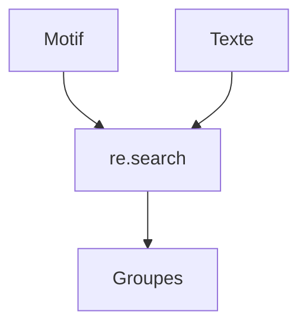

# Expressions régulières (re)

> [!info] En une phrase
> Un petit langage pour décrire un motif de texte (une date, un e-mail, un numéro) et le chercher, l'extraire ou le remplacer.

```dataviewjs
await dv.view("10 — Templates/Scripts/learning", { view: "concept" })
```

## 1 · Comprendre
### Définition
Une **expression régulière** (*regex*) décrit un motif : `\d{4}-\d{2}-\d{2}` = « 4 chiffres, tiret, 2 chiffres, tiret, 2 chiffres ». Le module `re` cherche (`search`, `findall`), découpe et remplace (`sub`).

| Motif | Sens |
| --- | --- |
| `\d` | un chiffre |
| `\w` | une lettre, un chiffre ou `_` |
| `\s` | un espace |
| `.` | n'importe quel caractère |
| `+` / `*` / `?` | 1 ou plus / 0 ou plus / 0 ou 1 |
| `{4}` | exactement 4 fois |
| `^` / `$` | début / fin |
| `( )` | un groupe à extraire |

### Pourquoi ça existe
Trouver des motifs variables dans du texte (logs, noms de fichiers) sans écrire des dizaines de conditions.

### Le problème résolu
`if "ERROR" in ligne` ne suffit plus quand il faut extraire la date et le code d'erreur de chaque ligne.

## 2 · Explorer
### Comment ça fonctionne


### Exemple concret
```python
import re

ligne = "2026-11-06 21:50:01 ERROR code=503 service=cvat_server"
m = re.search(r"^(\d{4}-\d{2}-\d{2}) .* ERROR code=(\d+)", ligne)
if m:
    date, code = m.group(1), int(m.group(2))

print(re.findall(r"\w+\.png", "a.png, b.txt, photo_2.png"))   # ['a.png', 'photo_2.png']
print(re.sub(r"\s+", "_", "rapport final  v2.pdf"))          # rapport_final_v2.pdf
```
Écris toujours le motif en chaîne brute `r"..."` pour que les `\` passent tels quels. Teste-le sur regex101.com.

### Cas d'utilisation
- Extraire des informations d'un log
- Valider un format (nom de fichier, version `v1.2.3`)
- `grep -E` dans le terminal utilise la même idée

> [!warning] À ne pas confondre
> `re.match` (seulement au **début** du texte) et `re.search` (n'importe où). Et une regex trop maligne devient illisible : si une simple méthode de texte suffit (`startswith`, `split`), utilise-la.

## 3 · Pratiquer
- Extrais toutes les dates et tous les codes d'erreur d'un fichier de log de test.

## 4 · Expliquer
> [!quote] Mon résumé, avec mes mots
> _À écrire sans regarder la fiche. Si je bloque, je ne l'ai pas encore compris._

## 5 · Relier
- **Prérequis** : [[Variables et types en Python]]
- **Complémentaires** : [[grep]] · [[Journaliser avec logging]]

## 6 · Réviser
> [!question] Me faire interroger
> Je demande à Claude de m'interroger sur cette notion pour vérifier que je l'ai comprise.

### Validation de la maîtrise
La notion est maîtrisée quand j'ai réussi **tous les exercices** qui l'utilisent (statut `reussi` dans l'exercice).

```dataviewjs
await dv.view("10 — Templates/Scripts/learning", { view: "maitrise" })
```
