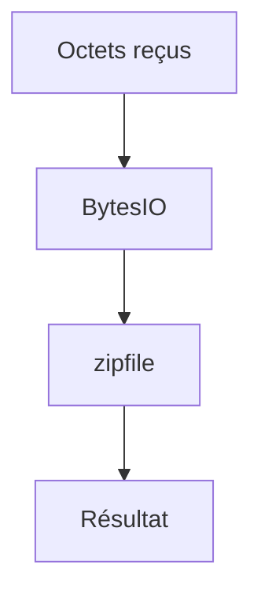

# Fichier en mémoire (io.BytesIO)

> [!info] En une phrase
> `io.BytesIO` est un faux fichier qui vit dans la mémoire : on y écrit et on y lit des octets comme dans un vrai fichier, sans rien créer sur le disque.

```dataviewjs
await dv.view("10 — Templates/Scripts/learning", { view: "concept" })
```

## 1 · Comprendre
### Définition
En Python, il y a deux sortes de données :
- le **texte** (`str`) : `"bonjour"`, des caractères ;
- les **octets** (`bytes`) : `b"PK\x03\x04..."`, le contenu brut d'un zip, d'une image, d'un PDF.

Un fichier ouvert en `"rb"` ou `"wb"` (b = binaire) donne ou attend des `bytes`. `io.BytesIO()` se comporte exactement comme ce fichier binaire, mais il est rangé dans la mémoire du programme.

### Pourquoi ça existe
Beaucoup d'outils attendent « un fichier » : `zipfile`, une bibliothèque d'images, `requests` pour un envoi. Quand les données viennent du réseau ou partent sur le réseau, passer par le disque ne sert à rien.

### Le problème résolu
Dans une fonction Nuclio ou un conteneur, on reçoit un zip et on renvoie une image. Sans BytesIO, il faudrait écrire un fichier temporaire, le relire, puis penser à le supprimer. Avec BytesIO, tout reste en mémoire.

## 2 · Explorer
### Comment ça fonctionne

| Pour… | On écrit |
| --- | --- |
| créer un tampon vide | `tampon = io.BytesIO()` |
| partir d'octets reçus | `tampon = io.BytesIO(octets)` |
| récupérer tout le contenu | `tampon.getvalue()` → `bytes` |
| revenir au début avant de relire | `tampon.seek(0)` |
| texte → octets | `"été".encode("utf-8")` |
| octets → texte | `b"...".decode("utf-8")` |

### Exemple concret
```python
import io
import zipfile

# Créer un zip sans toucher au disque
tampon = io.BytesIO()
with zipfile.ZipFile(tampon, "w", zipfile.ZIP_DEFLATED) as z:
    z.writestr("lisezmoi.txt", "Rapport du job 12")
octets = tampon.getvalue()          # le zip complet, en bytes
print(len(octets), octets[:2])      # ... b'PK'

# Relire un zip reçu (par exemple téléchargé)
with zipfile.ZipFile(io.BytesIO(octets)) as z:
    print(z.namelist())
```

### Cas d'utilisation
- Lire l'export zip de CVAT juste après l'avoir téléchargé
- Fabriquer un zip ou une image, puis l'envoyer directement dans une requête
- Dans un test : donner un « fichier » à une fonction sans créer de vrai fichier

> [!warning] À ne pas confondre
> - `io.StringIO` est la même idée pour du **texte**. Un zip ou une image, c'est toujours `BytesIO`.
> - Après avoir écrit dans un tampon, sa « position » est à la fin. `tampon.read()` renvoie alors `b""` : il faut `tampon.seek(0)` d'abord. `getvalue()` n'a pas ce problème.
> - Ouvrir un fichier zip ou image en `"r"` ou `"w"` (sans `b`) : Python essaie d'en faire du texte et plante (`UnicodeDecodeError` ou `TypeError`).
> - Tout est en mémoire : pour un fichier de plusieurs Go, mieux vaut un vrai fichier temporaire.

## 3 · Pratiquer
- [[Envoi 01 - Un zip sans toucher au disque]]
- [[Envoi 04 - Recevoir une image et un zip]]

## 4 · Expliquer
> [!quote] Mon résumé, avec mes mots
> _À écrire sans regarder la fiche. Si je bloque, je ne l'ai pas encore compris._

## 5 · Relier
- **Prérequis** : [[Lire et écrire un fichier]] · [[Binaire et octet]]
- **Complémentaires** : [[Archive zip (zipfile)]] · [[Encodage des caractères]] · [[Base64]]
- **Utilisé par** : [[Envoyer et recevoir un fichier en HTTP]] · [[Cours - Envoyer et recevoir des fichiers par HTTP]]

## 6 · Réviser
> [!question] Me faire interroger
> Je demande à Claude de m'interroger sur cette notion pour vérifier que je l'ai comprise.

### Validation de la maîtrise
La notion est maîtrisée quand j'ai réussi **tous les exercices** qui l'utilisent (statut `reussi` dans l'exercice).

```dataviewjs
await dv.view("10 — Templates/Scripts/learning", { view: "maitrise" })
```
