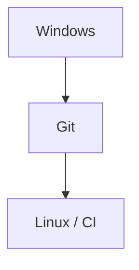

# Fichiers entre Windows et Linux

> [!info] En une phrase
> Un même fichier ne se comporte pas pareil sous Windows et sous Linux : droits d'exécution, majuscules dans les noms et fins de ligne diffèrent.

```dataviewjs
await dv.view("10 — Templates/Scripts/learning", { view: "concept" })
```

## 1 · Comprendre
### Définition
Trois différences piègent quand on code sous Windows et que le code tourne sous Linux (Docker, CI) :
1. **Droit d'exécution** : Linux exige qu'un script soit marqué *exécutable* ; Windows ne connaît pas ce droit.
2. **Casse** : Linux distingue `Script.py` et `script.py` ; Windows non.
3. **Fins de ligne** : Windows termine les lignes par `CRLF` (`\r\n`), Linux par `LF` (`\n`).

### Pourquoi ça existe
Les deux systèmes ont des histoires différentes ; Git sert de pont et garde certaines de ces informations.

### Le problème résolu
Comprendre ces écarts évite les erreurs qui « marchent sur mon PC » et cassent dans le conteneur ou la CI.

## 2 · Explorer
### Comment ça fonctionne

| Problème | Symptôme sous Linux | Solution |
| --- | --- | --- |
| Droit d'exécution absent | `Permission denied` en lançant `./entrypoint.sh` | `git update-index --chmod=+x entrypoint.sh` puis commit |
| Casse différente | `No such file or directory` alors que le fichier « existe » | renommer avec `git mv ancien Nouveau` |
| Fins de ligne CRLF | `/bin/sh^M: bad interpreter` ou `$'\r': command not found` | enregistrer en LF, `.gitattributes` avec `*.sh text eol=lf` |

### Exemple concret
```bash
git ls-files -s entrypoint.sh
# 100644 … → pas exécutable   |   100755 … → exécutable
git update-index --chmod=+x entrypoint.sh
git commit -m "fix: rend entrypoint.sh exécutable"
```
Dans VS Code, en bas à droite : `CRLF` ou `LF`, cliquable pour changer.

### Cas d'utilisation
- Un script shell d'un Dockerfile ou d'un job CI écrit sous Windows
- Un `import` Python ou un chemin écrit avec la mauvaise casse

> [!warning] À ne pas confondre
> `chmod +x` sur ton disque Windows ne sert à rien : c'est **Git** qui doit enregistrer le droit, d'où `git update-index --chmod=+x`.

## 3 · Pratiquer
- Vérifie avec `git ls-files -s` si les scripts `.sh` de ton projet sont en `100755`.
- Regarde si ton projet a un fichier `.gitattributes` et ce qu'il dit des fins de ligne.

## 4 · Expliquer
> [!quote] Mon résumé, avec mes mots
> _À écrire sans regarder la fiche. Si je bloque, je ne l'ai pas encore compris._

## 5 · Relier
- **Prérequis** : [[Système de fichiers]] · [[Git]]
- **Complémentaires** : [[Commit]]
- **Utilisé par** : [[Dockerfile]] · [[Pipeline GitLab CI]]

## 6 · Réviser
> [!question] Me faire interroger
> Je demande à Claude de m'interroger sur cette notion pour vérifier que je l'ai comprise.

### Validation de la maîtrise
La notion est maîtrisée quand j'ai réussi **tous les exercices** qui l'utilisent (statut `reussi` dans l'exercice).

```dataviewjs
await dv.view("10 — Templates/Scripts/learning", { view: "maitrise" })
```
