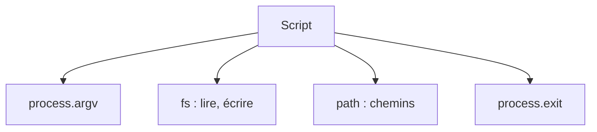

# Fichiers et chemins avec Node (fs et path)

> [!info] En une phrase
> Les modules intégrés fs et path permettent à un programme Node de lire, écrire, lister des fichiers et construire des chemins sans erreur.

```dataviewjs
await dv.view("10 — Templates/Scripts/learning", { view: "concept" })
```

## 1 · Comprendre
### Définition
```js
import { readFile, writeFile, readdir, mkdir, stat } from "node:fs/promises";
import path from "node:path";

const texte = await readFile("config.json", "utf8");
const config = JSON.parse(texte);
await mkdir("sortie", { recursive: true });
await writeFile(path.join("sortie", "rapport.txt"), "fini\n");
for (const nom of await readdir(".")) {
  const infos = await stat(nom);
  console.log(nom, infos.isDirectory() ? "dossier" : `${infos.size} octets`);
}
```
- **`path.join`**, `path.extname`, `path.basename`, `path.resolve` : construire des chemins portables (Windows/Linux).
- Version **promesses** (`fs/promises` + `await`) à préférer ; les versions `…Sync` bloquent la [[Boucle d'événements]].
- **`process.argv`** : arguments de la commande ; **`process.env`** : [[Variable d'environnement|variables d'environnement]] ; **`process.exit(1)`** : sortir avec un code d'erreur.

### Pourquoi ça existe
Beaucoup d'outils (build, scripts, serveurs) lisent et écrivent des fichiers : c'est la base d'un script Node utile.

### Le problème résolu
Faire en Node ce que tu fais en Python avec `pathlib` et `open`, sans dépendance externe.

## 2 · Explorer
### Comment ça fonctionne


### Exemple concret
```js
// compter.js : node compter.js ./images .png
import { readdir } from "node:fs/promises";
import path from "node:path";
const [dossier = ".", ext = ".png"] = process.argv.slice(2);
try {
  const fichiers = (await readdir(dossier)).filter((f) => path.extname(f) === ext);
  console.log(`${fichiers.length} fichiers ${ext}`);
} catch (e) {
  console.error(`Dossier introuvable : ${dossier}`);
  process.exit(1);
}
```

### Cas d'utilisation
- Scripts d'automatisation en JavaScript
- Serveurs qui stockent des fichiers
- Outils de build

> [!warning] À ne pas confondre
> Les chemins relatifs partent du **dossier où la commande est lancée** (`process.cwd()`), pas du fichier du script. Pour partir du script : `new URL("./data.json", import.meta.url)`.

## 3 · Pratiquer
- Écris un script qui liste les fichiers d'un dossier triés par taille

## 4 · Expliquer
> [!quote] Mon résumé, avec mes mots
> _À écrire sans regarder la fiche. Si je bloque, je ne l'ai pas encore compris._

## 5 · Relier
- **Prérequis** : [[Node.js]] · [[async et await]] · [[Système de fichiers]]
- **Complémentaires** : [[Chemin de fichier en Python (pathlib)]] · [[Arguments de ligne de commande]] · [[Code de sortie]]

## 6 · Réviser
> [!question] Me faire interroger
> Je demande à Claude de m'interroger sur cette notion pour vérifier que je l'ai comprise.

### Validation de la maîtrise
La notion est maîtrisée quand j'ai réussi **tous les exercices** qui l'utilisent (statut `reussi` dans l'exercice).

```dataviewjs
await dv.view("10 — Templates/Scripts/learning", { view: "maitrise" })
```
