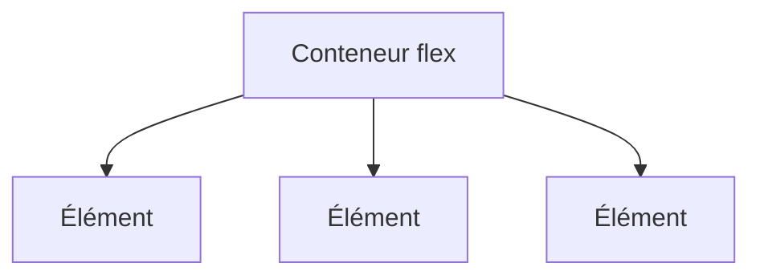

# Flexbox

> [!info] En une phrase
> Le mode de mise en page CSS pour aligner des éléments sur une ligne ou une colonne, les espacer et les répartir.

```dataviewjs
await dv.view("10 — Templates/Scripts/learning", { view: "concept" })
```

## 1 · Comprendre
### Définition
`display: flex` sur un **conteneur** range ses enfants le long d'un **axe principal** (`flex-direction: row` ou `column`). On règle :
- `justify-content` : répartition **le long** de l'axe (`flex-start`, `center`, `space-between`) ;
- `align-items` : alignement **en travers** (`center`, `stretch`) ;
- `gap` : l'espace entre les éléments ;
- `flex-wrap: wrap` : passer à la ligne ;
- sur un enfant, `flex: 1` : prendre la place restante.

### Pourquoi ça existe
Aligner et centrer était un casse-tête avant Flexbox (flottants, tableaux).

### Le problème résolu
Centrer verticalement, répartir des boutons, faire une barre de navigation.

## 2 · Explorer
### Comment ça fonctionne


### Exemple concret
```css
.barre {
  display: flex;
  justify-content: space-between;   /* logo à gauche, menu à droite */
  align-items: center;
  gap: 1rem;
}
.centre {                            /* centrer dans les deux sens */
  display: flex;
  justify-content: center;
  align-items: center;
  min-height: 100vh;
}
.ligne > .principal { flex: 1; }     /* prend toute la place restante */
```

### Cas d'utilisation
- Barres de navigation, rangées de boutons, cartes alignées
- Centrer quelque chose

> [!warning] À ne pas confondre
> **Flexbox** (une dimension : ligne **ou** colonne) et [[Grid CSS]] (deux dimensions : lignes **et** colonnes). Les propriétés `justify-*` et `align-*` changent de sens quand `flex-direction` passe à `column`.

## 3 · Pratiquer
- Fais une barre de navigation (logo à gauche, 3 liens à droite) et une rangée de cartes qui passe à la ligne.

## 4 · Expliquer
> [!quote] Mon résumé, avec mes mots
> _À écrire sans regarder la fiche. Si je bloque, je ne l'ai pas encore compris._

## 5 · Relier
- **Prérequis** : [[Modèle de boîte]]
- **Complémentaires** : [[Grid CSS]] · [[Responsive design]]

## 6 · Réviser
> [!question] Me faire interroger
> Je demande à Claude de m'interroger sur cette notion pour vérifier que je l'ai comprise.

### Validation de la maîtrise
- [ ] Je l'explique sans notes, en 3 phrases, à quelqu'un qui ne connaît pas
- [ ] J'ai réussi un exercice qui l'utilise
- [ ] Je l'ai utilisé dans un projet
- [ ] Je sais dire quand ne pas l'utiliser (ou ce qu'il ne faut pas confondre)
