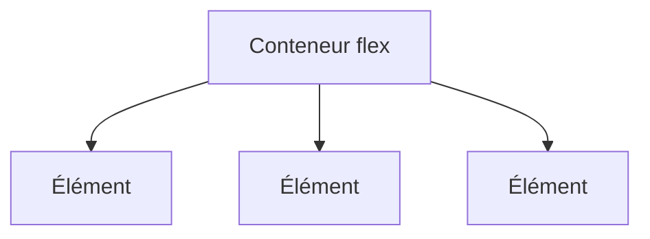

# Flexbox

> [!info] En une phrase
> Le mode de mise en page CSS pour aligner des éléments sur une ligne ou une colonne, les espacer et les répartir.

```dataviewjs
await dv.view("10 — Templates/Scripts/learning", { view: "concept" })
```

## 1 · Comprendre
### Définition
`display: flex` sur un **conteneur** range ses enfants le long d'un **axe principal** (`flex-direction: row` ou `column`). On règle :
- `justify-content` : répartition **le long** de l'axe (`flex-start`, `center`, `space-between`) ;
- `align-items` : alignement **en travers** (`center`, `stretch`) ;
- `gap` : l'espace entre les éléments ;
- `flex-wrap: wrap` : passer à la ligne ;
- sur un enfant, `flex: 1` : prendre la place restante.

### Pourquoi ça existe
Aligner et centrer était un casse-tête avant Flexbox (flottants, tableaux).

### Le problème résolu
Centrer verticalement, répartir des boutons, faire une barre de navigation.

## 2 · Explorer
### Comment ça fonctionne


### Exemple concret
```css
.barre {
  display: flex;
  justify-content: space-between;   /* logo à gauche, menu à droite */
  align-items: center;
  gap: 1rem;
}
.centre {                            /* centrer dans les deux sens */
  display: flex;
  justify-content: center;
  align-items: center;
  min-height: 100vh;
}
.ligne > .principal { flex: 1; }     /* prend toute la place restante */
```

### Cas d'utilisation
- Barres de navigation, rangées de boutons, cartes alignées
- Centrer quelque chose

> [!warning] À ne pas confondre
> **Flexbox** (une dimension : ligne **ou** colonne) et [[Grid CSS]] (deux dimensions : lignes **et** colonnes). Les propriétés `justify-*` et `align-*` changent de sens quand `flex-direction` passe à `column`.

## 3 · Pratiquer

### Exercice visuel

Sur Excalidraw, **sans regarder la fiche**. Puis je compare avec la fiche, je corrige en rouge ce qui était faux, et j'explique mon dessin à voix haute ou à Claude dans le chat.

> [!example] 🧠 Dessine de mémoire
> Dessine un conteneur flex avec trois cartes de dépenses. Trace l'axe principal et l'axe secondaire, et montre ce que font `justify-content` et `align-items`.

> [!example] 🔄 Change de contexte
> Redessine-le en colonne (`flex-direction: column`). Que deviennent les deux axes ?

### Mon schéma

> [!tip] Mon dessin Excalidraw
> _Je crée le dessin « Schéma - Flexbox » et je l'intègre ici avec `![[Schéma - Flexbox.excalidraw]]`, puis je coche `schema`._

### Appliquer dans le fil rouge
- Pas encore d'étape du fil rouge pour cette notion : elle sera pratiquée dans le fil rouge de son niveau (voir [[Niveaux]]).

## 4 · Relier
- **Prérequis** : [[Modèle de boîte]]
- **Complémentaires** : [[Grid CSS]] · [[Responsive design]]

## 5 · Réviser
> [!question] Me faire interroger
> Je demande à Claude de m'interroger sur cette notion pour vérifier que je l'ai comprise.

### Validation de la maîtrise
Trois cases à cocher dans les propriétés de la fiche :
- `schema` : mon dessin du concept est dans « Mon schéma » ;
- `exercice_visuel` : j'ai fait et corrigé les exercices visuels de la section 3 ;
- `fil_rouge` : je l'ai appliqué dans le fil rouge (coché tout seul quand une étape qui l'utilise est réussie).

Les trois cochées : la notion compte comme **comprise**. **Maîtrisé** : c'est moi qui le mets dans `status`, quand je le sens.

```dataviewjs
await dv.view("10 — Templates/Scripts/learning", { view: "maitrise" })
```
